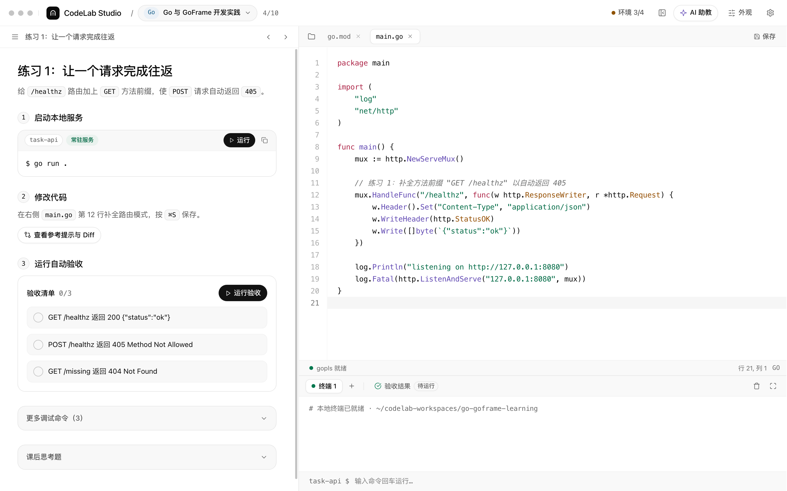

# CodeLab Studio

CodeLab Studio 是一个开源、本地优先（Local-first）的 Tauri 2 桌面交互式编程实践工作台，面向 macOS、Windows 和 Linux。它把标准 Markdown 实践手册或本地与 Git 课程包，转化为同一窗口内的三步引导手册、本地代码工作区、多终端与四语言函数判题环境，并按需展开上下文感知 AI 助教。

应用不需要登录、订阅或云端服务。未配置 AI 或处于离线状态时，手册解析、代码编辑、多终端运行与自动验收全部在本地可用。

> 当前仓库处于 **v3.1 文档与高保真原型定稿阶段**，尚未包含 Tauri 2 应用实现代码。你可以先直接用浏览器打开 [docs/design/prototype/index.html](docs/design/prototype/index.html) 体验界面与交互，再依据本文档导航进入工程开发。

## 当前状态与实现边界

### 当前可直接打开与复用

- **浏览器交互原型。** 直接打开 [docs/design/prototype/index.html](docs/design/prototype/index.html) 即可体验全部界面流程。页面内真实运行浅深主题与 8 组 Arc UI 强调色切换、代码字号调整、主题 CSS 复制、渐进披露布局、快捷键（`⌘/Ctrl + B`、`⌘/Ctrl + S`、`Esc`），以及「TypeScript 数据流水线实战」中 `getAdultNames` 的 JS 函数断言。Go、Python、Java 判题结果、双终端路由、高危命令拦截、参考代码 Diff、BYOK 与 ACP 助教回复及权限审批卡、课程包导入与创作、环境体检安装属于内存态交互模拟。
- **Arc UI 视觉规范与令牌。** [docs/design/design-system.md](docs/design/design-system.md)、[docs/design/tokens.css](docs/design/tokens.css) 与 [docs/design/tailwind.config.js](docs/design/tailwind.config.js) 已定稿，可直接接入前端工程。
- **产品需求与任务拆解。** [docs/prd/PRD.md](docs/prd/PRD.md) 定义完整需求与边界，[docs/prd/prd-stories.json](docs/prd/prd-stories.json) 拆解为 18 条原子用户故事（`US-001` 至 `US-018`，当前状态均为 `"passes": false`）。
- **评审记录与实机截图。** [docs/design/design-review.md](docs/design/design-review.md) 记录三轮评审迭代与 Headless Chrome 回归结果，配套 4 张 `2880×1800` 原型截图存放在 [docs/design/screenshots/](docs/design/screenshots/)。

### 尚未实现（研发待建）

仓库中目前没有 Rust 后端、前端构建工程或可执行桌面程序。下列能力均待按 [docs/prd/prd-stories.json](docs/prd/prd-stories.json) 逐项实现。

- **Tauri 2 桌面端外壳与本地状态持久化。** 包含三端应用脚手架，以及 `<workspace>/.codelab/` 下 `workspace.json`、`progress.json`、`metrics.json` 的原子读写与损坏恢复（`US-001`）。
- **Markdown 解析器与课程包引擎。** 包含标准 Markdown 零改造解析（章节拆分、命令 `cwd` 与运行模式推断），以及本地目录或 Git 课程包的加载、校验与创作试跑（`US-002`、`US-012`）。
- **四语言隔离托管运行时与环境体检。** 包含并行探测本地工具链、LSP 与 `GOPROXY`，以及将 Bun、Go 1.23、Eclipse Temurin JDK 21、`uv` 与 Python 3.12 隔离安装至 `~/.codelab/runtimes/`（`US-003`）。
- **本地 PTY 多终端与安全拦截。** 包含基于 `portable-pty` 的常驻服务与单次命令终端路由、端口占用捕获、子进程组清理、高危 Shell 命令确认弹窗与未信任课程包警告（`US-004`、`US-005`、`US-016`）。
- **工作区文件沙箱、Monaco 编辑器与可选 LSP 桥接。** 包含严格路径沙箱、500ms 内同步的文件监听、多标签编辑、外部修改冲突保护、参考代码强制 Diff 合并，以及 `gopls`、`tsserver`、`pyright`、`jdtls` 的按模块根启动与缺失降级（`US-006`、`US-014`、`US-015`）。
- **四语言真实判题与 HTTP 合同校验。** 包含独立进程组和超时熔断下的 `bun test`、`go test -json -race`、JUnit 5、`pytest --json-report` 执行，以及预期与实际结果 Diff 生成（`US-007`）。
- **BYOK 与 ACP 双协议 AI 助教。** 包含操作系统钥匙串存储的 BYOK 流式客户端、基于 JSON-RPC 2.0 over stdio 的 ACP 客户端与 `session/request_permission` 审批门禁、6,000 input tokens 截断上限的四维上下文装配与敏感文件屏蔽（`US-008`、`US-009`、`US-010`、`US-017`）。
- **Arc UI 生产界面与设置中心。** 包含正式组件接入、双主题与 8 组强调色抽屉、单入口首页、默认两栏三步流工作台、设置弹窗与 13 项本地隐私埋点（`US-011`、`US-013`、`US-018`）。

## 快速预览原型

1. 用任意现代浏览器直接打开 [docs/design/prototype/index.html](docs/design/prototype/index.html)，无需安装依赖或启动本地服务。联网时页面加载 Geist、Inter 和 JetBrains Mono 字体，离线时自动回退至本地系统字体。
2. 在首页查看单一主入口卡片与 `2×2` 四语言课程列表，或点击 **导入 / 创作课程包** 体验导入解析与规则编辑弹窗。
3. 打开「Go 与 GoFrame 开发实践」练习 1，依次运行 `go run .` 常驻服务、执行初检查看失败 Diff，再点击 **问 AI** 触发 ACP 权限审批卡。随后通过 **查看参考提示与 Diff** 安全写入修复并复检全绿，并可在 **更多调试命令 (3)** 中点击 `rm -rf` 验证高危确认弹窗。
4. 切换至「TypeScript 数据流水线实战」编辑 `src/pipeline.ts` 中的 `getAdultNames` 后运行验收，验证浏览器内实时 JS 函数断言。点击顶栏 **外观** 测试浅深主题与 8 组强调色切换，按 `⌘/Ctrl + B` 切换专注编码态。

以下截图均采自当前交互原型 [docs/design/prototype/index.html](docs/design/prototype/index.html)。

| 首页单一主入口（浅色） | 默认两栏三步流工作台（浅色） |
| --- | --- |
|  |  |
| **按需展开 AI 抽屉与 ACP 审批态** | **深色黑曜石主题与验收通过态** |
|  |  |

## 目标产品形态与用法

本节描述工程实现完成后的目标使用方式与核心约束，供后续研发对齐。完整规格见 [docs/prd/PRD.md](docs/prd/PRD.md)。

### 学习者主流程

1. 打开桌面应用首页，直接继续上次练习、选择内置四语言示范课程（含标杆课程《Go 与 GoFrame 开发实践手册：从第一性原理出发》练习 0 至 9），或导入本地 Markdown 文件、本地目录与 Git 课程包。
2. 绑定本地工作区目录并执行环境体检。缺少工具链时可一键隔离下载至 `~/.codelab/runtimes/`，不修改系统全局 `PATH`。
3. 在默认两栏工作台按编号三步流推进练习，先启动服务或运行测试，再修改本地代码，最后运行自动验收清单。项目文件树、次要调试命令、思考题与 AI 抽屉默认收起，按需展开。
4. 在手册正文、编辑器或终端输出划选 2 个以上字符，150ms 内浮现操作胶囊并可唤起 AI 助教。助教默认采用引导思考模式，输入框上方展示可移除的四维上下文芯片与实时 Token 预估。
5. 全部自动校验项通过后，应用将章节标记为完成，并原子写入 `<workspace>/.codelab/progress.json`。

### 课程包规范（目标格式）

普通标准 Markdown 教程无需修改即可直接导入。解析器将 `#` 识别为课程名，按 `##` 拆分有序章节与稳定 ID，并将 `bash`、`sh`、`zsh` 围栏代码块识别为可执行命令块（缺失扩展属性时自动推断 `cwd` 与常驻或单次运行模式）。

需要附带初始代码模板与自动验收规则时，课程包创作者可按 [docs/prd/PRD.md](docs/prd/PRD.md) 约定的目录格式分发本地目录或 Git 仓库。下述目录是目标外部课程包格式，并非当前仓库已有目录。

```text
my-course-pack/
├── codelab.json             # 课程元信息（名称、语言、简介、依赖、章节索引）
├── README.md                # 标准 Markdown 实践手册（保留纯阅读兼容性）
├── starter/                 # 初始单文件或多文件代码模板
└── .codelab-checks.json     # Schema v1.0 自动验收与函数判题规则
```

### 四语言运行时与判题目标矩阵

| 语言 | 隔离托管运行时（`~/.codelab/runtimes/`） | 单文件与多文件判题方式 | 可选 LSP | 超时熔断 |
| --- | --- | --- | --- | --- |
| JS/TS | 便携单文件 Bun（或系统 Node ≥ 20） | `bun test` 或内置 TS Runner | `tsserver` | 5s |
| Go | 官方绿色解压版 `go1.23` | `go test -json -race ./...` 与 PTY `go run .` | `gopls` | 10s |
| Java | 便携 Eclipse Temurin JDK 21 | `javac` 与 JUnit 5 Console Launcher | `jdtls` | 12s |
| Python | 单文件 `uv` 拉取独立 Python 3.12 | `pytest --json-report` | `pyright` | 8s |

### AI 助教协议与开发硬约束

后续工程实现必须满足以下来自 [docs/prd/PRD.md](docs/prd/PRD.md) 与 [docs/design/design-system.md](docs/design/design-system.md) 的基线要求。

- **BYOK 与 ACP 双协议。** BYOK 支持 OpenAI 兼容端点、DeepSeek、Anthropic、本地 Ollama 与自定义端点，API Key 仅保存在系统钥匙串（Keychain、Credential Manager、Secret Service），禁止写入工作区或日志。ACP 作为 JSON-RPC 2.0 over stdio 客户端连接本机 Claude Code、Gemini CLI、Codex CLI、OpenCode 或自定义 `--acp` 命令，引导模式默认仅放行工作区只读，写文件与执行命令须经对话流审批卡显式允许或拒绝。
- **上下文截断与隐私保护。** 上下文装配强制 6,000 input tokens 上限，永不截断用户选区与最新报错尾，并自动屏蔽 `.env`、`*secret*`、`*key*` 文件。本地埋点默认仅落盘 `<workspace>/.codelab/metrics.json`（统一 13 项事件），匿名统计默认关闭且永不上报源码、命令明文、文件路径、对话原文与密钥。
- **沙箱、终端与写入安全。** 所有文件读写限制在规范化后的 `workspaceRoot` 内，阻断 `../` 路径穿越与越界软链接。手册参考代码禁止静默覆盖用户文件，须通过左右 Diff 弹窗确认。常驻服务终端与单次命令终端严格隔离，高危命令（如 `rm -rf`、`sudo`、`mkfs`、`dd if=`、`chmod -R 777 /`、`curl | sh`）强制弹出默认焦点在「取消」的确认弹窗，外部课程包首次打开须确认信任。
- **进程回收、性能与无障碍。** 退出应用或切换工作区时完整回收所有派生 PTY 与 LSP 子进程树。桌面窗口最低支持 `1024×720`（最佳 `1440×900`），要求冷启动首屏 ≤ `2.0s`、1,000 行 Markdown 解析 ≤ `150ms`、文件树同步 ≤ `500ms`、划词浮层 ≤ `150ms`、常驻内存（不含 LSP）≤ `350 MB`。浅深双主题全色板须满足 WCAG 2.1 AA（≥ `4.5:1`），并完整支持键盘导航与 `prefers-reduced-motion`。

## 文档导航与仓库结构

下表按查阅目的列出当前仓库的全部产品与设计文件。

| 查阅目的 | 文件路径 | 内容说明 |
| --- | --- | --- |
| 了解完整需求、边界与指标 | [docs/prd/PRD.md](docs/prd/PRD.md) | v3.1 定稿版产品需求文档，覆盖 M1 至 M6 规格、安全红线与里程碑 |
| 拆解开发任务与验收条件 | [docs/prd/prd-stories.json](docs/prd/prd-stories.json) | 18 条按优先级排列的原子用户故事（`US-001` 至 `US-018`） |
| 对齐视觉体系与渐进披露规范 | [docs/design/design-system.md](docs/design/design-system.md) | Arc UI 纯中性灰阶、双主题对比度校准、界面断点与无障碍规则 |
| 复用三层 CSS 变量令牌 | [docs/design/tokens.css](docs/design/tokens.css) | `oklch` 色彩、字体、圆角、动效曲线与 8 组 `data-accent` 定义 |
| 接入 Tailwind 主题映射 | [docs/design/tailwind.config.js](docs/design/tailwind.config.js) | 将 `tokens.css` 映射为 Tailwind 配置的基准文件 |
| 复核设计评审与回归结果 | [docs/design/design-review.md](docs/design/design-review.md) | R1 至 R3 迭代记录、Headless Chrome 实机检查与分项评审得分 |
| 直接体验高保真交互原型 | [docs/design/prototype/index.html](docs/design/prototype/index.html) | 浏览器可打开的单文件交互原型 |
| 查看原型实机状态截图 | [docs/design/screenshots/](docs/design/screenshots/) | 4 张 `2880×1800` 原型截图（首页、工作台默认态、AI 与 ACP、深色验收通过） |

当前仓库面向项目文档与设计产物的实际文件树如下，可运行 `find README.md docs -type f | sort` 核对。

```text
codelab-studio/
├── README.md
└── docs/
    ├── prd/
    │   ├── PRD.md
    │   └── prd-stories.json
    └── design/
        ├── design-system.md
        ├── tokens.css
        ├── tailwind.config.js
        ├── design-review.md
        ├── prototype/
        │   └── index.html
        └── screenshots/
            ├── 01-welcome-light.png
            ├── 02-workbench-default-light.png
            ├── 03-workbench-active-ai.png
            └── 04-workbench-dark.png
```

## 研发里程碑（8 周开源 MVP）

后续工程排期与验收以 [docs/prd/PRD.md](docs/prd/PRD.md) 第 6 节及 [docs/prd/prd-stories.json](docs/prd/prd-stories.json) 为基准。

| 阶段 | 周期 | 对应用户故事 | 核心交付 |
| --- | --- | --- | --- |
| 阶段 1 核心骨架 | 第 1 至 3 周 | `US-001`、`US-002`、`US-004`、`US-005`、`US-006` | Tauri 2 桌面壳、工作区沙箱与 `.codelab/` 原子存储、Markdown 与课程包解析、PTY 多终端与安全拦截 |
| 阶段 2 运行时与编辑 | 第 4 至 5 周 | `US-003`、`US-007`、`US-014`、`US-015` | 四语言托管运行时与函数判题、实时文件树、Monaco 编辑器与多语言 LSP 降级桥接 |
| 阶段 3 AI 与 ACP | 第 6 周 | `US-008`、`US-009`、`US-010`、`US-017` | BYOK 钥匙串客户端、ACP Client 与权限审批卡、四维上下文装配、划词胶囊与 AI 抽屉 |
| 阶段 4 验收与发版 | 第 7 至 8 周 | `US-011`、`US-012`、`US-013`、`US-016`、`US-018` | Arc UI 渐进披露工作台联调、xterm.js 终端与判题 Diff 底栏、设置与隐私埋点、四语言端到端回归及三端开源发布 |
