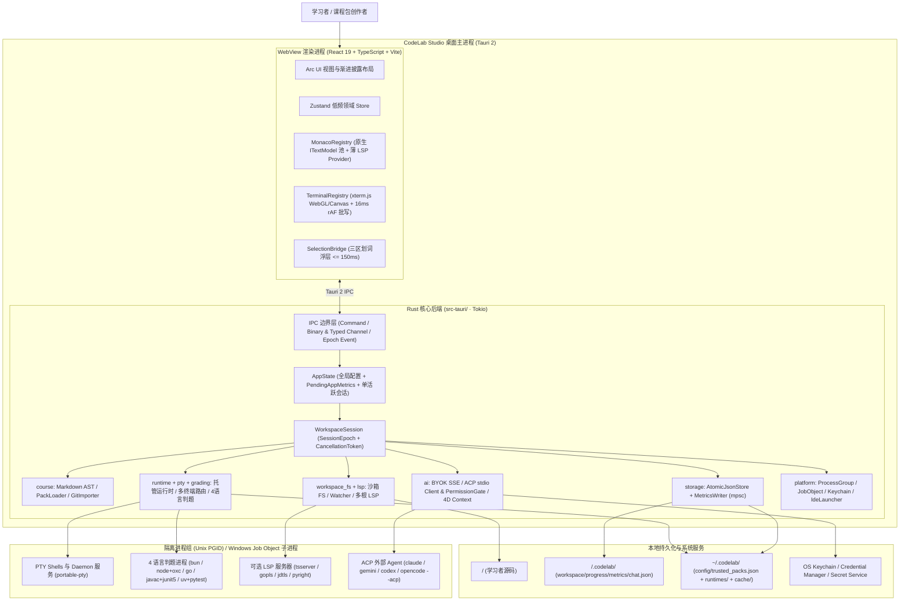

# CodeLab Studio 系统架构蓝图

> 状态：已敲定（v1.0，脚手架与业务代码落地前的权威设计基准）
> 对齐基线：[PRD.md](../prd/PRD.md)（v3.1）、[prd-stories.json](../prd/prd-stories.json)（`US-001` 至 `US-018`）、[design-system.md](../design/design-system.md)（v3.2 B 方案定稿）、[tokens.css](../design/tokens.css)、[tailwind.config.js](../design/tailwind.config.js)
> 配套评审记录：[arena-synthesis.md](./arena-synthesis.md)

本文档为参考规格（Reference），定义 CodeLab Studio 在编写应用脚手架和业务代码前的进程拓扑、模块边界、核心类型与状态机、Tauri 2 IPC 契约、六大子系统设计、安全与性能验证门禁，以及覆盖 `US-001` 至 `US-018` 的可验证交付序列。

---

## 1. 系统上下文、进程拓扑与职责边界

CodeLab Studio 采用 **Rust 内核独占系统副作用、WebView 作为薄投影层** 的 Tauri 2 桌面架构。所有触及文件系统、外部子进程、系统钥匙串、网络流与文档解析的状态，统一收口于 Rust 侧单一工作区会话聚合根 `WorkspaceSession`。WebView 不持有原始文件、Shell 或网络插件权限，不接触 API Key 明文，仅通过强类型 Tauri 2 IPC 渲染状态与受控数据流。

### 1.1 进程与运行时拓扑



### 1.2 四方职责边界矩阵

| 边界层 | 独占职责（单一所有者） | 明确禁止事项 |
|---|---|---|
| **Rust 后端** (`src-tauri/`) | 工作区会话生命周期与 `SessionEpoch` 隔离；`dunce::canonicalize` 路径沙箱与 500ms 文件监听；`.codelab/*.json` 原子写入与损坏恢复；Markdown 安全 AST 解析与课程包信任校验；高危 Shell 规则检测与一次性令牌签发；PTY、LSP、判题与 ACP 子进程树管理及退出 100% 回收；四语言隔离运行时安装与环境注入；OS Keychain 密钥读写、BYOK SSE 请求、ACP stdio 协议与 `fs/*`/`terminal/*` 权限门禁；4D 上下文 6,000 token 裁剪与敏感信息脱敏；13 项指标落盘。 | 禁止向 WebView 开放原始 `tauri-plugin-fs`、`tauri-plugin-shell` 或 `tauri-plugin-http`；禁止在日志、错误信息、JSON 文件或 IPC 响应中输出 API Key 明文。 |
| **WebView 前端** (`src/`) | Arc UI 双主题与 8 组 `data-accent` 切换；渐进披露布局与桌面断点状态机；受限 `MarkdownNode` AST 声明式渲染；Monaco 多标签编辑、外部冲突横幅与 Safe-Write Diff 对比；xterm.js 5,000 行画布渲染；三区划词坐标计算与浮层展示；ContextChips 勾选预览与 ACP 权限审批卡交互；`zh-CN`/`en-US` 双语渲染。 | 禁止前端直发带密钥的 BYOK HTTP 请求；禁止前端决定高危命令放行或绕过后端令牌；禁止将高频 PTY 字节流或完整大文件正文存入 React/Zustand 状态树；禁止使用 `dangerouslySetInnerHTML`；禁止静默覆写用户文件。 |
| **本地磁盘** | `<workspace>/.codelab/` 存工作区元数据、进度、本地指标、对话历史与临时编译缓存；`~/.codelab/` 存全局偏好、外部包信任指纹、隔离托管运行时与受限缓存。 | 禁止写入 API Key 明文；禁止改写操作系统全局 `PATH` 或用户 Shell 配置文件（`.zshrc`、`.bashrc`、Windows 注册表）。 |
| **外部子进程** | 运行在独立进程组（Unix `setsid`/`setpgid`）或 Windows Job Object（`JOB_OBJECT_LIMIT_KILL_ON_JOB_CLOSE`），仅接收经 `env_builder` 构造的隔离环境变量。 | 禁止继承 BYOK API Key；ACP Agent 在 `GuidedReadOnly` 默认策略下禁止未经审批写入工作区或执行命令。 |

### 1.3 Tauri 2 Capabilities 最小权限集

`src-tauri/capabilities/default.json` 仅向主窗口 `main` 授予下列权限：

- 允许：`core:default`、`dialog:allow-open`（仅目录与文件选择框）、`opener:allow-open-url`（仅 `http`/`https`）、`window-state:default`、`single-instance`。
- 禁止注册：`tauri-plugin-fs`、`tauri-plugin-shell`、`tauri-plugin-http`。所有磁盘、子进程与网络操作必须经过自定义 `#[tauri::command]` 并通过 Rust 边界校验。

---

## 2. 仓库结构与模块依赖规则

### 2.1 目标目录布局

```text
codelab-studio/
├── docs/                                # 既有 PRD、用户故事、Arc UI 设计系统与架构蓝图
├── schemas/                             # 由 Rust schemars 导出的权威 JSON Schema
│   ├── codelab-pack.v1.schema.json
│   ├── codelab-checks.v1.schema.json
│   └── workspace-meta.v1.schema.json
├── builtin-courses/                     # 随安装包分发的内置课程包（Tauri resources）
│   ├── go-goframe-practice/             # 标杆课程：练习 0 至 9
│   ├── ts-data-pipeline/                # JS/TS 函数判题示范
│   ├── py-task-engine/                  # Python 函数判题示范
│   └── java-order-service/              # Java 函数判题示范
├── src-tauri/
│   ├── Cargo.toml
│   ├── tauri.conf.json                  # 最小窗口 1024x720，严格 CSP
│   ├── capabilities/
│   │   └── default.json
│   └── src/
│       ├── main.rs                      # 桌面入口，委托至 lib::run()
│       ├── lib.rs                       # Tauri Builder、单实例、ExitRequested 清理屏障、命令注册
│       ├── domain/                      # 【纯领域层】零 Tauri、OS 进程或网络 IO 依赖
│       │   ├── mod.rs
│       │   ├── ids.rs                   # SessionEpoch, ChapterId, TerminalId, RelWorkspacePath 等
│       │   ├── error.rs                 # AppError (含 message_key / params) 与 ErrorCode
│       │   ├── course.rs                # CoursePack, Chapter, MarkdownNode, CommandBlock, ChecksSpec
│       │   ├── workspace.rs             # WorkspaceMeta, ProgressState, FileNode, ChatHistory
│       │   ├── runtime.rs               # Language, PreflightReport, ManagedRuntimeTarget
│       │   ├── pty.rs                   # PtyRole, OneshotIdleState, RiskAssessment, PortConflict
│       │   ├── grading.rs               # GradeRunResult, CheckResult, ExpectedActualDiff
│       │   ├── lsp.rs                   # LspLifecycleState, DiagnosticItem
│       │   ├── ai.rs                    # TeachingMode, ContextChip, AiStreamEvent, AcpDecision
│       │   └── metrics.rs               # 封闭 13 项 MetricEvent 枚举
│       ├── platform/                    # 【跨平台 OS 抽象】macOS / Windows / Linux
│       │   ├── mod.rs
│       │   ├── process_tree.rs          # Unix PGID/killpg 与 Windows JobObject 统一封装
│       │   ├── keychain.rs              # keyring 封装（服务名 studio.codelab.desktop）
│       │   ├── ide_launcher.rs          # VS Code / Cursor / GoLand / IDEA 参数数组拉起
│       │   └── paths.rs                 # ~/.codelab/ 路径解析与工作区 .lock 进程锁
│       ├── storage/                     # 【原子持久化与迁移】
│       │   ├── mod.rs
│       │   ├── atomic_json.rs           # tmp + sync_all + .bak + rename + .corrupt 恢复
│       │   ├── workspace_store.rs       # .codelab/{workspace,progress,chat}.json 独立单写器
│       │   ├── metrics_writer.rs        # 单工作区 mpsc 批处理写手（刷盘 .codelab/metrics.json）
│       │   └── global_store.rs          # ~/.codelab/{config,trusted_packs}.json
│       ├── course/                      # 【M1】零改造解析、课程包加载、Git 导入、创作校验
│       │   ├── mod.rs
│       │   ├── markdown_parser.rs       # pulldown-cmark + ammonia 受限白名单 -> MarkdownNode AST
│       │   ├── step_extractor.rs        # 三步流抽取、cwd/daemon 推断、折叠块归类
│       │   ├── pack_loader.rs           # 内置 / 本地 .md / 目录加载、starter 幂等注水
│       │   └── git_importer.rs          # 受限浅克隆（30s/100MB 限额）+ 信任校验 + LRU 缓存
│       ├── workspace_fs/                # 【M2】沙箱 FS、文件树与实时监听
│       │   ├── mod.rs
│       │   ├── sandbox.rs               # dunce::canonicalize 沙箱、软链/穿越/2MB/二进制守卫
│       │   ├── tree.rs                  # 忽略规则与增量树构建
│       │   └── watcher.rs               # notify 150ms 防抖 + SelfWriteGuard (blake3+TTL)
│       ├── runtime/                     # 【M3】四语言托管运行时与 Preflight
│       │   ├── mod.rs
│       │   ├── preflight.rs             # JoinSet 并行 5s 探针（4 语言 + 4 LSP + git/curl/GOPROXY）
│       │   ├── installer.rs             # 幂等下载、SHA-256、.staging 解压、原子更新 manifest
│       │   └── env_builder.rs           # 子进程隔离 PATH / GOROOT / JAVA_HOME / VIRTUAL_ENV
│       ├── pty/                         # 【M3】多终端路由、空闲探测、风控与环形缓冲
│       │   ├── mod.rs
│       │   ├── manager.rs               # portable-pty 会话池、Daemon/Oneshot 严格隔离、流重挂
│       │   ├── idle_detector.rs         # vte OSC 133（主）+ Unix tcgetpgrp / Win Job 进程表（兜底）
│       │   ├── shell_shim.rs            # zsh/bash/pwsh 无侵入 OSC 133 初始化垫片
│       │   ├── risk_guard.rs            # Shell 分词风控 + 绑定 (cmd,cwd,epoch,ttl) 一次性令牌
│       │   └── ring_buffer.rs           # 200 行 ANSI 剥离环形缓冲 + 端口冲突匹配器
│       ├── grading/                     # 【M3/M5】四语言判题与环回 HTTP 断言
│       │   ├── mod.rs
│       │   ├── runner.rs                # 调度、超时 SIGINT->SIGKILL、progress.json 原子更新
│       │   ├── http_assert.rs           # 300ms Daemon TCP 探活 + 环回地址 SSRF 白名单断言
│       │   └── adapters/                # bun_or_node_ts.rs (含 oxc_transformer), go_test.rs, junit5.rs, pytest.rs
│       ├── lsp/                         # 【M2】多根四语言 LSP 桥接与熔断降级
│       │   ├── mod.rs
│       │   ├── root_resolver.rs         # 向上定位最近模块根 + RFC 8089 file:// URI 映射
│       │   ├── client.rs                # stdio Content-Length JSON-RPC 帧收发
│       │   └── manager.rs               # (Language, ModuleRoot) 会话池、LRU<=2、崩溃熔断降级
│       ├── ai/                          # 【M4】BYOK + ACP 双协议与四维上下文引擎
│       │   ├── mod.rs
│       │   ├── context.rs               # 4D 装配、6,000 token 优先级截断、敏感路径屏蔽
│       │   ├── redactor.rs              # 日志、报错与提示词密钥脱敏（统计 redacted_secrets）
│       │   ├── prompts.rs               # Socratic（默认）与 Direct 系统提示词
│       │   ├── byok.rs                  # reqwest SSE/NDJSON 流式适配器（OpenAI/DeepSeek/Anthropic/Ollama）
│       │   ├── acp_client.rs            # ACP JSON-RPC 2.0 over stdio + fs/*/terminal/* 反向请求处理
│       │   ├── acp_gate.rs              # session/request_permission 挂起与策略门禁（120s 超时）
│       │   └── service.rs               # 统一 AiStreamEvent 流分发、聊天历史与取消控制
│       ├── session/                     # 【会话聚合根】
│       │   ├── mod.rs
│       │   ├── app_state.rs             # 全局配置、PendingAppMetrics、单活跃会话槽位
│       │   └── workspace_session.rs     # SessionEpoch、CancellationToken、3s 确定性关停屏障
│       └── ipc/                         # 【薄适配层】仅做边界校验与转发
│           ├── mod.rs                   # 命令注册表与 ts-rs/schemars 绑定导出测试
│           ├── workspace_cmd.rs
│           ├── course_cmd.rs
│           ├── fs_cmd.rs
│           ├── runtime_cmd.rs
│           ├── pty_cmd.rs
│           ├── grading_cmd.rs
│           ├── lsp_cmd.rs
│           ├── ai_cmd.rs
│           └── settings_cmd.rs
├── src/
│   ├── main.tsx                         # 首帧主题同步、React 根挂载、全局快捷键注册
│   ├── App.tsx                          # Welcome Home / Workbench 视图切换
│   ├── styles/
│   │   ├── tokens.css                   # 同步复用 docs/design/tokens.css（v3.2 权威令牌）
│   │   └── workbench.css                # 布局、分隔条、焦点环与 reduced-motion 样式
│   ├── i18n/
│   │   ├── index.ts                     # 强类型 t(key, params) 钩子与 locale 状态
│   │   ├── zh-CN.ts                     # 简体中文完整词典
│   │   └── en-US.ts                     # 英文完整词典（satisfies Record<MessageKey, string>）
│   ├── lib/
│   │   ├── ipc/
│   │   │   ├── generated.ts             # ts-rs 单向导出类型文件（禁止手改）
│   │   │   ├── client.ts                # 唯一强类型 invoke / Channel 封装门面
│   │   │   └── events.ts                # 自动按 activeEpoch 过滤陈旧广播事件的订阅器
│   │   ├── layout/
│   │   │   └── layoutReducer.ts         # 纯函数桌面断点与渐进披露布局状态机
│   │   ├── selection/
│   │   │   └── selectionBridge.ts       # Manual / Monaco / xterm 统一划词监听与防遮挡定位
│   │   └── sinks/
│   │       ├── terminalRegistry.ts      # 命令式 xterm.js 实例池 + Uint8Array 16ms rAF 批写
│   │       └── monacoRegistry.ts        # 原生 ITextModel LRU(<=12) 池、LSP Provider 与主题同步
│   ├── stores/                          # 按领域切分的 Zustand 低频状态 Store
│   │   ├── workspaceStore.ts            # 会话 epoch、课程 AST、进度、文件树元数据
│   │   ├── editorStore.ts               # OpenTabs、脏状态、外部冲突、Safe-Write Diff 状态
│   │   ├── terminalStore.ts             # 终端列表、Daemon/Oneshot 状态、端口冲突横幅
│   │   ├── gradingStore.ts              # 验收状态、单项结果与 Expected vs Actual Diff
│   │   ├── aiStore.ts                   # 协议配置投影、ContextChips、流式消息、ACP 审批队列
│   │   ├── uiStore.ts                   # 渐进披露开关、断点布局、焦点模式、Toast 队列(<=2)
│   │   └── settingsStore.ts             # 主题/强调色/字号/语言/Preflight 投影
│   ├── components/
│   │   ├── ui/                          # Arc UI 原子原语（Button, Badge, Segmented, Modal, Drawer, Toast）
│   │   └── chrome/                      # Topbar (48px, 6 组控件)、PreflightPopover、AppearanceDrawer
│   └── features/
│       ├── home/                        # WelcomeHome、HeroCard、2x2 CourseGrid、ImportAuthorModal
│       ├── manual/                      # ThreeStepManual、MarkdownAstRenderer、CommandCard、ChapterOutline
│       ├── editor/                      # CollapsibleFileTree、MonacoPane、ConflictBanner、SafeWriteDiffModal
│       ├── terminal/                    # BottomPanel、XtermPane、DaemonTabHeader、GradingDiffTab
│       ├── ai/                          # FloatingSelectionPill、AiTutorDrawer、ContextChipsBar、AcpPermissionCard
│       └── settings/                    # SettingsModal (4 Tab: AI & ACP / Runtimes / Editor / Privacy)
├── package.json
├── tailwind.config.js                   # 同步复用 docs/design/tailwind.config.js
├── tsconfig.json
└── vite.config.ts                       # manualChunks 拆分 Monaco / xterm，保障 <= 2.0s 冷启动
```

### 2.2 严格无环依赖规则（DAG）

- **Rust 依赖方向：** `ipc` -> `session` -> `{course, workspace_fs, pty, grading, lsp, ai}` -> `{runtime, storage, platform}` -> `domain`。
  - `domain` 仅依赖 `serde`、`ts-rs`、`schemars`、`thiserror`，零 Tauri 运行时或 IO 依赖。
  - 同层业务子系统不互相直接持有可变状态引用；跨模块协同（例如 `grading` 推进 `progress.json`、`ai::context` 读取 `pty::ring_buffer` 和 `course` 摘要、`acp_client` 调用 `WorkspaceSandbox`）全部经由 `WorkspaceSession` 注入只读视图或受控接口完成。
- **前端依赖方向：** `features/*` -> `{stores, components/ui, lib/*}` -> `lib/ipc/client.ts`。
  - 除 `src/lib/ipc/` 外，任何前端模块禁止直接导入 `@tauri-apps/api`。
  - `lib/sinks/*` 直接驱动 Monaco 和 xterm 原生实例，禁止反向导入 React 组件。

---

## 3. 核心领域类型、状态机与持久化 Schema

### 3.1 权威 Rust 领域类型与品牌化原语

所有跨 IPC 数据结构派生 `#[derive(Debug, Clone, Serialize, Deserialize, ts_rs::TS)]`，枚举统一使用带标签的判别联合 `#[serde(tag = "kind", rename_all = "camelCase")]`。

```rust
// src-tauri/src/domain/ids.rs
use serde::{Deserialize, Serialize};
use ts_rs::TS;

#[derive(Debug, Clone, Copy, PartialEq, Eq, Hash, Serialize, Deserialize, TS)]
#[ts(export)]
pub struct SessionEpoch(pub u64);

#[derive(Debug, Clone, PartialEq, Eq, Hash, Serialize, Deserialize, TS)]
#[ts(export)]
pub struct ChapterId(pub String);

#[derive(Debug, Clone, PartialEq, Eq, Hash, Serialize, Deserialize, TS)]
#[ts(export)]
pub struct TerminalId(pub String);

#[derive(Debug, Clone, PartialEq, Eq, Hash, Serialize, Deserialize, TS)]
#[ts(export)]
pub struct CommandBlockId(pub String);

#[derive(Debug, Clone, PartialEq, Eq, Hash, Serialize, Deserialize, TS)]
#[ts(export)]
pub struct RunId(pub String);

/// 反序列化边界即校验的 POSIX 相对路径。
/// 拒绝前导斜杠、反斜杠、`..`、`.`、空串、NUL 字节及 Windows 保留设备名。
#[derive(Debug, Clone, PartialEq, Eq, Hash, Serialize, Deserialize, TS)]
#[serde(try_from = "String", into = "String")]
#[ts(export, type = "string")]
pub struct RelWorkspacePath(String);

/// 只能由 WorkspaceSandbox 通过 dunce::canonicalize 构造；禁止跨 IPC 反序列化伪造。
#[derive(Debug, Clone, PartialEq, Eq, Hash)]
pub struct CanonicalWorkspacePath {
    abs: std::path::PathBuf,
    rel: RelWorkspacePath,
}

/// 绑定 (sha256(command), canonical_cwd, session_epoch, ttl=60s) 的高危命令一次性确认令牌。
#[derive(Debug, Clone, PartialEq, Eq, Serialize, Deserialize, TS)]
#[ts(export)]
pub struct RiskConfirmationToken(pub String);
```

```rust
// src-tauri/src/domain/error.rs
#[derive(Debug, Clone, Serialize, Deserialize, TS)]
#[serde(rename_all = "SCREAMING_SNAKE_CASE")]
#[ts(export)]
pub enum ErrorCode {
    WorkspaceNotOpen,
    SessionEpochStale,
    PathOutsideSandbox,
    FileTooLargeOrBinary,
    ExternalEditConflict,
    ExternalPackUntrusted,
    RiskConfirmationRequired,
    RiskTokenInvalidOrExpired,
    MarkdownLimitExceeded,
    SchemaValidationFailed,
    RuntimeMissing,
    RuntimeInstallFailed,
    RuntimeChecksumMismatch,
    PtySpawnFailed,
    DaemonNotRunning,
    GradeTimeout,
    LspUnavailable,
    KeychainUnavailable,
    AiProviderError,
    AcpHandshakeFailed,
    AcpPermissionDenied,
    StorageCorruptedRecovered,
    Cancelled,
}

#[derive(Debug, Clone, Serialize, Deserialize, TS)]
#[serde(rename_all = "camelCase")]
#[ts(export)]
pub struct AppError {
    pub code: ErrorCode,
    pub message_key: String, // 对应 src/i18n 的强类型消息键
    pub params: std::collections::BTreeMap<String, String>,
    pub detail: Option<String>, // 经 SecretRedactor 脱敏后的诊断信息
    pub retryable: bool,
}
```

```rust
// src-tauri/src/domain/pty.rs
#[derive(Debug, Clone, PartialEq, Eq, Serialize, Deserialize, TS)]
#[serde(tag = "kind", rename_all = "camelCase")]
#[ts(export)]
pub enum PtyRole {
    Daemon {
        service_key: String,
        label: String,
        port_hint: Option<u16>,
    },
    Oneshot {
        slot_index: u32,
    },
}

#[derive(Debug, Clone, PartialEq, Eq, Serialize, Deserialize, TS)]
#[serde(tag = "kind", rename_all = "camelCase")]
#[ts(export)]
pub enum OneshotIdleState {
    Idle { last_exit_code: Option<i32> },
    Busy { active_command: Option<String>, since_ms: u64 },
    Unknown, // 无法确认空闲时，路由器 fail-closed 新建 Oneshot 终端
}

#[derive(Debug, Clone, Serialize, Deserialize, TS)]
#[serde(tag = "level", rename_all = "camelCase")]
#[ts(export)]
pub enum RiskAssessment {
    Safe,
    HighRisk {
        matched_rules: Vec<RiskRuleMatch>,
        normalized_command: String,
        target_cwd: RelWorkspacePath,
        confirmation_token: RiskConfirmationToken,
    },
}
```

```rust
// src-tauri/src/domain/ai.rs
#[derive(Debug, Clone, Copy, PartialEq, Eq, Serialize, Deserialize, TS)]
#[serde(rename_all = "camelCase")]
#[ts(export)]
pub enum TeachingMode {
    Socratic, // 默认：引导思考
    Direct,   // 直接解答
}

#[derive(Debug, Clone, PartialEq, Eq, Serialize, Deserialize, TS)]
#[serde(rename_all = "camelCase")]
#[ts(export)]
pub struct ContextChip {
    pub chip_id: String,
    pub kind: ContextChipKind,
    pub estimated_tokens: u32,
    pub removable: bool,
    pub redacted_secrets: u32, // 内联正则脱敏次数，前端芯片可见
}

#[derive(Debug, Clone, PartialEq, Eq, Serialize, Deserialize, TS)]
#[serde(tag = "kind", rename_all = "camelCase")]
#[ts(export)]
pub enum ContextChipKind {
    ChapterSummary { chapter_id: ChapterId, title: String },
    Selection { source: SelectionSource, preview: String, line_range: Option<(u32, u32)> },
    ActiveFileSnippet { path: RelWorkspacePath, start_line: u32, end_line: u32 },
    TerminalErrorTail { terminal_id: TerminalId, line_count: u32 },
    VerificationDiff { chapter_id: ChapterId, failed_count: u32 },
    ExcludedSensitive { path: RelWorkspacePath, reason: String },
}

#[derive(Debug, Clone, Serialize, Deserialize, TS)]
#[serde(tag = "kind", rename_all = "camelCase")]
#[ts(export)]
pub enum AiStreamEvent {
    Started { turn_id: String, prompt_tokens: u32, truncated_chips: Vec<String> },
    TextDelta { turn_id: String, delta: String },
    ThinkingDelta { turn_id: String, delta: String },
    ToolCallUpdated { turn_id: String, call_id: String, title: String, status: ToolCallStatus },
    PermissionRequired {
        turn_id: String,
        request_id: String,
        agent_name: String,
        operation: AcpOperationKind, // Read | Write | Exec | Delete
        target_summary: String,
        options: Vec<AcpPermissionOption>,
    },
    PermissionResolved { turn_id: String, request_id: String, decision: AcpDecision },
    Completed { turn_id: String, finish_reason: FinishReason },
    Failed { turn_id: String, error: AppError },
}
```

### 3.2 Rust-to-TypeScript 契约与 Schema 单源派生

1. **DTO 类型单源派生（`ts-rs`）：** `domain/` 内全部跨边界类型派生 `ts_rs::TS`，运行 `cargo test export_bindings` 生成单一文件 `src/lib/ipc/generated.ts`。薄封装层 `src/lib/ipc/client.ts` 引用该生成文件绑定所有 `invoke` 与 `Channel` 调用，避免被 `tauri-specta` v2 宏与 Tauri 2 二进制 `Channel` 签名耦合阻塞。CI 运行 `cargo test export_bindings && git diff --exit-code src/lib/ipc/generated.ts && tsc --noEmit` 强制防漂移。
2. **配置文件 JSON Schema 单源派生（`schemars`）：** 对 `CourseManifest`（`codelab.json`）、`ChecksSpec`（`.codelab-checks.json`）及 `.codelab/*.json` 派生 `schemars::JsonSchema` 并导出至 `schemas/*.schema.json`。前端创作模式（`US-012`）直接加载 `codelab-checks.v1.schema.json` 到 Monaco JSON diagnostics，提供实时字段校验与补全。

### 3.3 核心状态机与硬不变量

| 状态机 | 状态迁移 | 结构性不变量 |
|---|---|---|
| **`WorkspaceSession`** | `Idle` -> `TrustPending(fingerprint)` -> `Opening` -> `Active(epoch)` -> `Closing(epoch)` -> `Idle` | 全局同一时刻至多存在一个 `Active` 会话；切换或退出时 `Closing` 必须执行 `CancellationToken::cancel()`、刷盘 `MetricsWriter`、回收全部 PTY/LSP/Grader/ACP 进程树（3 秒硬上限后强制终止），再允许释放槽位。 |
| **`EditorTabSyncState`** | `CleanSynced { disk_hash }` <-> `DirtyLocal { disk_hash }` -> `ExternalConflict { base_hash, latest_hash, latest_content }` | `CleanSynced` 收到非自写变更时静默重载并保持光标；`DirtyLocal` 收到非自写变更时保留草稿并弹出顶部冲突横幅；手册参考代码写入独立走 `SafeWriteDiffPending` 模态态。 |
| **`PtySessionState`** | `Daemon`: `Starting` -> `Running { pid, port }` -> `Stopping` -> `Stopped \| Crashed`<br>`Oneshot`: `Idle { last_exit_code }` <-> `Busy { cmd, since_ms }` \| `Unknown` | `Oneshot` 命令只能投递至 `Idle` 态 `Oneshot` 终端；`Busy` 或 `Unknown` 时 fail-closed 新建标签；绝不向 `Daemon` 终端注入单次命令。 |
| **`LspLifecycleState`** | `Missing` \| `Starting` -> `Ready` -> `Degraded { crash_count }` \| `Stopped` | 60 秒内崩溃达到 3 次熔断为 `Degraded` 停止重启；LSP 不可用永不阻断文本编辑。 |
| **`AcpPermissionState`** | `PendingApproval { request_id, oneshot_tx }` -> `Resolved(decision)` \| `TimedOut` \| `Cancelled` | 默认 `GuidedReadOnly` 仅自动放行工作区内非敏感读；写/执行/删操作阻塞于 `oneshot`，120 秒超时或用户点停止自动回复拒绝/取消，杜绝 Agent 死锁。 |

### 3.4 版本化磁盘 Schema 与原子写入恢复协议

所有持久化 JSON 文件均携带版本字段并通过 `storage/atomic_json.rs` 写入：

1. **写入步骤：** 先写入同目录临时文件 `<name>.json.tmp.<pid>.<seq>`，再调用 `file.sync_all()` 刷盘；若现有主文件合法则复制为 `<name>.json.bak`，最后通过原子重命名替换目标文件（Unix `rename(2)`、Windows `MoveFileExW(MOVEFILE_REPLACE_EXISTING)`）。
2. **启动清理与损坏恢复：** 启动时清扫遗留 `.tmp.*` 文件。读取主文件遇到语法损坏或不支持的 Schema 时，自动回退读取 `.bak` 恢复；若主文件与 `.bak` 均不可读，将损坏文件重命名为 `<name>.json.corrupt.<unix_ms>`，写入安全默认态并发射 `workspace://storage-corrupted` 通知，不阻塞启动。
3. **写竞争隔离：** `<workspace>/.codelab/` 下 `workspace.json`、`progress.json`、`metrics.json`、`chat.json` 拆分为四个独立文件各自单写，彻底消除共用单一状态文件的写竞争。`metrics.json` 由会话内唯一 `MetricsWriter`（`tokio::sync::mpsc` 接收事件，每 2 秒、满 20 条、章节验收完成或会话关闭时批量原子刷盘，滚动上限 5,000 条）串行写入。应用层启用 `tauri-plugin-single-instance` 与 `<workspace>/.codelab/.lock`（含 PID 与进程启动时间戳，支持陈旧锁识别回收）。

#### 3.4.1 工作区级文件（`<workspace>/.codelab/`）

- **`workspace.json` (`schemaVersion: 1`)：**

```json
{
  "schemaVersion": 1,
  "workspaceId": "ws_01J...",
  "workspaceRoot": "/Users/dev/go-practice",
  "courseSource": { "kind": "builtin", "courseId": "go-goframe-practice", "entryFile": "README.md" },
  "packFingerprint": "sha256:...",
  "hydratedFiles": ["task-api/go.mod", "task-api/main.go"],
  "activeChapterId": "ex-1-healthz",
  "openTabs": ["task-api/main.go", "task-api/main_test.go"],
  "activeTab": "task-api/main.go",
  "layout": { "manualWidthPct": 35, "bottomHeightPx": 256, "focusMode": false },
  "updatedAt": "2026-11-22T12:00:00Z"
}
```

- **`progress.json` (`schemaVersion: 1`)：**

```json
{
  "schemaVersion": 1,
  "courseId": "go-goframe-practice",
  "chapters": {
    "ex-1-healthz": {
      "status": "completed",
      "completedAt": "2026-11-22T12:10:00Z",
      "lastRunId": "run_01J...",
      "autoChecks": {
        "v1": { "passed": true, "latencyMs": 4, "checkedAt": "2026-11-22T12:10:00Z" },
        "v2": { "passed": true, "latencyMs": 820, "checkedAt": "2026-11-22T12:10:00Z" }
      },
      "selfChecks": { "s1": true }
    }
  }
}
```

- **`metrics.json` (`schemaVersion: 1`)：** 仅存脱敏的 13 项封闭枚举事件 `events[]`（每项含 `id`、`name`、`ts`、`payload`），无源码、无命令明文、无文件路径、无对话原文、无密钥。
- **`chat.json` (`schemaVersion: 1`)：** 按 `chapterId` 保存工作区级 AI 助教对话历史（每章保留最近 50 轮），供重启续聊并在用户触发 `ai_clear_history` 时原子清空；该文件位于 `.codelab/` 内，不纳入文件树、不进入 AI 上下文采集、不参与任何统计上报。

#### 3.4.2 全局配置与课程包（`~/.codelab/` 与 Course Pack）

- **`~/.codelab/config.json` (`schemaVersion: 1`)：** 保存 `locale`（`zh-CN` | `en-US`）、`appearance`（`theme`、`accent`、`codeFontSizePx`）、`editor`（`externalIde`、`lspEnabled`）、`ai`（仅非敏感 `activeProtocol`、`defaultTeachingMode`、BYOK 档案的 `keychainAccount` 引用与 ACP Agent 命令列表，**零 API Key**）、`privacy.optInAnonymousTelemetry`（默认 `false`）及 `recentWorkspaces[]`。
- **`~/.codelab/trusted_packs.json` (`schemaVersion: 1`)：** 按 `{ sourceKey, contentHash, trustedAt }` 存储用户显式信任的外部本地包与 Git 课程包指纹。
- **`~/.codelab/runtimes/manifest.json` (`schemaVersion: 1`)：** 记录各托管运行时的 `version`、`installDir`、`binRelPath`、`sha256` 与 `installedAt`。
- **`codelab.json` 与 `.codelab-checks.json` (`schemaVersion: "1.0"`)：** 完整兼容 `PRD.md` v3.1 规范。`.codelab-checks.json` 边界解析器同时兼容按 `chapters[]` 分组的完整格式与创作模式单章试跑格式；`checks[]` 支持 `http_assert`、`command_test`、`function_test`、`self_check` 四种判别类型。

---

## 4. Tauri 2 IPC 契约

IPC 严格分为四类通道，按吞吐与语义隔离：

1. **Commands（`#[tauri::command]`）：** 请求/响应控制面，统一返回 `Result<T, AppError>`。所有依赖活跃会话的命令携带 `expected_epoch: SessionEpoch`，拦截切换工作区瞬间的陈旧请求。
2. **Binary Streaming Channel（`Channel<tauri::ipc::InvokeResponseBody>`）：** 专用于 PTY 字节流。后端通过 `InvokeResponseBody::Raw(bytes)` 直推原始字节块，彻底消除 `Vec<u8>` JSON 数组编码导致的 3 至 4 倍体积膨胀、GC 抖动及多字节 UTF-8 切分乱码。
3. **Typed Streaming Channels（`Channel<T>`）：** 专用于有序结构化流（AI 流式事件、运行时下载进度、判题单项进度、LSP 服务消息），点对点绑定请求生命周期。
4. **Workspace Broadcast Events（`app.emit_to("main", ...)`）：** 低频广播通知，载荷统一包裹 `SessionEventEnvelope<T> { epoch: SessionEpoch, payload: T }`，前端事件总线自动丢弃 `epoch !== activeEpoch` 的陈旧事件。

### 4.1 Commands 清单

| 模块 | Command 签名 | 关键边界行为 |
|---|---|---|
| **Workspace & Course** | `app_bootstrap() -> BootstrapState` | 返回全局配置、最近工作区、内置课程元数据；将首屏前产生的 `app_launched` 暂存内存队列。 |
| | `course_inspect_source(source: CourseSourceInput) -> CourseInspectResult` | 只读预解析本地 `.md`、目录或 Git URL，返回信任需求状态、章节预览与 Schema 校验结果。 |
| | `course_trust_and_open(req: OpenWorkspaceReq) -> OpenedWorkspaceView` | 外部包先校验或写入 `trusted_packs.json`；同步排空旧会话；按幂等策略注水 `starter/`；启动新 `SessionEpoch`、Watcher 并一次性冲刷 `PendingAppMetrics`。 |
| | `course_reload_manual(epoch: SessionEpoch) -> ParsedCourse` | 手册外部修改触发热提示后重新解析并保持章节位置。 |
| | `course_author_preview(markdown: String, checks_json: Option<String>) -> AuthorPreviewResult` | 创作模式实时解析 Markdown 与校验 `.codelab-checks.json`。 |
| | `course_author_save(pack_dir: String, markdown: String, checks_json: String) -> ParsedCourse` | 创作者模式原子保存课程包并通过 Schema v1.0 校验。 |
| | `workspace_close(epoch: SessionEpoch) -> ()` | 排空并回收当前会话全部子进程后返回首页。 |
| **Workspace FS** | `fs_list_tree(epoch: SessionEpoch) -> Vec<FileNode>` | 忽略 `.git`、`node_modules`、`.codelab` 等目录返回工作区树。 |
| | `fs_read_file(epoch: SessionEpoch, path: RelWorkspacePath) -> FileReadOutcome` | 沙箱校验；大于 2 MB 或二进制返回 `TooLarge` / `Binary` 元信息；文本返回正文与 `blake3` `disk_hash`。 |
| | `fs_write_file(epoch: SessionEpoch, path: RelWorkspacePath, content: String, expected_disk_hash: Option<String>) -> FileWriteResult` | 写入前登记 `SelfWriteGuard`；若 `expected_disk_hash` 与磁盘不符返回 `ExternalEditConflict`；原子落盘。 |
| | `fs_create_entry(epoch, path, is_dir)` / `fs_rename_entry(epoch, from, to)` / `fs_delete_entry(epoch, path)` | 全链路通过 `WorkspaceSandbox` 校验，禁止删除根目录与 `.codelab`。 |
| | `fs_open_in_external_ide(epoch: SessionEpoch, path: RelWorkspacePath, ide: ExternalIdeKind, line: Option<u32>) -> ()` | 以参数数组安全拉起 VS Code / Cursor / GoLand / IDEA，零 Shell 拼接。 |
| **Runtime & Preflight** | `runtime_run_preflight(languages: Vec<Language>) -> PreflightReport` | 并行 5 秒超时探针，返回每项 `ok \| warn \| missing` 状态并记录 `preflight_executed`。 |
| | `runtime_install(target: ManagedRuntimeTarget, on_progress: Channel<RuntimeInstallEvent>) -> InstalledRuntimeInfo` | 幂等下载、SHA-256 校验、`.staging` 原子解压至 `~/.codelab/runtimes/`，记录 `runtime_installed`。 |
| **PTY 多终端** | `pty_spawn(epoch: SessionEpoch, req: PtySpawnReq, on_raw_output: Channel<InvokeResponseBody>) -> PtySessionView` | 创建 `Daemon` 或 `Oneshot` 终端并绑定专属二进制流通道。 |
| | `pty_attach_stream(epoch: SessionEpoch, terminal_id: TerminalId, on_raw_output: Channel<InvokeResponseBody>) -> PtyAttachSnapshot` | 组件重挂时重新绑定流通道并返回当前历史字节快照，避免丢失滚动记录。 |
| | `pty_dispatch_command_block(epoch: SessionEpoch, req: DispatchBlockReq, on_new_pty: Channel<InvokeResponseBody>) -> DispatchResult` | Rust 侧先做风险评估（未持有效令牌拦截并返回 `RiskConfirmationToken`），再严格按 `Daemon` / `Oneshot` 规则路由。 |
| | `pty_write(epoch: SessionEpoch, terminal_id: TerminalId, data: String) -> ()` | 交互键盘/粘贴输入直写 PTY（不接受命令块向 `Daemon` 误注入）。 |
| | `pty_resize(epoch: SessionEpoch, terminal_id: TerminalId, cols: u16, rows: u16) -> ()` | 同步 `xterm.js` 尺寸至 `portable-pty`。 |
| | `pty_signal_or_restart(epoch: SessionEpoch, terminal_id: TerminalId, action: PtyControlAction) -> ()` | 支持 `SigInt`、`Kill`、`Restart`。 |
| **Grading & Progress** | `grade_run_chapter(epoch: SessionEpoch, chapter_id: ChapterId, on_progress: Channel<GradeProgressEvent>) -> GradeRunResult` | 执行全部自动项（HTTP 断言 + 4 语言单测），全通过时原子更新 `progress.json` 并记录 `chapter_marked_done`。 |
| | `progress_toggle_self_check(epoch, chapter_id, check_id, checked) -> ProgressState` | 更新自查项并原子持久化。 |
| | `progress_reset(epoch, chapter_id: Option<ChapterId>) -> ProgressState` | 重置单章或整门课程进度。 |
| | `progress_export(epoch, dest_path: String) -> ()` | 导出脱敏后的本地学习记录 JSON。 |
| **LSP 桥接** | `lsp_ensure_for_file(epoch: SessionEpoch, path: RelWorkspacePath, on_message: Channel<LspServerMessage>) -> LspSessionStatus` | 向上定位最近模块根并复用/启动 LSP；缺失或熔断时返回降级状态不阻断编辑。 |
| | `lsp_send(epoch: SessionEpoch, session_id: String, payload: LspClientMessage) -> Option<serde_json::Value>` | 转发 `didOpen`/`didChange`（含未保存草稿）/`didSave`/`didClose`/`completion`/`hover`/`definition`。 |
| **AI & ACP** | `ai_preview_context(epoch: SessionEpoch, req: ContextPreviewReq) -> ContextPreview` | 实时计算四维 `ContextChip[]`（含 `ExcludedSensitive` 与 `redacted_secrets`）及预估 Token。 |
| | `ai_send_turn(epoch: SessionEpoch, req: AiTurnReq, on_stream: Channel<AiStreamEvent>) -> String` | 装配 6,000 token 上下文后路由至 BYOK 或 ACP，落盘 `chat.json`，返回 `turn_id`。 |
| | `ai_cancel_turn(epoch: SessionEpoch, turn_id: String) -> ()` | 中断 BYOK SSE 流或发送 ACP `session/cancel`。 |
| | `ai_test_connection(target: AiTestTarget) -> AiConnectivityResult` | 测试 BYOK 端点连通性或执行 ACP `initialize` 握手测试。 |
| | `ai_save_byok_key(profile_id: String, api_key: String) -> MaskedKeyView` / `ai_delete_byok_key(profile_id: String) -> ()` | 仅在 Rust 内操作 OS Keychain，仅返回脱敏提示（如 `sk-****9f2a`）。 |
| | `acp_respond_permission(epoch: SessionEpoch, request_id: String, decision: AcpDecision) -> ()` | 唤醒挂起的 `oneshot` 通道回复 ACP 权限请求并记录 `acp_permission_decision`。 |
| | `ai_get_history(epoch, chapter_id)` / `ai_clear_history(epoch, chapter_id: Option<ChapterId>)` | 读取或清空 `.codelab/chat.json` 并按需重建 ACP session。 |
| **Settings & Metrics** | `settings_update(patch: GlobalConfigPatch) -> GlobalConfigView` | 原子更新 `~/.codelab/config.json`。 |
| | `metrics_record(epoch: Option<SessionEpoch>, event: MetricEvent) -> ()` | 仅接受封闭 13 项白名单事件，经 `MetricsWriter` 或 `PendingAppMetrics` 处理。 |

### 4.2 Broadcast Events 清单

所有事件载荷统一包裹 `SessionEventEnvelope<T> { epoch: SessionEpoch, payload: T }`：

- `workspace://fs-delta`：`Vec<FsDelta>`（`Created`、`ContentChanged { path, new_hash }`、`Removed`、`ManualChanged`，150ms 防抖批量发出）。
- `workspace://storage-corrupted`：`{ file_name: String, backup_name: String }`。
- `pty://state`：`{ terminal_id: TerminalId, role: PtyRole, alive: bool, idle_state: OneshotIdleState }`。
- `pty://port-conflict`：`{ terminal_id: TerminalId, port: Option<u16>, matched_line: String, candidate_daemon_id: Option<TerminalId> }`。
- `lsp://status`：`{ language: Language, module_root: RelWorkspacePath, state: LspLifecycleState }`。
- `lsp://diagnostics`：`{ path: RelWorkspacePath, version: i32, items: Vec<DiagnosticItem> }`。

---

## 5. 各子系统详细设计（M1 至 M6）

### 5.1 M1：零改造 Markdown 解析器、课程包加载、Git 导入与创作模式

1. **5 MB 体积守卫与单遍 AST 解析（`course/markdown_parser.rs`）：**
   - 读取手册前校验字节数不超过 `5 * 1024 * 1024`，超限直接返回 `MarkdownLimitExceeded`。
   - 使用 Rust `pulldown-cmark` 单遍扫描（1,000 行实测耗时 `< 10ms`，远低于 `150ms` 预算）：`#` 识别课程名，`##` 拆分有序章节与确定性 `ChapterId`（优先读取 `{#id}` 锚点，其次按规范化标题 slug 加序号生成，冲突补后缀）。
   - **安全 HTML 与 XSS 零暴露：** Markdown 编译为受限 `MarkdownNode` AST（仅含段落、标题、列表、表格、引用、行内代码、代码块、链接、图片、粗斜体、换行、按键标签与折叠块）。对外部教程中常见的无害行内 HTML（`<br>`、`<kbd>`、`<sup>`、`<sub>`、`<details>`、`<summary>`）先经 `ammonia` 严格白名单过滤后再映射为对应 `MarkdownNode` 变体，其余标签一律转义为纯文本；链接仅允许 `http://`、`https://`、`mailto:` 与 `#` 锚点。React 按 AST 渲染原生组件，全局禁止 `dangerouslySetInnerHTML`，兼顾 XSS 根除与外部教程 `>= 90%` 零改造解析率。
2. **三步流抽取与命令推断（`course/step_extractor.rs`）：**
   - 扫描 `bash`、`sh`、`zsh`、`shell` 围栏块，优先读取属性 `cwd`、`mode`、`label`、`port`；缺失时追踪同章前导 `cd <dir>`（经沙箱校验）并匹配服务关键词表（`go run`、`gf run`、`npm run dev`、`bun dev`、`uvicorn`、`flask run`、`python -m http.server`、`mvn spring-boot:run`、`./gradlew bootRun`）推断 `Daemon`，其余归为 `Oneshot`。
   - 提取每章首句作核心目标；按 `① 启动服务/运行测试`、`② 修改代码（带路径标注的代码块绑定 Safe-Write Diff）`、`③ 自动验收清单（合并 .codelab-checks.json 与手册 - [ ] 自查项）` 组织，将辅助命令与课后思考题折叠收纳。
3. **课程包加载、`starter/` 幂等注水与 Git 导入（`pack_loader.rs`、`git_importer.rs`）：**
   - 统一支持 `Builtin`、`LocalMarkdown`、`LocalPackDir` 与 `GitRepo` 四类来源。
   - **Git 导入加固与缓存上限：** 仅允许 `https://`、`http://`、`ssh://` 与 `git@` 协议；克隆强制附加 `--depth 1 --single-branch -c protocol.file.allow=never -c core.hooksPath=/dev/null -c core.symlinks=false --`，30 秒网络超时，克隆至 `~/.codelab/cache/git-packs/<sha256(url)>/` 并校验解压后体积不超过 `100 MB`；缓存目录按 LRU 限制在 20 个课程包或 `500 MB` 以内。重复导入已有 URL 时提供显式刷新选项。
   - **首次信任门禁：** 外部本地目录或 Git 课程包在未命中 `~/.codelab/trusted_packs.json` 指纹时只做只读预览，展示来源、文件清单与命令摘要；用户显式确认信任后才允许绑定本地工作区。
   - **`starter/` 幂等注水策略：** 绑定工作区时遍历 `starter/`，仅在工作区对应 `RelWorkspacePath` 尚不存在且未被记录在 `workspace.json.hydratedFiles` 中时复制，绝不静默覆盖学习者已修改或主动删除的文件。
   - **创作模式（`US-012`）：** Import/Author 弹窗提供 `README.md` 与 `.codelab-checks.json`（挂载 `schemas/codelab-checks.v1.schema.json`）双编辑、200ms 防抖调用 `course_author_preview` 实时预览，并支持沙箱一键试跑验收。

### 5.2 M2：沙箱文件系统、500ms 监听、冲突保护、安全 Diff 与多根 LSP

1. **`WorkspaceSandbox`（`workspace_fs/sandbox.rs`）：**
   - 工作区打开时使用 `dunce::canonicalize(&workspace_root)` 锁定根路径（自动去除 Windows `\\?\` UNC 扩展前缀，保证与 `go`、`javac`、`bun`、`file://` URI 及外部 IDE 兼容）。
   - 所有路径参数在反序列化边界先通过 `RelWorkspacePath` 校验（阻断 `..`、绝对根、反斜杠、NUL 与 Windows 保留名 `CON` 至 `LPT9`），再经 `resolve_existing`（已存在路径 `dunce::canonicalize` 并验证 `starts_with(canonical_root)`）或 `resolve_for_write`（向上寻找最近已存在祖先做规范化并检查中间无越界软链接）生成不可伪造的 `CanonicalWorkspacePath`。
   - **2 MB 与二进制守卫：** 文件大于 `2 * 1024 * 1024` 字节，或前 8 KB 含 `0x00` / 非法 UTF-8 时拒绝加载进编辑器，返回只读元信息卡片。
2. **500ms 实时监听与外部 IDE 冲突协议（`workspace_fs/watcher.rs`）：**
   - 使用 `notify` + `notify-debouncer-mini`（防抖 150ms，端到端同步 200 至 350ms，满足 `<= 500ms`），排除 `.git`、`node_modules`、`.codelab`、`target`、`dist`、`build`、`.venv`、`__pycache__`、`.gradle`。
   - **自写回声抑制（`SelfWriteGuard`）：** 每次 `fs_write_file` 落盘后记录 `(RelWorkspacePath, blake3_hash, ts)`（TTL 2 秒）。监听回调比对磁盘 `blake3_hash`，命中则静默忽略。
   - **外部 IDE 原子重命名保存适配：** VS Code、Cursor、GoLand 与 Vim 保存文件通常采用临时文件加原子 `rename`，在 `notify` 中常表现为 `Create` 或 `Modify(Name(To))` 而非原地 `Modify(Data)`。监听器将打开标签路径上的 `Create`、`RenameTo` 与 `Modify` 统一归一化为 `FsDelta::ContentChanged { path, new_hash }`。前端收到非自写变更后：未脏标签静默刷新并保留光标；已脏标签且 hash 变化时顶部展示琥珀色横幅「加载磁盘版 / 保留草稿 / 对比 Diff」。
3. **参考代码安全写入与外部 IDE 拉起：**
   - 点击手册参考提示始终先打开左右对比 `SafeWriteDiffModal`（Monaco `DiffEditor`），仅在用户确认合并后写入，杜绝静默覆盖。
   - `platform/ide_launcher.rs` 通过可执行文件加参数数组拉起 VS Code、Cursor、GoLand 或 IntelliJ IDEA，零 Shell 字符串拼接。
4. **多根四语言可选 LSP 桥接（`lsp/`）：**
   - **向上最近模块根解析：** 从活跃文件父目录向上搜索至 `workspace_root`（绝不越界）：Go 匹配 `go.work`/`go.mod`（使 `task-api/` 与 `task-api-gf/` 各自拥有独立 `gopls` 实例），JS/TS 匹配 `tsconfig.json`/`jsconfig.json`/`package.json`，Python 匹配 `pyrightconfig.json`/`pyproject.toml`/`requirements.txt`，Java 匹配 `pom.xml`/`build.gradle`/`build.gradle.kts`；未命中回退至 `workspace_root`。
   - **URI 规范化与 `jdtls` 隔离目录：** 统一使用 `dunce::canonicalize` + `url::Url::from_file_path` 做 `RelWorkspacePath <-> file://` 双向映射。`jdtls` 必需的可写 OSGi `-data` 目录固定放在 `~/.codelab/cache/lsp/jdtls/<sha256(canonical_module_root)>/`，远离 `<workspace>` 以免污染学习者代码或触发 Watcher 死循环。
   - **脏缓冲同步与平滑降级：** Monaco 通过 `lsp_send` 推送 `didOpen`、`didChange`（100ms 防抖，同步未保存草稿）、`didSave`、`didClose`，并绑定薄原生 Provider（补全、悬停、跳转定义、诊断标记），零本地监听端口。会话池按 `(Language, CanonicalModuleRoot)` 缓存，LRU 上限 2 个实例；缺失或 60 秒内崩溃 3 次自动熔断为 `Degraded`，编辑器底栏单行提示并直链环境体检，不阻塞编辑。

### 5.3 M3：四语言隔离托管运行时、智能多终端与自动判题引擎

1. **并行 Preflight 与幂等托管安装（`runtime/`）：**
   - `preflight.rs` 用 `tokio::task::JoinSet` 并行探测四语言运行时、4 个 LSP、`git`、`curl` 与 `GOPROXY`，每项严格 5 秒超时熔断，返回 `ok | warn | missing`。
   - `installer.rs` 将缺失运行时幂等安装至 `~/.codelab/runtimes/<lang>/<ver>/`：先下载至 `.staging/<id>.part`，校验内嵌官方 `SHA-256`，解压至 `.staging/<id>/`，再原子重命名入位并更新 `manifest.json`；启动时自动清扫陈旧 `.staging` 目录。`env_builder.rs` 仅向子进程局部注入前置 `PATH`、`GOROOT`、`JAVA_HOME`、`VIRTUAL_ENV`，绝不修改全局系统 `PATH`。

| 语言 | 托管安装目录（`~/.codelab/runtimes/`） | 判题执行策略 | 可选 LSP | 判题超时 |
|---|---|---|---|---|
| **JS / TS** | `bun/<ver>/bun`（或系统 Node `>= 20`） | 优先 `bun test`；仅系统 Node 20 无 Bun 时，用内嵌纯 Rust `oxc_transformer` 将 `.ts` 剥离类型输出至 `.codelab/build-cache/ts/` 后运行 `node --test` | `typescript-language-server` | `5s` |
| **Go** | `go/<ver>/bin/go`（`go1.23`） | `go test -json -race ./...` + 扫描 `forbidOutput`（如 `WARNING: DATA RACE`）+ PTY `go run .` | `gopls` | `10s` |
| **Java** | `jdk/<ver>/bin/java`（Temurin JDK 21）+ `junit/junit-platform-console-standalone.jar` | `javac -d <ws>/.codelab/build-cache/java` 编译后执行 JUnit 5 Console Launcher 并解析 XML 报告 | `jdtls` | `12s` |
| **Python** | `uv/<ver>/uv` + `python/3.12/` + 隔离 pytest venv | `uv run --no-project pytest --json-report --json-report-file=<tmp>` | `pyright` | `8s` |

2. **`portable-pty` 智能多终端路由与真实跨平台进程清理（`pty/` + `platform/process_tree.rs`）：**
   - **物理角色隔离：** `Daemon` 独占按 `service_key` 命名的服务标签（运行脉冲、`■ 停止 SIGINT`、`↻ 重启`）；`Oneshot` 命令只能路由到 `OneshotIdleState::Idle` 的普通终端，处于 `Busy` 或 `Unknown` 时 fail-closed 新建普通终端，**绝不向运行中的服务终端输入文本**。
   - **双层空闲检测（含 ConPTY 真实细节）：**
     - 主路径：启动 `Oneshot` 交互 Shell 时经临时 `ZDOTDIR`（zsh）、`--rcfile`（bash）或 `-NoExit -File`（pwsh）无侵入输出 FinalTerm `OSC 133;B/C/D;<exit_code>`，Rust 侧 `vte` 解析器实时维护 `Idle`/`Busy` 状态并产出精确退出码（触发 `cmd_finished`）。
     - 降级兜底：无 OSC 133 时，Unix 校验 `tcgetpgrp(master_fd) == shell_pid`；Windows 查询该 PTY 绑定的 Job Object `JobObjectBasicProcessIdList`，排除 ConPTY 辅助进程（`conhost.exe`、`OpenConsole.exe`）后仅余根 Shell PID 才判 `Idle`，否则返回 `Unknown` 触发新建标签。
   - **真实进程组与 Job Object 清理：**
     - Unix：PTY 子进程由 `portable-pty` `openpty` 内置 `setsid()` 自动独立成组，停止时取 `master.process_group_leader()` / `child.process_id()` 发 `killpg(-pgid, SIGINT)`，1.5 秒后未退发 `SIGKILL`；非 PTY 子进程（Grader、LSP、ACP）经 `tokio::process::Command::pre_exec` 调用 `setpgid(0, 0)`。
     - Windows：非 PTY 子进程以挂起方式加入带 `JOB_OBJECT_LIMIT_KILL_ON_JOB_CLOSE` 的匿名 Job Object 后恢复运行；`portable-pty` ConPTY 子进程启动后立即取 `child.process_id()` 经 `OpenProcess` + `AssignProcessToJobObject` 纳入专属 Job Object，停止时先发 `Ctrl+C`/关闭 stdin，超时调用 `TerminateJobObject`；主进程异常崩溃时内核自动清理整棵子进程树。
   - **二进制流、环形缓冲与端口冲突：** PTY 字节经 16ms / 64 KB 合并后走 `Channel<InvokeResponseBody>`（`Raw`）直传前端 `TerminalRegistry`，前端按 16ms `rAF` 直接喂给 `xterm.write(Uint8Array)`（5,000 行滚动缓冲）。同时 Rust 侧维护每终端 200 行 ANSI 剥离环形缓冲供 AI 使用，并实时扫描 `address already in use`、`EADDRINUSE`、`Only one usage of each socket address` 发射 `pty://port-conflict` 恢复条。
3. **高危 Shell 命令双阶段门禁（`pty/risk_guard.rs`）：**
   - 任何命令块永不静默自动执行。`risk_guard` 按 Shell 控制符（`&&`、`||`、`;`、`|`、`$()`、反引号、换行）分词拦截 `rm` 递归强删、`sudo`/`su`/`doas`/`runas`、`mkfs`/`dd if=`/`fdisk`/`diskutil erase`、`chmod -R 777`（含 `/`、`~`、`..`）及 `curl|wget ... | sh|bash|zsh|pwsh|iex`。
   - 命中时拒绝执行并签发绑定 `(sha256(command), canonical_cwd, session_epoch, ttl=60s)` 的一次性 `RiskConfirmationToken`；弹窗展示完整目录与命令且**默认键盘焦点在「取消」**；二次确认携令牌提交后立即核销（防重放与参数篡改），并写 `cmd_risk_modal_action`。
4. **自动化判题与 HTTP 合同断言（`grading/`）：**
   - `http_assert` 前置 300ms TCP 探活 `requiresDaemon.port`，未就绪返回 `DaemonNotRunning`（UI 提供一键启动服务）；请求主机严格限定环回白名单（`127.0.0.1`、`localhost`、`[::1]`），阻断 SSRF。
   - 四语言单测运行在独立进程组并按表内超时执行 `SIGINT -> 1s -> SIGKILL` 熔断，解析输出生成结构化 `Expected vs Actual` Diff；章节全部自动项通过后原子写入 `<workspace>/.codelab/progress.json` 并记录 `chapter_marked_done`。

### 5.4 M4：双协议 AI 助教（BYOK + ACP）、四维上下文与跨区划词

1. **BYOK 安全客户端（`ai/byok.rs` + `platform/keychain.rs`）：**
   - API Key 仅存 OS Keychain（macOS Keychain、Windows Credential Manager、Linux Secret Service，服务名 `studio.codelab.desktop`）。Linux 缺少 Secret Service 时显式返回 `KeychainUnavailable`，绝不静默降级为明文文件。
   - Rust `reqwest` 直连 OpenAI 兼容、DeepSeek、Anthropic、本地 Ollama 及自定义端点，消除 WebView CORS 拦截并保证密钥永不离开 Rust 进程；`CancellationToken` 支持即时停止生成。
2. **ACP Client 完整双向协议与权限门禁（`ai/acp_client.rs` + `ai/acp_gate.rs`）：**
   - 按 Agent Client Protocol（JSON-RPC 2.0 换行分隔 JSON over stdio）拉起本机 `claude`、`gemini`、`codex`、`opencode` 或自定义 `--acp` 命令，工作目录设为 `canonical_root`，环境变量剥离全部 BYOK Key。
   - **正向生命周期：** 依次执行 `initialize`、`session/new`、`session/prompt`，流式消费 `session/update` 转为 `AiStreamEvent`，用户点击停止时发送 `session/cancel`。独立后台任务读取 Agent `stderr`，将 CLI 未登录或凭据过期等错误转为可读失败提示。
   - **反向 RPC 与双层权限拦截：**
     - 拦截 `session/request_permission`：在默认 `GuidedReadOnly` 策略下，工作区内非敏感只读自动放行；所有 `Write`、`Exec`、`Delete` 及敏感路径请求挂起在 `HashMap<RequestId, oneshot::Sender<AcpDecision>>`（120 秒超时自动拒止），在对话流渲染琥珀色审批卡，用户决议后记录 `acp_permission_decision`。
     - 同步承接 Agent 发起的反向能力调用 `fs/read_text_file`、`fs/write_text_file` 与 `terminal/*`：`fs/read_text_file` 强制经过 `WorkspaceSandbox` 与 `.env`/`*secret*`/`*key*` 黑名单；`fs/write_text_file` 与 `terminal/*` 强制校验对应已批准的 `AcpDecision` 才可执行，否则直接返回 JSON-RPC `-32003 PermissionDenied`（即使外部 Agent 跳过 `request_permission` 也无法越权）。
   - **会话作用域：** ACP `sessionId` 绑定 `(WorkspaceSession, activeChapterId)`，在清空历史、切换协议或切换工作区时发送 `session/cancel` 并优雅关闭子进程。
3. **四维上下文装配器（`ai/context.rs`）：**
   - 路径匹配 `.env`、`.env.*`、`*.pem`、`*.key`、`*.p12`、`*.pfx`、`*secret*`、`*credential*`、`id_rsa*`、`.codelab/**` 时拒绝读取正文并生成 `ExcludedSensitive` 芯片。
   - 所有进入提示词的代码、终端输出与报错均经 `SecretRedactor` 替换 `sk-*`、`ghp_*`、`AKIA*`、`Bearer *`、`PRIVATE KEY`、`*_API_KEY=*` 为 `[REDACTED]`，将计数写入 `ContextChip.redacted_secrets`。
   - **6,000 Input Token 硬上限与优先级裁剪（预估按 ASCII `chars/4`、CJK `chars*1.5`、代码符号 `1.2x` 并上浮 10% 余量）：**
     - **P0（永不截断）：** 系统提示词（`Socratic` 默认引导思考 vs `Direct` 直接解答，约 450 tok）+ 用户本轮提问 + **用户显式划选片段**（上限 2,200 tok）+ **最新终端报错尾**（优先最后 40 行错误/panic/堆栈，保底 1,000 tok）。
     - **P1：** 失败验收项 `Expected vs Actual` Diff（上限 900 tok）。
     - **P2：** 活跃文件围绕选区或光标的对称代码窗口（±40 行起逐步收缩）。
     - **P3：** 200 行终端环形缓冲历史补充。
     - **P4：** 当前章节目标与步骤摘要（约 300 tok）。
   - 输入框上方展示实时可移除 `ContextChip[]` 与总 Token 预估；被移除的芯片不计入提示词。
4. **跨三区域划词触发器（`src/lib/selection/selectionBridge.ts`，`<= 150ms`）：**
   - 手册正文（`mouseup`/`selectionchange` 50ms 防抖：`解释概念` · `提问`）、Monaco 编辑器（`onDidChangeCursorSelection` + `onMouseUp` 40ms 防抖：`解释代码` · `查问题` · `提问`）、xterm.js 终端（`onSelectionChange` + 鼠标抬起坐标：`诊断报错` · `提问`）。
   - 字符数 `>= 2` 时纯前端直算几何锚点，优先置于选区上方 `8px`（空间不足 `48px` 自动下翻），绝不遮挡选区，响应耗时 40 至 80ms；点击后展开 AI 抽屉、置顶引用卡、调用 `ai_preview_context` 并写 `selection_ai_clicked`。

### 5.5 M5/M6 与前端架构：Arc UI、响应式断点、流式性能、双语与埋点

1. **Arc UI 视觉基线对齐（v3.2 B 方案定稿）：**
   - 直接复用 `docs/design/tokens.css` 与 `docs/design/tailwind.config.js`。针对 `DESIGN.md`（v3.1 初稿：`38%` 手册、`212px` 终端、`368px` AI）与 `docs/design/design-system.md`/`tokens.css`（v3.2 B 定稿：`35%` 手册、`256px` 终端、`360px` AI、`560px` 编辑区基准）的尺寸差异，**本架构统一以 v3.2 B 定稿为准**，同时保留 `DESIGN.md` 的 `44px` 专注导轨与 `520px` 极端拖拽硬底线。
   - 首帧前由 `index.html` 同步注入持久化 `<html data-theme data-accent>` 防止闪白；Appearance 抽屉切换主题、8 组强调色和字号时同步刷新 Monaco 与 xterm 配色，并提供「一键复制主题 CSS」。
2. **桌面断点与渐进披露公式（`src/lib/layout/layoutReducer.ts`）：**
   - 打开课程默认进入两栏（`35%` 手册 / `65%` 编辑器与 `256px` 底栏），文件树（`204px`）、辅助调试命令、思考题与 AI 抽屉（`360px`）默认全部收起。
   - **统一编辑器宽度守恒公式：** 打开 AI 抽屉（`360px`）时：
     - 视口 `< 1280px`（含最低支持 `1024×720`）：AI 抽屉自动转为右侧毛玻璃覆盖浮层（`position: fixed; right: 0; z-index: 35; box-shadow: var(--shadow-floating)`），不挤压手册与编辑区。
     - 视口 `>= 1280px`：三栏并排停靠（`1280–1439px` 时手册内边距收紧为 `18px`，手册最小宽 `320px`，`320 + 560 + 360 = 1240 <= 1280`）；只要 `viewportWidth - manualWidth - aiWidth - treeWidth < 560`（例如 `1440px` 以下或同时开启文件树导致 `320 + 560 + 360 + 204 = 1444 > 1440`），**自动收起文件树**以守住 `560px` 编辑基准（手动拖拽分隔条不得突破 `520px` 硬底线）。
   - `⌘/Ctrl + B` 将左侧手册折叠为 `44px` 垂直专注轨；所有分隔条支持 `5px` 热区与双击复原；居中 Toast 固定在 `top: 58px` 且最多显示 2 条。
3. **性能与内存控制：**
   - **冷启动 `<= 2.0s`：** Vite `manualChunks` 将 `monaco-editor`、`@xterm/xterm` 与重型设置/创作弹窗异步拆包，Welcome Home 首屏零加载编辑器与终端引擎。
   - **终端 `>= 30 FPS`：** `Channel<InvokeResponseBody>` 原始字节直入 `TerminalRegistry` 队列，每 16ms `rAF` 合并调用 `xterm.write(Uint8Array)`（WebGL 优先，降级 Canvas），全程绕过 React 状态树；AI 流式文本每 32ms 合并刷入 `aiStore`。
   - **常驻内存 `<= 350 MB`（不含 LSP）：** `MonacoRegistry` 维护 `ITextModel` LRU 上限 12 个，关闭标签及时 `dispose()`；xterm 固定 5,000 行；Rust 环形缓冲固定 200 行；LSP 懒启动且最多并发 2 个实例。
4. **双语（`zh-CN` / `en-US`）与 13 项本地隐私埋点：**
   - 首次启动无配置时根据系统 Locale 自动选 `zh-CN`（`zh*`）或 `en-US`，用户可在设置中实时切换并写入 `~/.codelab/config.json`。词典使用 `satisfies Record<MessageKey, string>` 在编译期保证双语键完整对齐。
   - `domain/metrics.rs` 封闭枚举严格对应 `PRD.md` 全部 13 项事件：`app_launched`、`course_opened`、`preflight_executed`、`runtime_installed`、`cmd_block_clicked`、`cmd_risk_modal_action`、`cmd_finished`、`file_tree_open`、`selection_ai_clicked`、`ai_mode_switched`、`acp_permission_decision`、`verify_chapter_clicked`、`chapter_marked_done`。
   - 首页未打开工作区前产生的事件（`app_launched`、首页触发的 `preflight_executed`/`runtime_installed`）暂存于 `AppState.PendingAppMetrics` 有界内存队列，**在首次打开工作区时通过 `std::mem::take` 一次性冲刷**至 `<workspace>/.codelab/metrics.json`，既不生成孤立全局埋点文件也不跨工作区重复计数。`privacy.optInAnonymousTelemetry` 默认 `false`。

---

## 6. 性能预算与安全防线验证矩阵

### 6.1 性能与可靠性预算

| 维度 | 硬指标 | 架构机制 | 验证探针 |
|---|---|---|---|
| **冷启动首屏** | `<= 2.0s` | Welcome 视图不加载 Monaco/xterm 分包；Rust 启动仅读轻量配置，Preflight 异步执行。 | 三平台实机测进程启动至 Welcome Hero 首帧 `rAF` P95 耗时。 |
| **Markdown 解析** | 1,000 行 `<= 150ms` | Rust `pulldown-cmark` 单遍编译 `MarkdownNode` AST（目标 `< 10ms`）。 | `cargo bench` 针对 1,000 行与 5 MB 边界样本断言耗时。 |
| **文件树同步** | `<= 500ms` | `notify` 150ms 防抖 + 忽略重目录 + 增量 `FsDelta`。 | 集成测试在临时目录增删改文件测量 `workspace://fs-delta` 抵达 P99。 |
| **划词浮层** | `<= 150ms` | 纯前端 `SelectionBridge` 40–50ms 防抖计算视口坐标，零 IPC 阻塞。 | E2E 测试三区鼠标释放至胶囊 `visible` 毫秒数。 |
| **高吞吐终端** | `>= 30 FPS` | 二进制 `Channel<InvokeResponseBody>` + 16ms `rAF` 批写 WebGL xterm，零 React 重渲染。 | 终端输出 50,000 行日志采集前端 `FrameTiming` 帧率。 |
| **常驻内存** | `<= 350 MB`（不含 LSP） | Monaco 12 模型 LRU 销毁、xterm 5,000 行上限、Rust 200 行缓冲、非状态化流。 | 标杆课程 + 3 终端 + 5 标签 + AI 抽屉连续运行 10 分钟采样 RSS。 |
| **子进程清理** | `0` 残留 | `WorkspaceSession` 统一持有 PGID/JobObject 并在切换与退出时同步排空。 | 反复切换工作区并退出后巡检操作系统进程树断言 0 残留子 PID。 |

### 6.2 安全防线矩阵

| 威胁 | 结构性防线 | 必过验证用例 |
|---|---|---|
| 路径穿越（`../`）与越界软链接 | 禁用 `plugin-fs`；`RelWorkspacePath` 反序列化拒非法段；`WorkspaceSandbox` 经 `dunce::canonicalize` 强制校验祖先与软链接；检查 Windows 设备名。 | 单元测试覆盖 `../`、绝对路径、越界软链、`CON`/`NUL` 全部返回 `PathOutsideSandbox`。 |
| 外部或 Git 课程包恶意钩子与脚本 | Git 克隆强制 `-c protocol.file.allow=never -c core.hooksPath=/dev/null -c core.symlinks=false` 与 30s/100MB 限额；首次打开强制信任弹窗；零静默执行命令。 | 含恶意 hook 与高危命令的测试包导入验证未执行且命中信任门禁。 |
| 高危 Shell 命令误执行或前端绕过 | Rust `risk_guard` 强制拦截并签发绑定 `(sha256(cmd), cwd, epoch, ttl=60s)` 的一次性 `RiskConfirmationToken`；弹窗默认焦点在「取消」。 | 无令牌、过期令牌或篡改命令重放调用 `pty_dispatch_command_block` 必拒。 |
| 恶意 Markdown XSS | Rust `pulldown-cmark` + `ammonia` 白名单编译封闭 `MarkdownNode` AST，协议白名单过滤链接，React 零 `dangerouslySetInnerHTML`。 | 注入 `<script>`、``、`javascript:` 验证零可执行 DOM 节点。 |
| BYOK 密钥泄露 | 密钥独占 OS Keychain，永不发往 WebView；`SecretRedactor` 脱敏报错与日志；Linux 无 Keychain 显式报错不落明文。 | 扫描工作区、日志、配置与 IPC 流量断言零明文密钥。 |
| 敏感文件泄露至 AI 提示词 | `ContextAssembler` 路径黑名单（`.env*`、`*secret*`、`*key*`、`*.pem`）直接跳过并标 `ExcludedSensitive`；`SecretRedactor` 脱敏内联密钥并计数。 | 打开 `.env` 划词并预览上下文，断言无正文、显示屏蔽芯片且内联密钥变为 `[REDACTED]`。 |
| ACP Agent 越权写或执行 | `AcpPermissionGate` 拦截 `session/request_permission`，且反向 RPC `fs/*`/`terminal/*` 二次校验沙箱与已批准决议。 | Mock ACP Agent 发起未审批 `fs/write_text_file` 与 `exec` 必被阻断或挂起审批。 |
| 判题 `http_assert` SSRF | 强制校验请求主机仅限 `127.0.0.1`、`localhost`、`[::1]`。 | 指向 `http://169.254.169.254` 或公网域名的规则直接被拒。 |
| 异常断电导致 `.codelab/*.json` 损坏 | 同目录临时文件 + `sync_all` + `.bak` + 原子重命名；损坏回退 `.bak` 或隔离 `.corrupt.<ts>` 重建。 | 写入截断 JSON 与乱码重启验证自动恢复且不崩溃。 |

---

## 7. 可验证交付序列（`US-001` 至 `US-018`）

交付顺序遵循「脚手架与单源契约 -> 原子存储与沙箱 -> 执行与判题内核 -> 双协议 AI -> Arc UI 工作台装配 -> 端到端三平台回归」，每个单元均须通过对应验收门禁后再进入下一单元。

| 波次 | 单元 | 覆盖故事 | 核心交付内容 | 单元验收门禁 |
|---|---|---|---|---|
| **Wave 0 · 骨架与契约** | `U0` | `US-001`（脚手架） | 初始化 Tauri 2 + React/TS/Vite + Tailwind + `tokens.css` 工程；配置 `ts-rs`（`generated.ts`）与 `schemars`（`schemas/*.schema.json`）CI 漂移检查；落地最小 `capabilities/default.json` 与 `single-instance`。 | 三平台 CI `cargo check`、`tsc --noEmit`、绑定漂移检测通过，冷启动空白窗口 `>= 1024×720`。 |
| **Wave 1 · 存储、解析与沙箱** | `U1` | `US-001`（持久化） | 实现 `AtomicJsonStore`（含 `.bak`/`.corrupt` 恢复）、`MetricsWriter`（`mpsc`）、`<workspace>/.codelab/` 四文件与 `~/.codelab/config.json`、`WorkspaceSession` + `SessionEpoch` 聚合根。 | Rust 单测验证新建、绑定、并发指标写、截断 JSON 自动回退 `.bak` 与 `.corrupt` 恢复全绿。 |
| | `U2` | `US-002` | 实现 `pulldown-cmark` + `ammonia` 零改造解析器、三步流抽取、`cwd`/`daemon` 推断、课程包加载、`starter/` 幂等注水与加固 Git 导入；准备 Go/GoFrame（0–9）与三语言测试夹具。 | Go/GoFrame 练习 0 至 9 零丢失解析全绿；1,000 行解析基准 `<= 150ms`；XSS 与外部 HTML 兼容测试全绿。 |
| | `U3` | `US-006` | 实现 `WorkspaceSandbox`（`dunce::canonicalize` + `RelWorkspacePath`）、2 MB/二进制守卫、`notify` 150ms 监听、`SelfWriteGuard` 与外部 IDE 原子重命名事件归一化。 | 越界路径/软链/Windows 保留名必拒；磁盘到事件同步实测 `<= 500ms`；自写不触发误冲突。 |
| **Wave 2 · 终端、风控、运行时与判题** | `U4` | `US-004`、`US-005` | 实现 `platform/process_tree.rs`、`PtyManager`（二进制 `Channel`、`pty_attach_stream`）、OSC 133 + OS PGID/JobObject 空闲兜底、Daemon/Oneshot 路由、200 行环形缓冲、端口冲突捕获、`risk_guard` 一次性令牌与外部包信任清单。 | 集成测试验证 Daemon 不被 Oneshot 注入、无令牌高危命令必拒、切换工作区与退出后残留子进程为 `0`。 |
| | `U5` | `US-003` | 实现并行 5s `Preflight` 探针与 `~/.codelab/runtimes/` 四语言幂等下载、SHA-256 校验、原子安装与 `env_builder`。 | 缺环境探测、重复安装幂等、校验和篡改拦截与局部 `PATH` 隔离断言全绿。 |
| | `U6` | `US-007` | 实现四语言判题适配器（Bun 与 Node 20 + `oxc_transformer` 回退、`go test -json -race`、`javac` 隔离缓存 + JUnit 5、`uv` + `pytest --json-report`）与环回白名单 `http_assert`（含 Daemon 300ms 探活）。 | 四语言示范题（通过、失败 Diff、超时熔断、竞态检出、服务未启、SSRF 拦截）真实执行全绿。 |
| **Wave 3 · 双协议 AI 与上下文** | `U7` | `US-008`、`US-010` | 实现 OS Keychain 存储、`SecretRedactor`、BYOK SSE 客户端（OpenAI/DeepSeek/Anthropic/Ollama）、4D `ContextAssembler`（6,000 tok 优先级截断、`.env` 屏蔽、`redacted_secrets` 计数）、Socratic/Direct 提示词与 `chat.json` 持久化。 | Mock SSE 流与取消中断测试、6,000 tok 截断保选区与报错尾测试、`.env` 屏蔽与密钥零泄露测试全绿。 |
| | `U8` | `US-009` | 实现 ACP JSON-RPC 2.0 over stdio 客户端（正向全生命周期 + `stderr` 错误捕获 + 反向 `fs/*`/`terminal/*` 沙箱与门禁）及 120s 超时 `AcpPermissionGate`。 | Mock ACP Agent 集成测试验证只读自动放行、写/执行拦截挂起、跳过 `request_permission` 直接调 `fs/write` 必拒、取消不死锁。 |
| **Wave 4 · Arc UI 工作台装配** | `U9` | `US-011`、`US-012` | 接入 Arc UI v3.2 `tokens.css`、Light/Dark + 8 组强调色抽屉与复制 CSS、双语 i18n、Welcome Home 单入口首页、`2×2` 课程网格与导入/创作模态框（挂载 `codelab-checks.v1.schema.json`）。 | 双主题 WCAG 2.1 AA 对比度校验、`prefers-reduced-motion` 与导入/创作预览 E2E 通过。 |
| | `U10` | `US-013`、`US-014` | 实现两栏三步流工作台与 `layoutReducer` 断点守恒机、AST 手册渲染、可折叠文件树、多标签 Monaco（LRU `<= 12`）、外部冲突横幅、Safe-Write Diff 弹窗与外部 IDE 桥接。 | 实机验证默认收起态、`1280px`/`1440px`/`1024px` 断点不挤压编辑区、脏缓冲冲突横幅与参考代码必经 Diff。 |
| | `U11` | `US-015` | 接入 Rust 多根 `LspManager`（`jdtls` `-data` 隔离与 `file://` URI 映射）与薄 Monaco Provider，实现多模块根（`task-api/` + `task-api-gf/`）隔离与熔断降级提示。 | 双模块 Go 工程实机补全/诊断通过；移除 `gopls` 或连续崩溃 3 次后平滑降级不阻塞编辑。 |
| | `U12` | `US-016` | 实现 `TerminalRegistry`（16ms `rAF` 二进制直写 WebGL xterm.js）底栏、Daemon 脉冲/停止/重启、Oneshot 标签、端口冲突恢复条与结构化 Grading Diff 标签（直达「问 AI」）。 | 50,000 行吞吐压测 `>= 30 FPS`；组件切换重挂不丢历史；端口占用与验收失败 Diff 一键问 AI 闭环通过。 |
| | `U13` | `US-017`、`US-018` | 实现跨三区 `SelectionBridge`（`<= 150ms` 防遮挡胶囊）、AI 抽屉（引用卡、可移除 Chips、Socratic/Direct 切换、停止生成、ACP 审批卡）、4-Tab 设置弹窗与 13 项本地隐私埋点（含 `PendingAppMetrics` 冲刷）。 | 三区划词响应计时 `<= 150ms`；`< 1280px` 浮层覆盖不挤编辑区；13 项事件写入 `.codelab/metrics.json` 全量核验。 |
| **Wave 5 · 全量回归与发版** | `U14` | 全量 `US-001`–`US-018` | 完成内置 Go/GoFrame 练习 0 至 9 与 JS/TS、Python、Java 示范课程在 macOS、Windows、Linux 的离线与联网回归，以及冷启动、内存与子进程回收基准测试。 | 冷启动 `<= 2.0s`、内存 `<= 350 MB`、0 残留子进程、全离线 100% 可用签收。 |

---

## 8. 架构演进与偏差评审协议

为保证架构蓝图在整个开发周期内始终与代码一致，每个交付单元（`U0` 至 `U14`）在合入或向下一单元移交契约前执行以下核对：

1. 将本单元的接口、状态机或边界实现偏差与本文档逐条比对。
2. 经项目负责人或评审流程**接受**的架构调整，同步更新本文档对应章节并在下表登记批准人与理由。
3. **未接受**的临时偏差或待决争议保留在下方记录中显式可见，严禁为迁就既有代码实现而静默改写架构蓝图。

| 日期 | 涉及章节 | 偏差摘要 | 状态（已接受 / 待决） | 批准人 / 理由 |
|---|---|---|---|---|
| 2026-11-23 | 全文 | 初版系统架构蓝图经三候选 Arena 与盲评综合定稿 | 已接受 | 架构定稿基线（详见 [arena-synthesis.md](./arena-synthesis.md)） |
| 2026-11-23 | §1.3, §2.1, §3.2, §7 | U0 落地调整：`tauri-plugin-single-instance` 仅在 Rust 侧注册且不写入 `capabilities/default.json`；`schemas/` 导出 6 个 v1 Schema 文件覆盖 `codelab.json`、`.codelab-checks.json` 与 `.codelab/*.json`；锁定 Tailwind v3.4 复用设计配置；严格 CSP 下采用本地系统字体回退栈且不外链在线字体；`src-tauri/Cargo.toml` 在许可证确定前暂不填写 `license` 字段。 | 已接受 | U0 评审确认，见 [u0-implementation-plan.md](./u0-implementation-plan.md) 第 2 节 |
| 2026-11-23 | §2.1, §3.1, §5.1 | U2-1 落地细化：`ParsedCourse` 新增 `intro_nodes` 保留 H1 与首个 H2 之间导语以保证零数据丢失；`CommandBlock` 新增可选 `label`；`ParsedChapter` 新增 `three_step: ChapterThreeStepFlow`（含 `ReferenceCodeBlock` 与 `SelfCheckItem`）将三步流结构化模型收口于 Rust 领域层；`course/` 保持对外薄门面（`parse_markdown` / `parse_markdown_file`），内部拆分为私有子模块 `ast`、`ast_text`、`html_sanitize`、`markdown_parser`、`shell_analyzer`、`section_extractor`、`step_extractor`。课程包加载与 Git 导入保留至后续交付 U2-2。 | 已接受 | U2-1 架构与独立双评审确认 |
