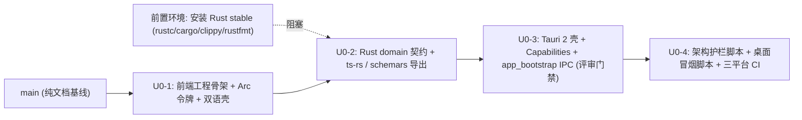

# U0「工程骨架与契约」实施计划

> 历史记录。U0 已在 `954a930`、`eda2f24`、`3dae58c` 和 `86d3c4a` 交付。后续执行见 [U2 至 U14 多阶段实施计划](./u2-u14-multi-phase-plan.md)。
> 对齐基线：[ARCHITECTURE.md](./ARCHITECTURE.md)（v1.0）、[PRD.md](../prd/PRD.md)（v3.1）、[prd-stories.json](../prd/prd-stories.json)、[design-system.md](../design/design-system.md)（v3.2 B 定稿）、[tokens.css](../design/tokens.css)、[tailwind.config.js](../design/tailwind.config.js)

本计划把 [ARCHITECTURE.md](./ARCHITECTURE.md) 第 7 节的 `U0`（Wave 0 · 骨架与契约）拆解为 4 个小而可独立验证的 PR。每个 PR 只交付一项可核验改动，包含依赖、允许修改的文件集合、单测命令、真实运行验证、性能门禁和评审关卡。

## 1. 变更总览与 PR 落地顺序

落地顺序为 `U0-1`、`U0-2`、`U0-3`、`U0-4`。

| PR 编号 | 目标 | 分支起点 | 前置依赖 | 人工评审门禁 |
|---|---|---|---|---|
| `U0-1` | 前端 Vite、React 19、TypeScript、Tailwind v3、Arc UI 令牌与双语最小壳 | `main` | 无（可立即启动，不依赖 Rust） | 否 |
| `U0-2` | Rust `domain/` 纯领域契约与 `ts-rs`、`schemars` 单源导出 | 基于 `U0-1` | `U0-1` + 本机安装 Rust stable | 否 |
| `U0-3` | Tauri 2 桌面壳、最小 Capabilities、`single-instance`、`app_bootstrap` IPC 与真实桌面启动 | 基于 `U0-2` | `U0-2` | 是（锁定应用 ID、窗口尺寸、CSP 与 Capabilities） |
| `U0-4` | 架构边界检查脚本、Schema 夹具校验、桌面冒烟脚本与三平台 GitHub Actions CI | 基于 `U0-3` | `U0-3` | 否 |

### 依赖图与文件所有权



文件边界约定如下。

- `U0-1` 仅触及根目录前端构建配置、`.gitignore`、`index.html`、`src/main.tsx`、`src/App.tsx`、`src/styles/`、`src/i18n/`、`scripts/check-tokens-sync.mjs`。
- `U0-2` 仅触及 `src-tauri/Cargo.toml`、`src-tauri/Cargo.lock`、`src-tauri/src/lib.rs`、`src-tauri/src/domain/`、`src-tauri/tests/export_contracts.rs`、`src/lib/ipc/generated.ts`、`schemas/*.schema.json`。
- `U0-3` 触及 `src-tauri/` 桌面运行时配置与入口（`build.rs`、`tauri.conf.json`、`capabilities/default.json`、`icons/`、`src/main.rs`、`src/lib.rs`、`src/session/`、`src/ipc/`）、前端 `src/lib/ipc/{client,events}.ts`、`src/App.tsx` 与 `package.json` 中的 Tauri 依赖。
- `U0-4` 触及 `scripts/`、`.github/workflows/ci.yml`、`package.json` 校验脚本入口，以及按 [ARCHITECTURE.md](./ARCHITECTURE.md) 第 8 节登记 U0 架构偏差记录。

---

## 2. 现有文档间影响 U0 的差异核对

实施 U0 之前，先消解现有文档与本机环境的 8 处具体差异。以下结论均来自直接读取仓库文件与本机命令实测。

| 编号 | 冲突来源与定位 | 差异内容 | 对 U0 的影响与裁决 |
|---|---|---|---|
| D1 | [ARCHITECTURE.md](./ARCHITECTURE.md) §2.1（L94 至 L97）vs §3.2（L440）vs §3.4.1（L458 至 L503）vs [prd-stories.json](../prd/prd-stories.json) `US-001`（L14） | `US-001` 与 [PRODUCT.md](../../PRODUCT.md) 只列了 `.codelab/` 下 3 个文件（`workspace.json`、`progress.json`、`metrics.json`）。`ARCHITECTURE.md` §3.4.1 新增了第 4 个文件 `chat.json`（供 `US-018` 清空对话）。同时 `ARCHITECTURE.md` §2.1 在 `schemas/` 下只列出 3 个文件，但 §3.2 要求为 `CourseManifest`、`ChecksSpec` 及 `.codelab/*.json` 全部派生 `JsonSchema`。 | U0 在 `domain/` 中定义全部 6 个结构，在 `schemas/` 下导出 6 个文件：`codelab-pack.v1.schema.json`、`codelab-checks.v1.schema.json`、`workspace-meta.v1.schema.json`（对应 `workspace.json`）、`workspace-progress.v1.schema.json`、`workspace-metrics.v1.schema.json`、`workspace-chat.v1.schema.json`。该方案同时满足 `US-001` 与 §3.2，并避免 U1 返工导出器。 |
| D2 | [PRD.md](../prd/PRD.md) §4 M1（L80）与 [ARCHITECTURE.md](./ARCHITECTURE.md) §3.4.2（L509）vs §3.4.1（L466, L484） | 课程包文件 `codelab.json` 和 `.codelab-checks.json` 的 `schemaVersion` 是字符串 `"1.0"`。工作区与全局本地文件（`workspace.json`、`progress.json`、`metrics.json`、`chat.json`、`config.json`、`trusted_packs.json`、`manifest.json`）的 `schemaVersion` 是整数 `1`。 | U0 在 `domain/` 中显式拆分两种版本类型：`PackSchemaVersion`（序列化为字面量 `"1.0"`）与 `StorageSchemaVersion`（序列化为整数 `1`），防止混用导致外部课程包解析失败。 |
| D3 | [docs/design/tailwind.config.js](../design/tailwind.config.js)（L1 至 L85）vs [docs/design/tokens.css](../design/tokens.css) vs [docs/design/design-system.md](../design/design-system.md)（L27）vs [docs/design/prototype/index.html](../design/prototype/index.html)（L53, L75 至 L113, L868） | 1. `tailwind.config.js` 是 Tailwind v3 CJS 语法且缺少 `content` 扫描路径。2. `tokens.css` 的 `--tabbar-h`（`36px`）、`--border`（Light `92.5%` / Dark `29%`）、`--badge-tint`（Light `10%`）与 `design-system.md` 表格及原型内联值存在微差，而原型在 L868 后置加载 `../tokens.css` 覆盖了内联值。3. `--overlay-scrim` 仅存在于原型内联样式，未写入 `tokens.css`。4. `tailwind.config.js` 使用 `--focus-outline`，原型使用 `--focus-ring`。 | 1. U0 锁定 `tailwindcss@^3.4` 直接复用 `docs/design/tailwind.config.js` 并补齐 `content`。2. `src/styles/tokens.css` 与 `docs/design/tokens.css` 保持字节一致，由脚本防漂移。3. `--overlay-scrim` 等仅组件层需要的变量放在 `src/styles/workbench.css`，并统一聚焦环变量为 `tokens.css` 的 `--focus-outline`。 |
| D4 | [docs/design/prototype/index.html](../design/prototype/index.html)（L8 至 L10）vs [PRD.md](../prd/PRD.md) §1（L14）与 [ARCHITECTURE.md](./ARCHITECTURE.md) §2.1（L105） | 交互原型通过外链 `https://fonts.googleapis.com` 加载 Geist、Inter、JetBrains Mono。PRD 要求 100% 离线可用，`ARCHITECTURE.md` 要求 `tauri.conf.json` 配置严格 CSP。 | U0 的 `index.html` 禁止外链 `fonts.googleapis.com`，先使用 `tokens.css` 已定义的本地系统字体回退栈，确保严格 CSP 与完全离线冷启动。若后续需要捆绑本地字体包（`@fontsource`），放到 Wave 4 的 `U9` 决定，不拖慢 U0。 |
| D5 | [ARCHITECTURE.md](./ARCHITECTURE.md) §1.3（L82）与 Tauri 2 真实插件权限机制 | §1.3 将 `single-instance` 写进了 `capabilities/default.json` 权限列表。在 Tauri 2 中，`tauri-plugin-single-instance` 是纯 Rust 启动期插件，没有前端 capability 权限标识，写入 `capabilities/default.json` 会导致 `tauri-build` 编译报错。同时 `opener:allow-open-url` 需显式配置 `http://` 与 `https://` scope 白名单。 | `tauri-plugin-single-instance` 在 `src-tauri/src/lib.rs` 中作为第一个桌面插件注册，不写入 `capabilities/default.json`。`capabilities/default.json` 仅保留 `core:default`、`dialog:allow-open`、带 `http/https` scope 的 `opener:allow-open-url` 与 `window-state:default`。该修正须同步登记到 `ARCHITECTURE.md` 第 8 节偏差表。 |
| D6 | [ARCHITECTURE.md](./ARCHITECTURE.md) §3.2（L439）与 `ts-rs` 默认行为 | §3.2 要求 `cargo test export_bindings` 生成单一文件 `src/lib/ipc/generated.ts`。`ts-rs` 默认每个类型输出一个 `.ts` 文件，多类型指向同一路径并发导出会发生文件覆写竞态。 | U0 在 `src-tauri/tests/export_contracts.rs` 中实现单一确定性导出测试 `export_bindings`，按固定拓扑顺序拼接各导出类型的 `TS::decl()` 并原子写入单一 `src/lib/ipc/generated.ts`，确保跨平台字节级确定。 |
| D7 | [ARCHITECTURE.md](./ARCHITECTURE.md) §2.1（L235）与 §5.5（L678）vs U0 最小边界 | §2.1 要求 `vite.config.ts` 用 `manualChunks` 拆分 `monaco-editor` 和 `@xterm/xterm`。但 Monaco 与 xterm 属于 Wave 4（`U10`、`U12`）。 | U0 不安装 `monaco-editor` 和 `@xterm/xterm`，避免无用依赖拖慢构建与冷启动测量。`vite.config.ts` 仅配置基础 React vendor 分包与预留分包函数，待 `U10`、`U12` 引入时接入。 |
| D8 | [prd-stories.json](../prd/prd-stories.json) `US-001` vs [ARCHITECTURE.md](./ARCHITECTURE.md) §7（L724 至 L725）及本机工具链实测 | 1. `US-001` 将脚手架与 `.codelab/` 原子存储合为一条故事，`ARCHITECTURE.md` 拆为 `U0` 与 `U1`。2. [PRODUCT.md](../../PRODUCT.md)（L86）把双语默认检测标为未决，但 `ARCHITECTURE.md` §5.5（L682）已确定按系统 Locale 自动匹配 `zh-CN` 或 `en-US`。3. 本机实测具备 `node v26.13.0`、`pnpm 12.16.1`、`bun 1.4.4` 与 Xcode CLT，但**缺少 `rustc`、`cargo`、`rustup`**。4. 现有 `.gitignore` 未忽略 `node_modules/`、`dist/`、`src-tauri/target/`。 | 1. U0 完成后 `prd-stories.json` 中 `US-001.passes` 保持 `false`，待 `U1` 落地持久化与恢复测试后置 `true`。2. 前端包管理器锁定 `pnpm`。3. 双语默认检测按 `ARCHITECTURE.md` §5.5 执行。4. `U0-2` 执行前必须先在本机安装 Rust stable。5. `U0-1` 首先补齐 `.gitignore`。 |

---

## 3. 前置环境准备（`U0-2` 开始前）

以下为启动 `U0-2` 时的前置检查。

- [ ] 安装 Rust stable 工具链（`rustup`、`rustc`、`cargo`、`rustfmt`、`clippy`）。
- [ ] 验证版本命令：`rustc -V && cargo -V && cargo clippy -V && rustfmt -V && pnpm -v && node -v`。
- [ ] 确认 `git status` 对未提交的 `docs/architecture/` 与 `todo.md` 已有明确归属（先提交或留在基线分支），避免 `U0` 的 `git diff --exit-code` 检查混入无关变更。

---

## 4. 分 PR 实施清单

### PR `U0-1`：前端 Vite + React 19 + TypeScript + Tailwind v3 + Arc UI 令牌与双语最小壳

- **依赖检查**
  - [ ] 直接从 `main` 分支切出，无前置代码 PR，不依赖本机 Rust 工具链。
- **涉及文件**
  - [ ] 修改 `.gitignore`（追加 `node_modules/`、`dist/`、`src-tauri/target/`、`src-tauri/gen/`、`.audit/`、`*.tsbuildinfo`）
  - [ ] 新增 `package.json`、`pnpm-lock.yaml`（依赖仅限 `react`、`react-dom`、Vite、TypeScript、`tailwindcss@^3.4`、`postcss`、`autoprefixer`、`vitest`、`@types/react`、`@types/react-dom`）
  - [ ] 新增 `tsconfig.json`、`tsconfig.node.json`（开启 `strict: true`、`noUncheckedIndexedAccess: true`、`noUnusedLocals: true`、`noUnusedParameters: true`）
  - [ ] 新增 `vite.config.ts`（固定 `server.port = 1420`、`strictPort = true`，配置基础 vendor `manualChunks` 预留位，不引入 Monaco 与 xterm）
  - [ ] 新增 `postcss.config.cjs`、`tailwind.config.js`（复用 [docs/design/tailwind.config.js](../design/tailwind.config.js)，补齐 `content: ['./index.html', './src/**/*.{ts,tsx}']`）
  - [ ] 新增 `index.html`（无 Google Fonts 外链，内联最小首帧主题脚本同步设置 `<html data-theme data-accent>` 防止闪白）
  - [ ] 新增 `src/styles/tokens.css`（从 [docs/design/tokens.css](../design/tokens.css) 完整同步）、`src/styles/workbench.css`（`@tailwind` 指令、基础画布、`:focus-visible` 使用 `var(--focus-outline)`、`--overlay-scrim`、`prefers-reduced-motion`）
  - [ ] 新增 `src/i18n/index.ts`、`src/i18n/zh-CN.ts`、`src/i18n/en-US.ts`、`src/i18n/__tests__/i18n.test.ts`（`satisfies Record<MessageKey, string>` 仅含 U0 壳体与通用错误键）
  - [ ] 新增 `src/main.tsx`、`src/App.tsx`（最小验证壳，展示应用名称、当前语言、主题和视口尺寸，不含首页或工作台业务 UI）
  - [ ] 新增 `vitest.config.ts`、`scripts/check-tokens-sync.mjs`
- **交付的单一改动**
  - [ ] 建立纯前端可构建、可测试、严格遵循 Arc UI v3.2 令牌与离线约束的 React + Vite + Tailwind v3 基础工程。
- **预期可见结果**
  - [ ] 浏览器打开 `http://127.0.0.1:1420` 渲染零外部网络请求的纯中性白底壳页，切换 `data-theme` 与 `data-accent` 实时变更 CSS 变量，零控制台报错。
- **验收门禁**
  - [ ] **Unit**：在独立 worktree 执行以下命令全部退出码为 `0`：
    ```bash
    pnpm install --frozen-lockfile
    pnpm exec tsc --noEmit
    pnpm test
    node scripts/check-tokens-sync.mjs
    pnpm build
    ```
  - [ ] **Live**：通过本地命令启动 `pnpm dev --host 127.0.0.1 --port 1420`，使用 Headless Chrome 驱动真实页面（`1440x900` 与 `1024x720`），验证场景与通过谓词：页面渲染标题文本、控制台 `error` 数为 `0`、网络请求中外部域名数为 `0`、计算样式 `--background` 与 `--accent` 在浅深主题及 `data-accent="violet"` 下与 `docs/design/tokens.css` 一致。验证完毕关闭 dev server。
  - [ ] **Perf**：指标为生产构建 `dist/assets/*.js` 与 `*.css` 的 gzip 总大小及 `pnpm build` 耗时。探针为 `pnpm build` 输出与 `gzip -c dist/assets/* | wc -c`。本 PR 建立 trunk 基线；若 gzip 总大小超过 `150 KB` 或产生任何外部字体网络请求则不通过。

---

### PR `U0-2`：Rust `domain/` 纯领域契约层与 `ts-rs` + `schemars` 单源导出

- **依赖检查**
  - [ ] 依赖 `U0-1` 合入，且本机已安装 Rust stable 工具链。
- **涉及文件**
  - [ ] 新增 `src-tauri/Cargo.toml`、`src-tauri/Cargo.lock`（本 PR 仅引入领域与序列化依赖：`serde`、`serde_json`、`ts-rs`、`schemars`、`thiserror`，`domain` 保持零 Tauri、Tokio、OS 进程或网络 IO 依赖）
  - [ ] 新增 `src-tauri/src/lib.rs`（仅导出 `pub mod domain;`）
  - [ ] 新增 `src-tauri/src/domain/mod.rs`
  - [ ] 新增 `src-tauri/src/domain/ids.rs`（`SessionEpoch`、`ChapterId`、`TerminalId`、`CommandBlockId`、`RunId`、`RelWorkspacePath` 含 `#[serde(try_from = "String", into = "String")]` 校验、`CanonicalWorkspacePath` 不实现 `Deserialize`、`RiskConfirmationToken`）
  - [ ] 新增 `src-tauri/src/domain/error.rs`（23 项 `ErrorCode` 与 `AppError { code, message_key, params, detail, retryable }`）
  - [ ] 新增 `src-tauri/src/domain/events.rs`（`SessionEventEnvelope<T>` 及 §4.2 全部 6 类广播事件载荷类型）
  - [ ] 新增 `src-tauri/src/domain/workspace.rs`（`StorageSchemaVersion`、`WorkspaceMeta`、`ProgressState`、`FileNode`、`ChatHistory`、`GlobalConfigView`、`GlobalConfigPatch`、`BootstrapState`、`Locale`、`ThemeMode`、`AccentPreset`）
  - [ ] 新增 `src-tauri/src/domain/course.rs`（`PackSchemaVersion` 固定 `"1.0"`、`CourseManifest`、`ChecksSpec` 兼容多章与单章试跑及 4 类 check 判别联合、`MarkdownNode`、`CommandBlock`、`ParsedCourse`）
  - [ ] 新增 `src-tauri/src/domain/metrics.rs`（精确 13 项封闭 `MetricEvent` 枚举与 `MetricsLog`）
  - [ ] 新增 `src-tauri/src/domain/{runtime,pty,grading,lsp,ai}.rs`（仅定义 [ARCHITECTURE.md](./ARCHITECTURE.md) §3.1 跨边界核心 DTO 与状态枚举，零业务逻辑）
  - [ ] 新增 `src-tauri/tests/export_contracts.rs`（单一确定性 `export_bindings` 与 `export_schemas` 测试，写出并校验契约文件）
  - [ ] 生成 `src/lib/ipc/generated.ts`（自动生成，禁止手改）
  - [ ] 生成 `schemas/codelab-pack.v1.schema.json`、`schemas/codelab-checks.v1.schema.json`、`schemas/workspace-meta.v1.schema.json`、`schemas/workspace-progress.v1.schema.json`、`schemas/workspace-metrics.v1.schema.json`、`schemas/workspace-chat.v1.schema.json`
  - [ ] 新增 `scripts/validate-schemas.mjs`（用 JSON Schema 校验 `PRD.md` 与 `ARCHITECTURE.md` 中的示例 JSON）
- **交付的单一改动**
  - [ ] 建立 Rust 作为唯一类型源的 `domain/` 模块，打通 `Rust -> src/lib/ipc/generated.ts` 与 `Rust -> schemas/*.schema.json` 两条确定性派生链路。
- **预期可见结果**
  - [ ] 运行导出命令后，`src/lib/ipc/generated.ts` 与 6 个 `schemas/*.schema.json` 无手工修改即可通过 `tsc --noEmit` 与示例 JSON 校验；连续两次运行产物哈希完全一致。
- **验收门禁**
  - [ ] **Unit**：在独立 worktree 执行以下命令全部退出码为 `0`：
    ```bash
    cargo test --manifest-path src-tauri/Cargo.toml
    cargo clippy --manifest-path src-tauri/Cargo.toml --all-targets -- -D warnings
    cargo fmt --manifest-path src-tauri/Cargo.toml -- --check
    git diff --exit-code src/lib/ipc/generated.ts schemas/
    pnpm exec tsc --noEmit
    ```
    单测必须覆盖：`RelWorkspacePath` 拒绝 `../`、`/etc/passwd`、`a\b`、`.`、`""`、NUL 字节、Windows 保留名 `CON`/`NUL`/`COM1`/`LPT9`；`CanonicalWorkspacePath` 不允许直接反序列化伪造；`MetricEvent` 变体数精确等于 `13`；`PackSchemaVersion` 仅接受 `"1.0"` 而 `StorageSchemaVersion` 仅接受整数 `1`。
  - [ ] **Live**：在 worktree 执行真实契约导出与夹具校验命令：
    ```bash
    cargo test --manifest-path src-tauri/Cargo.toml --test export_contracts export_bindings -- --exact
    cargo test --manifest-path src-tauri/Cargo.toml --test export_contracts export_schemas -- --exact
    node scripts/validate-schemas.mjs
    ```
    通过谓词：`PRD.md` 中的 `.codelab-checks.json` 示例和 `ARCHITECTURE.md` 中的 `workspace.json`、`progress.json` 示例全部通过 Schema 校验，且非法样本（如把 `"schemaVersion": "1.0"` 写成 `2` 或把未知 check type 填入）被明确拒绝并打印精确字段错误。
  - [ ] **Perf**：指标为契约测试套件执行耗时与导出确定性。探针为连续两次执行 `export_bindings` + `export_schemas` 并比对 `shasum -a 256 src/lib/ipc/generated.ts schemas/*.schema.json`。基线在 `U0-2` 首次实测登记；若两次哈希存在任何差异或热运行耗时超过 `5s` 则不通过。

---

### PR `U0-3`：Tauri 2 桌面壳、最小 Capabilities、`single-instance` 与 `app_bootstrap` IPC 闭环（人工评审门禁）

- **依赖检查**
  - [ ] 依赖 `U0-2` 合入。
- **涉及文件**
  - [ ] 修改 `src-tauri/Cargo.toml`、`src-tauri/Cargo.lock`（新增 `tauri` v2、`tauri-build`、`tauri-plugin-single-instance`、`tauri-plugin-dialog`、`tauri-plugin-opener`、`tauri-plugin-window-state`、`sys-locale` 或系统 Locale 探测、`tokio`；严禁添加 `tauri-plugin-fs`、`tauri-plugin-shell`、`tauri-plugin-http`）
  - [ ] 新增 `src-tauri/build.rs`
  - [ ] 新增 `src-tauri/tauri.conf.json`（`identifier: "studio.codelab.desktop"`，主窗口 `label: "main"`、`width: 1440`、`height: 900`、`minWidth: 1024`、`minHeight: 720`、`resizable: true`，`devUrl: "http://127.0.0.1:1420"`，`frontendDist: "../dist"`，严格 CSP）
  - [ ] 新增 `src-tauri/capabilities/default.json`（仅授权主窗口 `main`：`core:default`、`dialog:allow-open`、仅限 `http://*` 与 `https://*` scope 的 `opener:allow-open-url`、`window-state:default`）
  - [ ] 新增 `src-tauri/icons/`（基于原型品牌 SVG 生成桌面图标集）
  - [ ] 新增 `src-tauri/src/main.rs`（桌面入口委托至 `codelab_studio_lib::run()`）
  - [ ] 修改 `src-tauri/src/lib.rs`（按 Tauri 2 规范首个注册 `#[cfg(desktop)] tauri_plugin_single_instance`，注册其余 3 个最小插件，挂载 `AppState`，挂接 `RunEvent::ExitRequested` 清理钩子预留位，注册唯一命令 `app_bootstrap`）
  - [ ] 新增 `src-tauri/src/session/mod.rs`、`src-tauri/src/session/app_state.rs`（最小 `AppState`：`current_epoch: AtomicU64`、`pending_metrics` 有界内存队列占位、供 U1 接入的 `ActiveSessionSlot` 空槽位；零磁盘读写）
  - [ ] 新增 `src-tauri/src/ipc/mod.rs`、`src-tauri/src/ipc/bootstrap_cmd.rs`（薄命令 `app_bootstrap() -> Result<BootstrapState, AppError>`，记录内存态 `MetricEvent::AppLaunched` 占位并返回检测到的 `locale` 与初始 `epoch: 0`）
  - [ ] 修改 `package.json`、`pnpm-lock.yaml`（新增 `@tauri-apps/api` 与开发依赖 `@tauri-apps/cli`）
  - [ ] 新增 `src/lib/ipc/client.ts`（前端唯一允许导入 `@tauri-apps/api/core` 的门面，导出强类型 `appBootstrap()`）
  - [ ] 新增 `src/lib/ipc/events.ts`、`src/lib/ipc/__tests__/events.test.ts`（前端唯一允许导入 `@tauri-apps/api/event` 的门面，实现按 `activeEpoch` 自动丢弃陈旧 `SessionEventEnvelope` 的订阅器）
  - [ ] 修改 `src/App.tsx`（挂载时调用 `appBootstrap()`，展示返回的 `locale`、`epoch` 与当前窗口宽高，并输出首帧冷启动打点）
- **交付的单一改动**
  - [ ] 把前端最小壳与 Rust 契约封装为可真实启动的 Tauri 2 桌面应用，打通首个强类型 IPC 命令、事件 epoch 过滤门面、最小权限集与单实例聚焦机制。
- **预期可见结果**
  - [ ] macOS 上真实弹出 `1440x900` 桌面窗口，无法缩至 `1024x720` 以下；窗口内显示来自 Rust `app_bootstrap` 的真实 `locale` 和 `epoch = 0`；再次启动第二个进程时自动聚焦原窗口并退出新进程。
- **验收门禁**
  - [ ] **Unit**：在独立 worktree 执行以下命令全部退出码为 `0`：
    ```bash
    cargo test --manifest-path src-tauri/Cargo.toml
    cargo clippy --manifest-path src-tauri/Cargo.toml --all-targets -- -D warnings
    pnpm exec tsc --noEmit
    pnpm test
    pnpm build
    ```
    单测必须验证 `events.ts` 收到 `epoch < activeEpoch` 的事件时静默丢弃、收到 `epoch === activeEpoch` 时准确投递；`app_bootstrap` 在 Rust 单元测试中返回合法 `BootstrapState`。
  - [ ] **Live**：执行第 5 节「真实桌面启动的验证方式」全部 6 项检查并保留终端输出日志。
  - [ ] **Perf**：指标为桌面冷启动耗时（进程启动至 WebView 首帧 `rAF` 且 `app_bootstrap` 解析完成）与空壳常驻内存 RSS。探针为启动 release 或无 bundle 二进制记录 `startup_ms` 并用 `ps -o rss= -p <pid>` 连续采样 3 次取中位数。以本 PR 首次实测值作 trunk 基线；若 release 冷启动 `> 2000ms`（PRD 硬指标）或空壳 RSS `> 150 MB`（须为后续 Monaco、xterm、业务状态留足 `>= 200 MB` 空间，以守住 `350 MB` 上限）则不通过。
- **人工评审门禁**
  - [ ] 等待操作者审阅 `src-tauri/tauri.conf.json`（应用 identifier、窗口尺寸、CSP）、`src-tauri/capabilities/default.json` 及真实桌面窗口启动表现后再合入。

---

### PR `U0-4`：结构性边界护栏、桌面冒烟脚本与三平台 CI 流水线

- **依赖检查**
  - [ ] 依赖 `U0-3` 合入。
- **涉及文件**
  - [ ] 新增 `scripts/check-architecture-guards.mjs`（编码 5 条结构规则：禁止 `src/lib/ipc/` 之外导入 `@tauri-apps/*`；禁止前端出现 `dangerouslySetInnerHTML`；禁止 `Cargo.toml` 与 `capabilities/` 注册 `tauri-plugin-fs` / `tauri-plugin-shell` / `tauri-plugin-http`；禁止 `src-tauri/src/domain/` 导入 `tauri`、`tokio`、`std::fs`、`std::process`、`reqwest`；校验 `src/styles/tokens.css` 与 `docs/design/tokens.css` 一致）
  - [ ] 新增 `scripts/verify-u0-desktop.sh`（将第 5 节的 macOS 真实桌面冒烟检查固化为可重跑脚本）
  - [ ] 新增 `.github/workflows/ci.yml`（`macos-latest`、`windows-latest`、`ubuntu-latest` 三平台矩阵，运行前端类型检查/单测/构建、Rust 格式/Clippy/单测、`export_bindings` + `export_schemas` 漂移检测、`validate-schemas.mjs`、`check-architecture-guards.mjs` 与 `cargo check`）
  - [ ] 修改 `package.json`（新增 `check:guards`、`check:schemas`、`check:contracts`、`check:all` 聚合命令）
  - [ ] 修改 [docs/architecture/ARCHITECTURE.md](./ARCHITECTURE.md) 第 8 节（登记 U0 经评审确认的调整项：`single-instance` 纯 Rust 注册、`schemas/` 6 文件列表、Tailwind v3.4 锁定与离线字体策略）
- **交付的单一改动**
  - [ ] 把架构边界与契约防漂移规则编码为本地和三平台 CI 自动执行的强制门禁。
- **预期可见结果**
  - [ ] 本地运行 `pnpm run check:all` 全绿通过；故意引入任意一条违规代码时对应护栏脚本以非零退出码报错并指出具体文件与行号。
- **验收门禁**
  - [ ] **Unit**：执行 `pnpm run check:all` 退出码 `0`；并在临时验证中逐条注入违规样本（例如临时在 `src/App.tsx` 导入 `@tauri-apps/api/core`、在 `generated.ts` 末尾加空行、在 `Cargo.toml` 加入 `tauri-plugin-fs`），确认每条规则都按预期失败并给出明确 diff，验证后恢复工作树干净。
  - [ ] **Live**：在 worktree 中执行 `bash scripts/verify-u0-desktop.sh` 驱动真实构建后的 macOS 桌面二进制，验证退出码为 `0` 且进程退出后无残留子进程。若已推送到 GitHub 远端，同时核查三平台 CI workflow 结果。
  - [ ] **Perf**：指标为 `pnpm run check:all` 本地热运行总耗时。探针为 `time pnpm run check:all`。本 PR 建立基线；若热运行总耗时超过 `45s` 或检查后留下未跟踪或被修改的文件（`git status --porcelain` 非空）则不通过。

---

## 5. 真实桌面启动的验证方式（U0 必过实机流程）

单靠 `cargo check`、`tsc --noEmit` 和 `pnpm build` 不能证明 Tauri 2 桌面壳可真实运行。`U0-3` 与 `U0-4` 必须在本机 macOS 上按以下可复现步骤驱动真实桌面可执行文件，并记录原始命令输出。

### 5.1 构建真实可执行桌面程序

```bash
pnpm build
pnpm tauri build --debug --no-bundle
# 产出可执行文件：src-tauri/target/debug/codelab-studio
# 性能冷启动基线测量使用 release 构建：
pnpm tauri build --no-bundle
# 产出可执行文件：src-tauri/target/release/codelab-studio
```

### 5.2 六项真实运行检查（由 `scripts/verify-u0-desktop.sh` 封装并可手工复核）

1. **进程启动与窗口几何下限验证（`>= 1024x720`）**
   - 直接拉起 `src-tauri/target/debug/codelab-studio`（或 `pnpm tauri dev`），等待窗口注册。
   - 在 macOS 上通过 `osascript` 查询主窗口尺寸并尝试缩小至 `800x600`，断言实际窗口宽高初始为 `1440x900` 且缩小后被操作系统强制钳制在 `>= 1024` 与 `>= 720`。
2. **首帧 `app_bootstrap` IPC 与 CSP 零报错验证**
   - 壳体在启动完成时将结构化启动摘要（`{ startupMs, locale, epoch, innerWidth, innerHeight, theme, accent }`）打印到 Rust 侧标准输出（通过轻量启动完成标记或 debug 日志），确认 `app_bootstrap` 真实穿过 Tauri IPC 返回且 WebView 完成首帧绘制，无 CSP 拦截报错，无外部字体网络请求。
3. **单实例（`single-instance`）验证**
   - 在第一个进程存活时，再次启动同一个可执行文件 `src-tauri/target/debug/codelab-studio`。
   - 验证第二个进程在 2 秒内自动退出，`pgrep -x codelab-studio | wc -l` 保持为 `1`，原窗口被置前激活。
4. **禁用插件 Fail-Closed 验证**
   - 通过自动化诊断或单元测试验证 `tauri-plugin-fs`、`tauri-plugin-shell`、`tauri-plugin-http` 未被注册，尝试调用 `plugin:fs|read_file` 或 `plugin:shell|execute` 必然被 Tauri 拒绝。
5. **干净退出与 0 残留子进程验证**
   - 向主进程发送优雅退出信号（`kill -TERM <pid>` 或 `osascript -e 'tell application "codelab-studio" to quit'`）。
   - 等待退出后检查 `pgrep -P <pid>` 与 `pgrep -x codelab-studio`，断言主进程与全部派生子进程残留数为 `0`。
6. **冷启动耗时与空壳内存采样**
   - 对 release 二进制连续冷启动 3 次，取中位数验证 `startupMs <= 2000`，并用 `ps -o rss= -p <pid>` 采样空壳常驻内存，断言 `RSS <= 150 MB`。

> Windows 与 Linux 平台说明：本机为 macOS，U0 阶段通过 `.github/workflows/ci.yml` 在 `windows-latest` 与 `ubuntu-latest` 验证编译、契约一致性和单测，两端的真实 GUI 桌面窗口启动验证留待三端实机或 Wave 5（`U14`）回归，在本计划中显式标记为当前未实测项。

---

## 6. 后续 U1 至 U3 接入边界（防止提前实现）

U0 的职责严格止步于「可启动的空桌面壳 + 稳定领域契约 + 边界护栏」。下表定义 U0 提供给 `U1`、`U2`、`U3` 的精确接入点，以及 U0 禁止越界实现的内容。

| 后续单元 | U0 预先提供的契约与接入点 | 后续单元自行实现的内容（U0 严禁提前实现） |
|---|---|---|
| **U1 · 存储与会话聚合根**（`US-001` 持久化） | 1. `domain/workspace.rs` 与 `domain/metrics.rs` 权威类型及 4 个 `.codelab/*.schema.json`。<br>2. `session/app_state.rs` 中的 `current_epoch: AtomicU64`、`PendingAppMetrics` 内存队列接口与 `ActiveSessionSlot` 空槽位。<br>3. `lib.rs` 中的 `RunEvent::ExitRequested` 挂钩位置。<br>4. `src/lib/ipc/events.ts` 的 `epoch` 过滤订阅器。 | 1. `storage/atomic_json.rs`（临时文件、`sync_all`、`.bak` 备份、`.corrupt.<ts>` 损坏恢复）。<br>2. `storage/{workspace_store,metrics_writer,global_store}.rs` 与 `platform/paths.rs` 的 `.codelab/.lock` 进程锁。<br>3. `session/workspace_session.rs` 的 `Idle -> TrustPending -> Opening -> Active -> Closing` 状态机与 3 秒关停屏障。<br>4. 将 `prd-stories.json` 中 `US-001.passes` 置为 `true`。 |
| **U2 · Markdown 解析与课程包加载**（`US-002`） | 1. `domain/course.rs` 中的 `CourseManifest`、`ChecksSpec`、`MarkdownNode`、`CommandBlock`、`ParsedCourse` 类型。<br>2. `schemas/codelab-pack.v1.schema.json` 与 `schemas/codelab-checks.v1.schema.json`。<br>3. `domain/error.rs` 中的 `MarkdownLimitExceeded`、`SchemaValidationFailed`、`ExternalPackUntrusted` 错误码。 | 1. 引入 `pulldown-cmark` 与 `ammonia` 实现 `course/markdown_parser.rs` 与 5 MB 体积守卫。<br>2. `course/step_extractor.rs` 三步流抽取及 `cwd`/`daemon` 推断。<br>3. `course/pack_loader.rs`（`starter/` 幂等注水）与 `course/git_importer.rs`（浅克隆加固与 LRU 缓存）。<br>4. `ipc/course_cmd.rs` 命令实现与 `builtin-courses/` 内置课程包夹具。 |
| **U3 · 沙箱文件系统与 500ms 监听**（`US-006`） | 1. `domain/ids.rs` 中的 `RelWorkspacePath`（反序列化边界守卫）与不可伪造的 `CanonicalWorkspacePath`（预留 `pub(crate)` 构造权限给 `workspace_fs`）。<br>2. `domain/events.rs` 中的 `FsDelta` 事件类型与 `workspace://fs-delta` 通道契约。<br>3. `domain/error.rs` 中的 `PathOutsideSandbox`、`FileTooLargeOrBinary`、`ExternalEditConflict`。 | 1. 引入 `dunce`、`notify`、`notify-debouncer-mini`、`blake3`。<br>2. `workspace_fs/sandbox.rs` 规范化路径沙箱、软链接阻断与 2 MB / 二进制守卫。<br>3. `workspace_fs/tree.rs` 与 `workspace_fs/watcher.rs`（150ms 防抖、`SelfWriteGuard`、外部 IDE 原子重命名归一化）。<br>4. `ipc/fs_cmd.rs` 与 `platform/ide_launcher.rs`。 |

### U0 明确禁止提前落地清单

在 `U0-1` 至 `U0-4` 中，以下内容一律不得出现：

- 不得写入任何 `~/.codelab/` 或 `<workspace>/.codelab/` 磁盘持久化代码。
- 不得安装 `monaco-editor`、`@xterm/xterm`、`zustand` 业务 Store，也不得编写 Welcome Home、三步手册、编辑器、终端、AI 抽屉或设置弹窗界面。
- 不得引入 `pulldown-cmark`、`ammonia`、`notify`、`portable-pty`、`reqwest`、`keyring`、`oxc_transformer` 等属于 Wave 1 至 Wave 3 的重型 Rust crate。
- 不得创建 `builtin-courses/` 课程内容，也不得修改 `docs/prd/prd-stories.json` 的 `passes` 字段。

---

## 7. 待操作者确认或留待后续验证的事项

1. **U0-2 的构建依赖。** Rust stable 工具链已用于 U0 至 U2 的构建与验证。
2. **包管理器与插件清单确认**：本计划默认前端使用 `pnpm`（本机已安装 `12.16.1`），并按 Tauri 2 真实机制把 `tauri-plugin-single-instance` 仅在 Rust 侧注册而不写入 `capabilities/default.json`、`schemas/` 导出 6 个 v1 文件。若希望调整包管理器或保留仅 3 个 Schema 文件，请在开跑前指示。
3. **跨平台真实桌面窗口启动**：本机为 macOS，Windows 与 Linux 的真实 GUI 窗口拉起与窗口最小尺寸钳制无法在 U0 本机实测，U0 阶段通过 GitHub Actions 三平台 CI 覆盖编译与单测，实机桌面启动留待对应平台环境验证。
