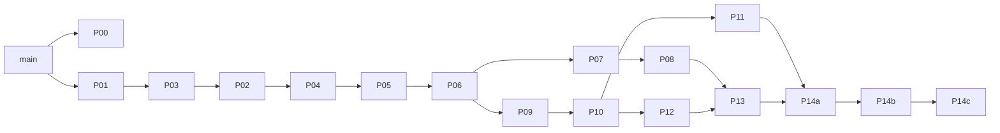

# U2 到 U14 多阶段实施计划

## 目标与边界

本计划把`2885e2e` 之后至 `U14` 的剩余工作拆成可独立签收的小 PR。每个 PR 只交付一个可观察变化，并在合并前完成单元、真实应用和性能三类证据。本文档只描述计划，不实现代码。

计划以 [ARCHITECTURE.md](./ARCHITECTURE.md) 第 7 节、[PRD.md](../prd/PRD.md) 第 4 至 6 节和 [prd-stories.json](../prd/prd-stories.json) 为需求来源。发生偏差时，先在对应 PR 中更新架构偏差记录，再继续下一 PR。

## 当前基线

### 已完成并有证据的交付

| 交付 | 当前事实 | 证据 |
|---|---|---|
| U0 工程骨架与契约 | 已合入 `954a930`、`eda2f24`、`3dae58c`、`86d3c4a`。Tauri 2 壳、React 工程、领域契约、6 个 Schema、架构护栏、桌面冒烟和三平台 CI 已存在。 | `.audit/u0-exec.todo.md`，`docs/architecture/u0-implementation-plan.md` |
| U1 存储与会话 | 已合入 `160558c`、`ac9b5df`。原子 JSON、`.bak` 与 `.corrupt` 恢复、4 个工作区文件、全局配置、指标单写器、`WorkspaceSession` 和 `SessionEpoch` 已存在。 | `.audit/u1-persistence.todo.md`，`src-tauri/tests/u1_persistence_verification.rs` |
| US-001 故事状态 | `passes` 为 `true`。 | `docs/prd/prd-stories.json` |
| `2885e2e` 的静态质量门禁 | 在 `2885e2e` 上 `pnpm run check:all` 通过。涵盖 TypeScript、Vite、Vitest、Rust、架构护栏、生成契约和 Schema。ts-rs 仍输出 `serde(try_from, into)` 兼容性警告。 | 本地 `.audit/u2-2-final-check.log` |
| U2-1 代码交付 | 已合入 `a030438` 和 `fff4646`。当前 `course/` 解析器、Go handbook fixture、三步流、HTML 清洗和 U2 验证测试已提交。桌面预览旅程留给 P01。 | `git log`、`src-tauri/src/course/`、`src-tauri/tests/u2_markdown_parser_verification.rs` |
| U2-2 代码交付 | `10b211b`、`2885e2e` 包含内置 Go/GoFrame 课程、本地目录与 Git 课程包加载、信任和 starter 处理，以及已注册的课程 IPC。Rust 集成测试已通过。 | `src-tauri/tests/u2_course_pack_verification.rs` |
| `2885e2e` 桌面冒烟 | macOS release 二进制通过 3 次隔离冷启动，启动中位数 235ms，RSS 最大值 102,320KB。真实 `app_bootstrap` 回包列出含 10 个练习章节的 Go/GoFrame 内置课程。清理验证确认宿主状态未变。 | 本地 `.audit/verify/u2-2-final-pack-smoke-20261123/`、`.audit/verify/u2-2-final-pack-live-20261123/` |
| U2-1 解析性能 | `fff4646` 的 release `inspect_markdown` 对真实 Go/GoFrame 手册 7 次运行的中位数为 0.440ms，输入 644 行、22,241 bytes。release 1,000 行 fixture 单测耗时 1.207ms。两个数字都低于 150ms 目标，后续仍需通过真实课程预览 IPC 复测。 | `fff4646` 的 `inspect_markdown --bench 7` 和 release U2 fixture 输出 |
| `fff4646` 的前端壳验证 | `fff4646` 的 `dist/` 通过 CDP 驱动。中英文切换、深色主题、蓝色强调色、刷新持久化、1024×720 调整均通过，外部请求数为 0，控制台错误数为 0，页面异常数为 0。 | `.audit/verify/u14-plan-u2-ui/` |
| `fff4646` 的配置重启验证 | `fff4646` 的 `doctor`、`drive-bootstrap-persist` 与 `cleanup` 均通过。重启读取已保存的 `en-US`，`epoch` 为 0。 | `.audit/verify/u14-plan-u2-persist/` |

### 未完成或未验证的交付

| 范围 | 状态 | 事实依据 |
|---|---|---|
| U2 / US-002 | 课程预览、信任确认与工作区绑定仍缺真实桌面旅程。`US-002.passes` 为 `false`。 | `src/App.tsx`、`src-tauri/src/ipc/course_cmd.rs`、`docs/prd/prd-stories.json` |
| U3 至 U13 | 尚未实现。当前已有 U2 `course` 子系统，仍没有 `workspace_fs`、`pty`、`runtime`、`grading`、`lsp`、`ai` 子系统，`src/App.tsx` 仍是 U0 验证壳。 | 当前源文件树和 `src/App.tsx` |
| US-002 至 US-018 | `passes` 均为 `false`。 | `docs/prd/prd-stories.json` |
| 工作区真实用户路径 | 未验证。Rust 层已覆盖创建、绑定、恢复和并发写入，但当前没有 `workspace_open` IPC、前端绑定控件或工作区级真实桌面旅程。 | `.agents/skills/verify/features/workspace-binding.md`，当前 `codelab-verify check-workspace-ui` 返回 `unmet_precondition` |
| 交互式设置持久化 | 未验证。当前 `App.tsx` 点击语言和主题只更新 React 状态与 `localStorage`，没有调用 `settings_update`。 | `.agents/skills/verify/features/desktop-bootstrap.md`，当前 `src/App.tsx` |
| Windows 与 Linux 实机 GUI | 未验证。现有 CI 只验证编译、测试和契约，U14 才增加三端真实桌面旅程。 | `docs/architecture/u0-implementation-plan.md` 第 5 节 |
| U14 全量离线与联网回归 | 未开始。四语言课程、进程树回收、350MB 内存上限和三端签收均没有当前证据。 | `ARCHITECTURE.md` U14 验收门禁 |

### P00 同步范围

| 文件 | 原有状态 | P00 同步内容 |
|---|---|---|
| `README.md` | 状态和目录说明停留在原型阶段。 | 记录 U0、U1 和 U2 后端的实现边界、桌面构建入口与后续计划。 |
| 本地 `PRODUCT.md` | 技术栈和证据清单停留在原型阶段。 | P00 改为当前实现边界，保留产品目标和未交付能力。 |
| `docs/architecture/arena-synthesis.md` | Phase F 记录架构检查。 | 明确架构检查的范围并链接故事验收状态。 |
| `docs/architecture/u0-implementation-plan.md` | 包含已完成前置条件的未勾选清单、旧的缺少 Rust 工具链结论和 U0 期间的未来时态。 | P00 增加历史计划标识和当前完成提交，避免把它当作待执行清单。 |
| 本地 `.agents/skills/verify/features/workspace-binding.md` | 以旧提交 `72f8d8d` 作为当前状态锚点。 | P00 改为基于能力探测的门禁。P03 更新为真实旅程。 |
| `.audit/u2-markdown-parser.todo.md` | 本地记录已随 `fff4646` 更新，解析器实现、验证与评审已勾选。 | 保留历史记录。P01 接入桌面入口，P02 补齐课程导入和信任的桌面旅程。 |
| `.audit/u1-persistence.todo.md` | `Target repo` 的 base commit 仍是 `86d3c4a`。 | 保留历史证据，不直接改写。P00 在状态索引中注明当前 HEAD。 |
| `docs/design/design-review.md` | 设计报告给出 9.75 分的完整业务闭环，但文中同时说明 AI 和终端仍是交互模拟。 | P00 把评分限定为原型设计评审，不作为生产功能证据。 |

## PR 落地顺序与依赖图

以下各组按推荐顺序合入。P00 与 P01 均可从包含 `2885e2e` 的 `main` 独立开工。表中的依赖是功能前置条件。共享 `Cargo.lock`、IPC 注册表或生成契约的 PR 依推荐顺序合入，合入前在最新父分支重跑检查。

1. 课程与工作区。P00、P01、P03、P02。沙箱和会话先于外部包 starter 写入。
2. 本地执行。P04、P05、P06。
3. AI 后端与工作台。P07、P08、P09、P10、P11、P12、P13。外观和首页可以与 AI 后端并行开发。
4. 发布验收。P14a、P14b、P14c。

| 顺序 | PR | 最早可用父分支或功能依赖 | 主要文件范围 |
|---:|---|---|---|
| 0 | P00 | `main@2885e2e` | 项目状态、架构历史和 verify 文档 |
| 1 | P01 | `main@2885e2e` | 已有课程预览 IPC 的前端接线、Markdown 打开入口 |
| 2 | P03 | P01 | 工作区绑定入口、`workspace_fs/` |
| 3 | P02 | P01、P03 | 课程来源选择、信任确认、starter 与 Git 缓存的实机验收 |
| 4 | P04 | P02、P03 | 进程树、PTY 路由与命令确认 |
| 5 | P05 | P04 | 运行时、Preflight 入口和安装 |
| 6 | P06 | P02、P04、P05 | 判题、验收入口与进度 |
| 7 | P07 | P03、P04、P06 | BYOK、上下文与钥匙串 |
| 8 | P08 | P07 | ACP 传输与权限门禁 |
| 9 | P09 | P02、P05、P06。共享文件按合入顺序同步 | 首页、外观和导入创作 |
| 10 | P10 | P03、P04、P06、P09 | 两栏工作台、文件树、Monaco 与 Diff |
| 11 | P11 | P05、P10 | LSP 与编辑器接线 |
| 12 | P12 | P04、P06、P10 | xterm 和判题结果 |
| 13 | P13 | P07、P08、P09、P10、P12 | 划词、AI 抽屉、设置与指标 |
| 14 | P14a | P11、P13 | 三端证据矩阵 |
| 15 | P14b | P14a | 内置课程与离线及联网回归 |
| 16 | P14c | P14b | 发布产物、签收和故事状态 |

交互评审覆盖 P01 至 P06、P09 至 P13，以及 P14b、P14c 的回归与签收。P07、P08 评审后台协议和权限，AI 的最终用户操作由 P13 签收。

在各 PR 的独立 worktree 中运行 `.agents/skills/verify/scripts/codelab-verify`。使用同一提交构建 release，隔离 `HOME`、`CODELAB_HOME` 和工作区，在同一进程环境按 launch、doctor、旅程、cleanup 顺序执行。桌面证据包含真实窗口、动作前后状态和必要的磁盘、网络及子进程记录。后端先行的盒子可通过验证构建的 WebView 驱动已注册的生产 IPC，保存实际回包及副作用。能力的用户操作留到对应界面交付。避免把验证入口装入发行包。浏览器 CDP 只补充 DOM、ARIA 和网络证据。新旅程名均为拟新增入口。

每个 PR 先在父分支运行相同探针。可比较时在同一机器和相同运行时、输入、缓存条件下交替测量，每侧至少 5 次，记录中位数、范围、错误数和限制因素。新功能在父分支缺失时，记录缺失出口及原因，另取一项可比回归指标，再应用该功能的绝对预算。只在可比指标上使用计划提出的 10% 回归线。波动大于差值时补测，不能判定时记录未决。PRD 预算独立生效。

## P00 文档状态同步

**覆盖范围** `US-001` 状态说明和项目执行入口。

### 依赖

- [ ] 以 `origin/main` 上的 `2885e2e` 为父提交。
- [ ] 确认 U2-1 的 `a030438` 和 `fff4646` 已在父分支，P00 不重新修改或复制这些源代码。
- [ ] 确认不修改 `src/`、`src-tauri/`、`schemas/` 和 `package.json`。

### 文件范围

- [ ] `README.md`
- [ ] 本地 `PRODUCT.md`（Git 忽略）
- [ ] `docs/design/design-review.md`
- [ ] `docs/architecture/arena-synthesis.md`
- [ ] `docs/architecture/u0-implementation-plan.md`
- [ ] 本地 `.agents/skills/verify/features/workspace-binding.md`（Git 忽略）
- [ ] `docs/architecture/u2-u14-multi-phase-plan.md`
- [ ] 不改写 `.audit/u0-*`、`.audit/u1-*` 的历史证据。

### 一个变化

- [ ] 把当前实现边界、故事状态、旧证据提交和未验证项写成可核对的事实。

### 单元证据

- [ ] `git diff --check` 通过。
- [ ] 用 Node 读取 `prd-stories.json`，确认恰有 1 条 `passes: true` 和 17 条 `passes: false`。
- [ ] `rg` 不再命中 README、PRODUCT 和 Arena 记录中的“尚无实现”或 `18/18` 交付断言。

### 真实应用证据

- [ ] 在该 worktree 构建当前 release 二进制，运行 `codelab-verify smoke --run-id <id> --build`。
- [ ] 通过条件是 3/3 冷启动、隔离配置有效、cleanup 报告宿主状态未改变。

### 性能证据

- [ ] 先测父分支 `pnpm run check:all` 的 5 次中位数和范围。
- [ ] 再测本 PR 的同一命令。
- [ ] 失败条件是命令失败、工作树出现非计划改动，或中位数相对父分支上升超过 10%。

### 合并条件

- [ ] 所有历史文档都明确标出历史状态或当前状态。
- [ ] 没有源代码改动。
- [ ] review 通过。

## P01 U2-1 解析器验收与课程预览 IPC

**覆盖范围** `US-002` 的 Markdown 解析、命令识别和章节三步流。

### 依赖

- [ ] 从 `main@2885e2e` 分支。
- [ ] 从已经包含 `a030438` 和 `fff4646` 的父分支开始。
- [ ] 保留 U1 的 `CourseManifest`、`ChecksSpec`、`MarkdownNode`、`CommandBlock` 和错误码契约。

### 文件范围

- [ ] `src/App.tsx`、`src/features/course-preview/`、`src/i18n/` 的本地 Markdown 打开和只读预览。
- [ ] `.agents/skills/verify/scripts/`、`.agents/skills/verify/features/` 的预览驱动。
- [ ] `src-tauri/src/ipc/course_cmd.rs` 的只读解析预览命令、`src-tauri/src/ipc/mod.rs` 和命令注册
- [ ] `src/lib/ipc/client.ts` 的解析预览调用和生成契约
- [ ] `src-tauri/tests/course_preview.rs` 与预览夹具。
- [ ] `src-tauri/tests/export_contracts.rs`、`src/lib/ipc/generated.ts` 和受影响 Schema

### 一个变化

- [ ] 复用 `course_inspect_source`，把已有 AST 解析、三步流和 HTML 清洗接到 Tauri 的 Markdown 文件选择和只读预览。

### 单元证据

- [ ] 保持 `cargo test --manifest-path src-tauri/Cargo.toml --test u2_markdown_parser_verification` 的 8 个场景通过，覆盖稳定章节 ID、代码块属性、`cd` 推断、Daemon 和 Oneshot 推断、自查项、5MB 限制、XSS 清洗和外部 HTML 兼容。
- [ ] 新增课程预览 IPC 的 Rust 和 TypeScript 测试，重新生成 `src/lib/ipc/generated.ts`，再让 `pnpm run check:all` 通过。
- [ ] 夹具对标题、代码块、链接、图片、列表、表格、`details` 和非法 HTML 做结果快照比较。

### 真实应用证据

- [ ] 保留 `inspect_markdown` 作为解析器诊断入口，并新增 `codelab-verify course-parse` 旅程。旅程必须启动真实 Tauri 二进制，通过注册的文件选择器和课程预览 IPC 解析受控 Markdown 夹具，不接受只运行 Rust 单测作为 live 证据。
- [ ] 夹具包含带属性和无属性的 `bash`、`sh`、`zsh` 围栏块，以及一个恶意 HTML 标签。
- [ ] 通过条件是章节顺序和节点数量稳定，命令的 `cwd`、角色和 `is_secondary` 符合夹具预期，恶意标签只作为文本出现。

### 性能证据

- [ ] 先在当前父分支运行现有 Rust fixture 探针，记录 U2-1 解析时间、中位数、范围、错误数和 CPU 或 I/O 限制因素。
- [ ] 用同一 Rust 解析探针对比前后 1,000 行样本。另计真实桌面从确认文件到预览可见的延迟，记录 P01 基线。
- [ ] 失败条件是解析中位数大于 150ms、结果校验失败，或探针没有实际消费完整 AST。

### 合并条件

- [ ] P01 不修改 `prd-stories.json` 的 `US-002.passes`。
- [ ] 课程预览 IPC 的所有源代码、fixture、生成文件和测试归属清晰，工作树只剩计划文档或下一 PR 明确声明的改动。
- [ ] 真实旅程证据和单测证据都保存到 `.audit/verify/<run-id>/`。
- [ ] review 通过。

## P03 U3 工作区绑定、沙箱与监听

**覆盖范围** `US-006`，以及真实工作区用户路径所需的 `workspace_open` IPC。

### 依赖

- [ ] P01 已合入。
- [ ] 使用 U1 的 `WorkspaceSession`、`SessionEpoch`、`WorkspaceStore` 和 `RelWorkspacePath`。

### 文件范围

- [ ] `src-tauri/src/workspace_fs/mod.rs`
- [ ] `src-tauri/src/workspace_fs/sandbox.rs`
- [ ] `src-tauri/src/workspace_fs/tree.rs`
- [ ] `src-tauri/src/workspace_fs/watcher.rs`
- [ ] `src-tauri/src/platform/ide_launcher.rs`
- [ ] `src-tauri/src/ipc/fs_cmd.rs`、`src-tauri/src/ipc/workspace_cmd.rs`
- [ ] `src-tauri/src/domain/events.rs`、`src-tauri/src/domain/error.rs`
- [ ] `src/lib/ipc/client.ts`、事件订阅和生成契约
- [ ] `src/App.tsx`、`src/features/workspace/` 与 i18n 的目录选择和已绑定状态
- [ ] `src-tauri/tests/workspace_fs.rs`、对应 verify feature 文件和脚本

### 一个变化

- [ ] 把工作区根、文件树、文件读写、外部修改冲突和 150ms 防抖事件接入会话，并在 IPC 边界阻断越界路径、外部软链、二进制和超过 2MB 的文件。

### 单元证据

- [ ] `cargo test --manifest-path src-tauri/Cargo.toml workspace_fs` 覆盖 `../`、绝对路径、反斜杠、NUL、Windows 保留名、软链、根目录删除、二进制和 2MB 上限。
- [ ] 测试 `SelfWriteGuard`、外部 IDE 原子重命名、忽略目录和 `ExternalEditConflict`。
- [ ] `pnpm run check:all` 通过。

### 真实应用证据

- [ ] 新增 `codelab-verify workspace-bind`，启动真实 Tauri，绑定隔离临时目录并检查 `<workspace>/.codelab/{workspace,progress,chat,metrics}.json`、`epoch` 和 `.lock`。
- [ ] 在应用运行中从外部进程修改一个打开文件，记录真实 IPC 收到的文件树增量，并以过期磁盘哈希验证写入冲突。脏草稿横幅在 P10 验证。
- [ ] 关闭工作区后通过磁盘检查确认锁可被重新获取，且无临时写入残留。

### 性能证据

- [ ] 先测父分支没有工作区旅程的基线，记录 `N/A` 和 `check-workspace-ui` 的退出码。
- [ ] 在 release 构建中对 100 次磁盘修改交替运行 5 轮，记录磁盘写入到 `fs-delta` 的中位数、范围、丢失事件和 watcher CPU。
- [ ] 失败条件是端到端同步超过 500ms、事件重复或丢失，或 `.git`、`node_modules`、`.codelab` 出现在文件树。

### 合并条件

- [ ] 通过真实目录选择、绑定、关闭、重开证明文件持久化和 epoch 变化。更新 workspace-binding 的验证步骤。
- [ ] `US-006` 的沙箱和监听验收全绿。
- [ ] review 通过。

## P02 U2 课程包加载与 Git 导入

**覆盖范围** `US-002` 的课程包、starter 注水、信任门禁和 Git 来源。

### 依赖

- [ ] P01 已通过解析门禁，P03 已交付工作区绑定和沙箱。
- [ ] 使用 P01 的 `ParsedCourse` 和现有的 `GlobalStore`、`WorkspaceStore`。

### 文件范围

- [ ] `src-tauri/src/course/pack_loader.rs`
- [ ] `src-tauri/src/course/git_importer.rs`
- [ ] `src-tauri/src/ipc/course_cmd.rs`、`src-tauri/src/ipc/mod.rs` 的课程包加载扩展
- [ ] `src/lib/ipc/client.ts` 和生成契约
- [ ] `src/features/course-preview/`、`src/features/workspace/` 的来源选择、信任确认和绑定
- [ ] `builtin-courses/` 的资源注册与 Go/GoFrame 源版本固定。四语言成品课程的责任见 P14b。
- [ ] `src-tauri/tests/course_pack.rs`、`src-tauri/tests/fixtures/course-packs/`
- [ ] `scripts/` 下的课程导入验证入口及对应 `.agents/skills/verify/features/course-pack.md`

### 一个变化

- [ ] 将 U2-2 的课程来源加载接到桌面入口。外部包先只读预览，经信任确认后绑定工作区，并按 `hydratedFiles` 幂等复制 starter 文件。

### 单元证据

- [ ] `cargo test --manifest-path src-tauri/Cargo.toml course_pack` 覆盖 `codelab.json`、`.codelab-checks.json`、缺省文件、Schema 失败、starter 重复执行、已删除文件和信任指纹。
- [ ] Git 测试覆盖允许协议、禁止协议、浅克隆参数、30 秒超时、100MB 限制、20 包和 500MB LRU 淘汰。
- [ ] `pnpm run check:all` 通过。

### 真实应用证据

- [ ] 新增 `codelab-verify course-import`，在真实 Tauri 应用中导入本地 Markdown 和本地课程包。
- [ ] 通过条件是第一次导入只读预览，确认后写入工作区，第二次导入不覆盖学习者改动，错误 Schema 阻止绑定。
- [ ] 通过受控的环回 Git 服务和版本固定夹具验证浅克隆和缓存，避免把网络可用性当作课程解析证据。

### 性能证据

- [ ] 先在父分支运行 `course-import` 探针并记录 `N/A`。
- [ ] 对本地包和已缓存 Git 包各运行 5 次，记录加载时间、缓存命中、错误数和磁盘占用。
- [ ] 失败条件是未缓存 Git 克隆超过 30 秒、解包超过 100MB、LRU 超过 20 包或 500MB，或相同 Markdown 的只读预览较 P01 回归超过 10%。

### 合并条件

- [ ] 18 条故事状态中仍只有 `US-001` 为 `true`。
- [ ] Go/GoFrame 0 至 9 的跟踪夹具能加载，完整无丢失解析留给 P14b 做最终签收。
- [ ] review 通过。

## P04 U4 PTY 路由、进程树与风险门禁

**覆盖范围** `US-004` 和 `US-005` 的 Rust 执行边界。

### 依赖

- [ ] P02 和 P03 已合入。
- [ ] 使用 `SessionEpoch`、工作区沙箱和课程命令块。

### 文件范围

- [ ] `src-tauri/src/platform/process_tree.rs`
- [ ] `src-tauri/src/pty/mod.rs`
- [ ] `src-tauri/src/pty/manager.rs`
- [ ] `src-tauri/src/pty/idle_detector.rs`
- [ ] `src-tauri/src/pty/shell_shim.rs`
- [ ] `src-tauri/src/pty/risk_guard.rs`
- [ ] `src-tauri/src/pty/ring_buffer.rs`
- [ ] `src-tauri/src/ipc/pty_cmd.rs`、事件契约和 `Cargo.toml`
- [ ] `src-tauri/tests/pty_manager.rs`、`src-tauri/tests/risk_guard.rs`
- [ ] `src/features/manual/` 的命令入口、风险确认和基础运行状态，及对应 IPC client 和验证脚本。

### 一个变化

- [ ] 建立 Daemon 与 Oneshot 的物理终端隔离、OSC 133 和进程表空闲兜底、200 行环形缓冲、端口冲突事件、一次性风险令牌和跨平台进程组回收。

### 单元证据

- [ ] Rust 集成测试覆盖 spawn、write、resize、SIGINT、restart、kill、重挂快照、Daemon 不接收 Oneshot 输入、200 行上限和端口冲突匹配。
- [ ] 风险测试覆盖所有架构列出的高危模式、cwd 绑定、epoch 绑定、TTL、令牌核销和参数篡改拒绝。
- [ ] `pnpm run check:all` 通过。

### 真实应用证据

- [ ] 新增 `codelab-verify pty-risk`，在真实 Tauri 中启动一个本地 Daemon，再执行 Oneshot 命令。
- [ ] 通过条件是服务终端不被注入，`rm -rf` 等命令在无令牌时被拒绝，退出应用和切换工作区后子进程数为 0。
- [ ] 核对风险弹窗的完整命令、目录和取消默认焦点。危险模式只走拒绝或无副作用模拟夹具。允许分支用测试替身记录派发，避免执行破坏性命令。P12 接入完整终端控件。

### 性能证据

- [ ] 先测父分支 `smoke` 的进程和启动基线。
- [ ] 对 100 次短命令和 3 次 Daemon 重挂交替运行 5 轮，记录 spawn、重挂和退出中位数、范围、错误数及受限因素。
- [ ] 失败条件是 200 行环形缓冲失控、退出残留进程大于 0、端口冲突漏报，或可比的启动中位数相对父分支增加超过 10%。新测的 spawn 和重挂成为 P12 基线。

### 合并条件

- [ ] `US-004` 和 `US-005` 的后端门禁通过。
- [ ] `pty://state`、`pty://port-conflict` 和 risk token 契约完成漂移检查。
- [ ] review 通过。

## P05 U5 四语言运行时与 Preflight

**覆盖范围** `US-003`。

### 依赖

- [ ] P04 已合入。
- [ ] 使用 P04 的进程树回收和 P03 的工作区路径。

### 文件范围

- [ ] `src-tauri/src/runtime/mod.rs`
- [ ] `src-tauri/src/runtime/preflight.rs`
- [ ] `src-tauri/src/runtime/installer.rs`
- [ ] `src-tauri/src/runtime/env_builder.rs`
- [ ] `src-tauri/src/ipc/runtime_cmd.rs`
- [ ] `src-tauri/src/domain/runtime.rs` 的必要扩展
- [ ] `src-tauri/tests/runtime_preflight.rs`、`src-tauri/tests/runtime_installer.rs`
- [ ] `src/features/runtime/`、`src/lib/ipc/client.ts`、`src/i18n/` 的 Preflight 入口、运行时状态和安装控件
- [ ] `scripts/` 下的本地 runtime fixture 和 verify feature

### 一个变化

- [ ] 并行探测 Bun、Node、Go、JDK、Python、uv、git、curl、GOPROXY 和 LSP，并把缺失运行时下载到 `~/.codelab/runtimes/`，使用 SHA-256 和原子安装。

### 单元证据

- [ ] 测试 `ok`、`warn`、`missing`、5 秒单探针超时、探测失败隔离、重复安装幂等、校验和篡改、陈旧 staging 清理和局部 PATH。
- [ ] `pnpm run check:all` 通过。

### 真实应用证据

- [ ] 新增 `codelab-verify preflight`，在隔离 `HOME` 中运行真实 Tauri 的 Preflight 和安装 IPC。
- [ ] 通过条件是状态出现在应用配置和运行时面板，安装后使用隔离路径运行 hello fixture，宿主 PATH 和宿主 runtime 目录不变。

### 性能证据

- [ ] 先测父分支 release 冷启动基线。
- [ ] 对四语言探针交替运行 5 轮，记录单项中位数、并行总耗时、超时数和网络或磁盘限制因素。
- [ ] 失败条件是任何单项超过 5 秒、安装结果不满足 SHA-256、重复安装改变文件，或局部 PATH 泄漏到宿主进程。

### 合并条件

- [ ] 顶部 Preflight 在本 PR 签收。P13 在设置中复用同一面板并复验。
- [ ] review 通过。

## P06 U6 四语言判题与 HTTP 合同

**覆盖范围** `US-007`。

### 依赖

- [ ] P02、P04 和 P05 已合入。
- [ ] 使用 P05 的 `env_builder` 和 P04 的 process group kill。

### 文件范围

- [ ] `src-tauri/src/grading/mod.rs`
- [ ] `src-tauri/src/grading/runner.rs`
- [ ] `src-tauri/src/grading/http_assert.rs`
- [ ] `src-tauri/src/grading/adapters/bun_or_node_ts.rs`
- [ ] `src-tauri/src/grading/adapters/go_test.rs`
- [ ] `src-tauri/src/grading/adapters/junit5.rs`
- [ ] `src-tauri/src/grading/adapters/pytest.rs`
- [ ] `src-tauri/src/ipc/grading_cmd.rs`
- [ ] `src-tauri/tests/grading.rs`、四语言 course fixtures
- [ ] `src/features/manual/` 提供运行验收和基础结果，`src/lib/ipc/client.ts` 接线。完整底栏由 P12 提供。

### 一个变化

- [ ] 运行四语言函数测试和环回 HTTP 断言，统一返回退出码、延迟、预期与实际 Diff，并在全绿时原子更新 `progress.json`。

### 单元证据

- [ ] 测试通过、失败 Diff、超时熔断、Go race、Java 编译缓存、Python JSON 报告、Node 回退、Daemon 300ms 探活和 SSRF 拦截。
- [ ] `pnpm run check:all` 通过。

### 真实应用证据

- [ ] 新增 `codelab-verify grading`，在真实 Tauri 中分别运行 JS/TS、Go、Java、Python 的通过和失败 fixture。
- [ ] 通过条件是四种语言都能返回结构化结果，服务未启时给出明确状态，进度只在全部自动项通过后推进。

### 性能证据

- [ ] 先测父分支 `smoke` 和构建基线。
- [ ] 四语言 fixture 各交替运行 5 次，记录启动、判题、Diff 生成和 HTTP 探活中位数，保留错误数和超时数。
- [ ] 失败条件是超过语言硬超时 `5s/10s/12s/8s`、HTTP 探活超过 300ms、非环回目标被接受，或结果没有实际消费测试输出。

### 合并条件

- [ ] `US-007` 的 Rust 和真实 IPC 证据齐全。
- [ ] review 通过。

## P07 U7 BYOK、脱敏与上下文

**覆盖范围** `US-008` 和 `US-010` 的 Rust 能力。

### 依赖

- [ ] P06 已合入。
- [ ] P03 的沙箱和 P01 的 AST 可被上下文装配器复用。

### 文件范围

- [ ] `src-tauri/src/platform/keychain.rs`
- [ ] `src-tauri/src/ai/mod.rs`
- [ ] `src-tauri/src/ai/redactor.rs`
- [ ] `src-tauri/src/ai/context.rs`
- [ ] `src-tauri/src/ai/prompts.rs`
- [ ] `src-tauri/src/ai/byok.rs`
- [ ] `src-tauri/src/ai/service.rs`
- [ ] `src-tauri/src/ipc/ai_cmd.rs`
- [ ] `src-tauri/tests/ai_context.rs`、`src-tauri/tests/byok.rs`

### 一个变化

- [ ] 用 OS Keychain 保存密钥，接入统一 SSE 流，装配章节、选区、终端错误尾和验收状态四维上下文，并在 6,000 input tokens 内优先保留选区和错误尾。

### 单元证据

- [ ] Mock SSE 测试覆盖增量、完成、错误、AbortController 取消和连接测试。
- [ ] Keychain 测试确认密钥不出现在工作区、日志、错误和 JSON。
- [ ] 上下文测试确认 `.env`、`*secret*`、`*key*` 文件被排除，`redacted_secrets` 计数正确，Socratic 为默认模式。
- [ ] `pnpm run check:all` 通过。

### 真实应用证据

- [ ] 新增 `codelab-verify byok-context`，使用本地 mock SSE 服务和隔离 Keychain 服务名驱动真实 Tauri IPC。
- [ ] 通过条件是流式文本可停止、重启后只恢复脱敏聊天记录，离线时所有非 AI 功能继续可用，密钥搜索结果为空。

### 性能证据

- [ ] 先测父分支冷启动、构建和 0 外部请求基线。
- [ ] 对 1,000 行上下文和 6,000 token 上限各交替运行 5 次，记录装配中位数、范围、截断位置、错误数和 token 计数器限制因素。
- [ ] 失败条件是上下文超过 6,000 tokens、选区或最新错误尾被截断、敏感文件进入 prompt，或非 AI 离线路径相对父分支增加超过 10%。

### 合并条件

- [ ] P07 不把 `US-008` 或 `US-010` 标为最终通过，UI 旅程留给 P13。
- [ ] review 通过。

## P08 U8 ACP 客户端与权限门禁

**覆盖范围** `US-009`。

### 依赖

- [ ] P07 已合入。
- [ ] 使用 P03 的 `WorkspaceSandbox` 和 P04 的进程树清理。

### 文件范围

- [ ] `src-tauri/src/ai/acp_client.rs`
- [ ] `src-tauri/src/ai/acp_gate.rs`
- [ ] `src-tauri/src/ai/service.rs`、`src-tauri/src/ipc/ai_cmd.rs` 的 ACP 接线
- [ ] `src-tauri/tests/acp_client.rs`、`src-tauri/tests/acp_permission.rs`
- [ ] `src/lib/ipc/generated.ts` 和 ACP 事件契约

### 一个变化

- [ ] 实现 JSON-RPC 2.0 over stdio 的 ACP 生命周期、流式 `session/update`、stderr 捕获、反向 `fs/*` 和 `terminal/*` 请求，以及 120 秒权限门禁。

### 单元证据

- [ ] Mock Agent 测试覆盖 `initialize`、`session/new`、`session/prompt`、取消、stderr、只读自动放行、写入和执行挂起、绕过 `request_permission` 的直接调用拒绝。
- [ ] `cargo test --manifest-path src-tauri/Cargo.toml acp` 和 `pnpm run check:all` 通过。

### 真实应用证据

- [ ] 新增 `codelab-verify acp`，在真实 Tauri 中拉起仓库内 mock ACP 命令。
- [ ] 通过条件是只读请求自动完成，写入和执行请求进入挂起状态，允许和拒绝都回到 Agent，取消后没有死锁或残留进程。

### 性能证据

- [ ] 先测父分支冷启动和进程清理基线。
- [ ] 对正向会话、权限等待和取消各交替运行 5 次，记录首个 update、完成和清理中位数、范围、错误数和 IPC 限制因素。
- [ ] 失败条件是权限等待超过 120 秒仍不收敛、取消阻塞、反向请求绕过沙箱，或子进程残留大于 0。

### 合并条件

- [ ] P08 不把审批卡 UI 视为完成，UI 留给 P13。
- [ ] review 通过。

## P09 U9 Welcome、外观与导入创作

**覆盖范围** `US-011` 和 `US-012`。

### 依赖

- [ ] P02、P05、P06 已合入。试跑复用 P06 的隔离判题。
- [ ] P02 的课程 IPC 已稳定，P01/P02 的 Schema 可加载到创作编辑器。

### 文件范围

- [ ] `src/App.tsx`
- [ ] 新增 `src/features/home/`、`src/features/appearance/`、`src/components/`
- [ ] `src/styles/workbench.css`、`src/styles/tokens.css`、`src/i18n/`
- [ ] `src/lib/ipc/client.ts`、前端事件和 `package.json`/`pnpm-lock.yaml`
- [ ] `src-tauri/src/ipc/course_cmd.rs`、`src-tauri/src/course/author.rs` 的创作校验、预览、保存与试跑
- [ ] 新增前端单测、对比度检查脚本和 `.agents/skills/verify/features/home.md`

### 一个变化

- [ ] 把 U0 验证壳替换成单入口 Welcome、2×2 课程网格、Light/Dark 和 8 组强调色抽屉，以及带 Schema 预览的 Import/Author 模态框。

### 单元证据

- [ ] Vitest 覆盖语言、主题、强调色、模态框关闭、Schema 错误和 200ms author preview 防抖。
- [ ] 对浅色和深色所有文字与控件组合运行 WCAG 2.1 AA 对比度检查，最低值至少 4.5:1。
- [ ] `pnpm run check:all` 和 0 external requests 检查通过。

### 真实应用证据

- [ ] 扩展 `codelab-verify drive-ui` 的真实生产 `dist/` 旅程，并新增 `drive-home-native` 用 native Tauri 驱动入口、导入和创作。
- [ ] 通过条件是默认焦点在 Continue，外部包先预览，错误 Schema 不可提交，合法课程保存后可重开并在临时沙箱试跑，导入后课程卡状态和语言过滤正确，`prefers-reduced-motion` 下没有强制动画。
- [ ] 交互 PR 等待操作者 review 后再合并。

### 性能证据

- [ ] 先测父分支 `dist/` gzip 总量、首屏和 CDP 交互中位数。
- [ ] 本 PR 交替运行 5 次，记录 bundle gzip、首屏、模态框打开和 1024×720 布局范围。
- [ ] 失败条件是 AA 对比度低于 4.5:1、首屏超过 2.0s、外部请求不为 0，或首页实际加载的 gzip 资源大于 150KiB。该预算为本计划提出，排除尚未加载的 Monaco 和 xterm。

### 合并条件

- [ ] `US-011` 和 `US-012` 的 UI、Schema 和离线证据齐全。
- [ ] review 通过。

## P10 U10 工作台、文件树与 Safe-Write Diff

**覆盖范围** `US-013` 和 `US-014`。

### 依赖

- [ ] P03、P04、P06、P09 已合入。
- [ ] `workspace_open`、文件读写和 fs-delta 事件已可从前端调用。

### 文件范围

- [ ] 新增 `src/features/workbench/`、`src/features/manual/`、`src/features/editor/`
- [ ] `src/App.tsx`、`src/styles/workbench.css`、`src/lib/ipc/client.ts`
- [ ] `package.json`、`pnpm-lock.yaml` 中的 Monaco 依赖和 Vite 分包
- [ ] `src-tauri/src/ipc/fs_cmd.rs` 的前端接线和必要事件类型
- [ ] `src/features/workbench/__tests__/`、`.agents/skills/verify/features/workbench.md`

### 一个变化

- [ ] 装配两栏三步手册、可折叠文件树、多标签 Monaco、LRU 12 个标签、外部修改横幅、Safe-Write Diff、外部 IDE 按钮、拖拽分栏和 Cmd/Ctrl+B 专注态。

### 单元证据

- [ ] 测试 `layoutReducer` 的 1024、1280、1440 断点，文件树折叠，标签 LRU，脏状态，冲突选择和参考代码必须先 Diff。
- [ ] `pnpm run check:all` 通过，且无 `dangerouslySetInnerHTML`。

### 真实应用证据

- [ ] 新增 `codelab-verify workbench`，在真实 Tauri 中绑定临时工作区、打开 Markdown、编辑文件、从外部修改文件并触发冲突。
- [ ] 通过条件是 1024×720、1280×800 和 1440×900 均无编辑区裁切，Load Disk 与 Keep Draft 结果正确，参考代码未确认 Diff 前不写盘。
- [ ] 将 `workspace-binding.md` 的 `unmet_precondition` 复用 P03 已验证的真实点击和磁盘断言。
- [ ] 交互 PR 等待操作者 review 后再合并。

### 性能证据

- [ ] 先测 P03 的文件事件基线和父分支 bundle 基线。
- [ ] 对 1,000 个文件树节点、100 次外部修改和 12 个标签交替运行 5 次，记录树更新、冲突提示、编辑器打开和内存范围。
- [ ] 失败条件是磁盘到界面超过 500ms、标签超过 12 个、编辑区在目标断点裁切、或加载 12 个标签后的常驻内存超过 350MB。另保留与父分支可比的空工作台 RSS。

### 合并条件

- [ ] `US-013` 和 `US-014` 的真实工作区路径通过。
- [ ] review 通过。

## P11 U11 多根 LSP 与降级

**覆盖范围** `US-015`。

### 依赖

- [ ] P05 和 P10 已合入。
- [ ] 使用 P03 的 canonical path、P05 的 runtime 状态和 P10 的 Monaco provider 边界。

### 文件范围

- [ ] `src-tauri/src/lsp/mod.rs`
- [ ] `src-tauri/src/lsp/root_resolver.rs`
- [ ] `src-tauri/src/lsp/client.rs`
- [ ] `src-tauri/src/lsp/manager.rs`
- [ ] `src-tauri/src/ipc/lsp_cmd.rs`
- [ ] `src-tauri/tests/lsp.rs`
- [ ] `src/features/editor/lsp/`、前端状态和 `.agents/skills/verify/features/lsp.md`

### 一个变化

- [ ] 按 `(Language, ModuleRoot)` 管理 LSP 会话，规范化 `file://` URI，隔离 `jdtls -data`，同步脏缓冲，并在缺失或连续崩溃 3 次后降级而不阻塞编辑。

### 单元证据

- [ ] 测试 Go 双模块根、JS/TS、Python、Java 根解析，Content-Length 帧，URI 往返，LRU 2 个会话，100ms didChange 防抖和 3 次崩溃熔断。
- [ ] `pnpm run check:all` 通过。

### 真实应用证据

- [ ] 新增 `codelab-verify lsp`，在真实 Tauri 中打开双模块 Go fixture，先用真实 gopls 检查补全和诊断。再移除 gopls 或使用故障夹具触发连续崩溃。
- [ ] 通过条件是两个模块不串诊断，缺失状态可直达 Runtime Manager，降级后编辑、保存和文件树仍可用。

### 性能证据

- [ ] 先测父分支编辑器打开和首个 fs-delta 基线。
- [ ] 对两个模块、四类请求和 3 次崩溃各交替运行 5 次，记录首个诊断、补全响应、降级和清理中位数。
- [ ] 失败条件是诊断阻塞编辑、`jdtls` 写入工作区、URI 逃逸根目录，或启用 LSP 后可比的编辑器打开时间回归超过 10%。新测首个诊断和补全成为 U14 基线。

### 合并条件

- [ ] `US-015` 的真实降级证据齐全。
- [ ] review 通过。

## P12 U12 xterm.js 与 Grading Diff

**覆盖范围** `US-016`。

### 依赖

- [ ] P04、P06、P10 已合入。
- [ ] 使用 P04 的 raw PTY stream、P06 的 GradeRunResult 和 P10 的两栏布局。

### 文件范围

- [ ] 新增 `src/features/terminal/`、`src/features/grading/`
- [ ] `src/App.tsx`、`src/styles/workbench.css`
- [ ] `package.json`、`pnpm-lock.yaml`、`vite.config.ts` 的 xterm.js 与 WebGL 分包
- [ ] `src/lib/ipc/client.ts`、PTY 和 grading event 订阅
- [ ] `src/features/terminal/__tests__/`、`.agents/skills/verify/features/terminal-grading.md`

### 一个变化

- [ ] 用 `TerminalRegistry`、16ms `requestAnimationFrame`、Daemon/Oneshot 标签、停止重启、新终端、端口冲突横幅和结构化 Grading Diff 底栏接入真实事件。
- [ ] 加入高危命令确认弹窗，展示完整 cwd 和命令，默认焦点落在取消。

### 单元证据

- [ ] 测试 raw bytes 到 `Uint8Array`、组件重挂历史恢复、Daemon 脉冲、Oneshot 标签、端口冲突、通过数、延迟、expected/actual Diff 和问 AI 所需的上下文交接。
- [ ] `pnpm run check:all` 通过。

### 真实应用证据

- [ ] 新增 `codelab-verify terminal-grading`，在真实 Tauri 中启动 Daemon，运行 Oneshot，制造端口冲突，并执行一个失败再通过的 grading fixture。
- [ ] 通过条件是切换标签不丢历史，端口冲突可以恢复，Grading Diff 保留可交接的上下文，问 AI 点击到抽屉的验收随 P13 完成，退出后无 PTY 子进程。
- [ ] 交互 PR 等待操作者 review 后再合并。

### 性能证据

- [ ] 先测父分支前端 bundle 和空面板内存基线。
- [ ] 用 50,000 行真实 PTY 输出交替运行 5 次，记录 FPS 中位数、范围、丢帧、错误数、滚动内存和受限因素。
- [ ] 失败条件是吞吐低于 30 FPS、历史丢失、raw stream 出现 UTF-8 截断错误，或终端场景常驻内存超过 350MB。

### 合并条件

- [ ] `US-016` 的真实终端和 Diff 旅程通过。
- [ ] review 通过。

## P13 U13 划词 AI、设置与本地指标

**覆盖范围** `US-008`、`US-009`、`US-010`、`US-017` 和 `US-018` 的完整用户路径。

### 依赖

- [ ] P07、P08、P09、P10、P12 已合入。
- [ ] 复用现有 `PendingAppMetrics`、`WorkspaceStore`、BYOK、ACP、Monaco 和 terminal 事件。

### 文件范围

- [ ] 新增 `src/features/selection/`、`src/features/ai/`、`src/features/settings/`
- [ ] `src/App.tsx`、`src/styles/workbench.css`、`src/i18n/`
- [ ] `src/lib/ipc/client.ts`、流事件、permission 事件和 metrics 调用
- [ ] `src-tauri/src/ipc/ai_cmd.rs`、`settings_cmd.rs` 的前端接线
- [ ] `src/features/ai/__tests__/`、`src/features/settings/__tests__/`
- [ ] `.agents/skills/verify/features/ai-selection-settings.md`

### 一个变化

- [ ] 在手册、编辑器和终端三处加入不遮挡选区的划词胶囊、AI 抽屉、引用卡、可移除 Context Chips、Socratic/Direct、停止生成、ACP 审批卡、4-Tab 设置、清空聊天和重置进度。

### 单元证据

- [ ] 前端测试覆盖少于 2 个字符不显示、三处选区、窄屏覆盖、不遮挡、Chip 删除、停止生成、审批允许/拒绝和设置保存。
- [ ] Rust 集成测试确认 13 个事件名称精确闭合，`PendingAppMetrics` 在首次打开工作区时冲刷，metrics 写入无密钥、源码、命令明文和路径。
- [ ] `pnpm run check:all` 通过。

### 真实应用证据

- [ ] 新增 `codelab-verify ai-settings`，在真实 Tauri 中用本地 mock SSE 和 mock ACP 驱动三处选区、AI 抽屉、审批卡和设置保存。
- [ ] 通过条件是三处选区都可召回上下文，窄屏不挤编辑器，设置重启后恢复，清空聊天和重置进度直接反映到磁盘，13 个事件全量出现，判题失败的问 AI 入口携带对应结果，关闭匿名统计时外发请求为 0。只有显式启用后才验证允许名单字段。
- [ ] 交互 PR 等待操作者 review 后再合并。

### 性能证据

- [ ] 先测父分支无 AI 抽屉时的冷启动、内存和前端交互基线。
- [ ] 对三处选区各运行至少 5 次，记录选区完成到胶囊可见的中位数和最大值、范围、遮挡错误和布局限制因素。
- [ ] 失败条件是浮层超过 150ms、出现遮挡、13 事件不闭合、聊天或 metrics 丢失，或常驻内存超过 350MB。

### 合并条件

- [ ] `US-008`、`US-009`、`US-010`、`US-017`、`US-018` 的 UI、IPC、隐私和离线证据齐全。
- [ ] 互动 review 通过。

## P14a 三端验证矩阵

**覆盖范围** U14 的平台验证基础设施。

### 依赖

- [ ] P13 已合入，所有用户故事已有本地验证命令。

### 文件范围

- [ ] `.github/workflows/ci.yml`
- [ ] `scripts/verify-u14-matrix.mjs`
- [ ] `scripts/verify-u14-desktop.sh`
- [ ] `src-tauri/tests/fixtures/` 和 `tests/e2e/fixtures/`
- [ ] `.agents/skills/verify/features/u14-matrix.md`

### 一个变化

- [ ] 把 macOS、Windows、Linux 的构建、真实启动、离线网络隔离、窗口尺寸、进程回收和四语言课程 fixture 统一成可重复矩阵。

### 单元证据

- [ ] CI 在三端运行 `pnpm run check:all`、fixture 校验、契约漂移和 release 构建。
- [ ] 验证脚本拒绝缺失平台、缺失日志、旧二进制和未清理 PID。

### 真实应用证据

- [ ] macOS 使用 `codelab-verify` native binary 和 CDP bundle 驱动。
- [ ] Windows 和 Linux 使用对应真实 Tauri 二进制，不把 CI 编译当作 GUI 证据。
- [ ] 每个平台保存启动、窗口、网络、日志、磁盘和 cleanup 证据。

### 性能证据

- [ ] 先在每个平台记录父分支矩阵的冷启动和 RSS 中位数、范围及错误数。
- [ ] 失败条件是任一平台无法生成完整证据，或当前 PR 相对对应平台父分支中位数上升超过 10%。

### 合并条件

- [ ] 三端矩阵脚本可以在空运行和完整运行之间区分 `blocked` 与 `failed`。
- [ ] review 通过。

## P14b 全课程离线与联网回归

**覆盖范围** 全量 `US-001` 至 `US-018` 的用户旅程。

### 依赖

- [ ] P14a 已合入并在三端生成矩阵证据。
- [ ] P01 至 P13 的所有 verify feature 文件都通过当前 HEAD。

### 文件范围

- [ ] `tests/e2e/` 下的课程回归清单和场景数据
- [ ] `scripts/verify-u14-offline.mjs`
- [ ] `.agents/skills/verify/features/u14-courses.md`
- [ ] `builtin-courses/` 补齐 Go/GoFrame 练习 0 至 9 和 JS/TS、Python、Java 发行用课程，含版本固定的离线依赖和可分发资源。若需修复产品缺陷，先回到对应能力的小 PR，再重跑矩阵。

### 一个变化

- [ ] 在真实桌面应用中跑完 Go/GoFrame 练习 0 至 9、JS/TS、Python 和 Java 示范课程的导入、绑定、编辑、终端、判题、AI 可选路径和进度恢复。

### 单元证据

- [ ] 每个课程记录入口、工作区、章节、命令、验收结果、错误 Diff、恢复结果和清理结果。
- [ ] 离线运行通过网络阻断器，确认阅读、编辑、终端和判题不依赖外网。
- [ ] 联网矩阵验证 Git、BYOK、运行时安装及支持的 ACP 握手，记录平台、端点或 Agent、限额和版本。离线矩阵按已安装工具链和预置依赖执行，另验证未安装时可读手册并明确提示工具链缺失。

### 真实应用证据

- [ ] macOS、Windows、Linux 每个平台至少完成一轮离线和一轮联网回归。
- [ ] 通过条件是 Go/GoFrame 练习 0 至 9 无丢失解析，四语言各覆盖通过、失败和超时。Go 另证实竞态检测，服务课程另证实端口冲突和恢复。
- [ ] 全部旅程完成后运行 cleanup，进程数为 0，工作区临时文件为 0，宿主用户目录未改变。

### 性能证据

- [ ] 先测 P14a 父分支的冷启动、RSS、完整课程路径和清理耗时。
- [ ] 每个平台至少交替运行 5 次关键场景，记录中位数、范围、错误数和瓶颈进程。
- [ ] 失败条件是冷启动超过 2.0s、常驻内存超过 350MB、任一课程离线路径需要网络，或退出后残留子进程大于 0。

### 合并条件

- [ ] 所有场景证据可从单个 run id 追溯。
- [ ] review 通过。

## P14c U14 版本签收

**覆盖范围** U14 最终门禁和故事状态。

### 依赖

- [ ] P14b 的三端课程矩阵和所有 cleanup 证据通过。
- [ ] 所有已接受架构偏差都已登记，未决偏差有明确 owner 和退出条件。

### 文件范围

- [ ] `scripts/check-release-gates.mjs`
- [ ] `.github/workflows/ci.yml`、`.github/workflows/release.yml`、`src-tauri/tauri.conf.json` 的三端发布构建和产物校验
- [ ] `docs/architecture/ARCHITECTURE.md` 第 8 节和 U14 证据索引
- [ ] `docs/release/U14-signoff.md`
- [ ] `README.md`、`PRODUCT.md` 的发布状态
- [ ] `docs/prd/prd-stories.json` 的 `US-001` 至 `US-018` `passes`

### 一个变化

- [ ] 把三端、四语言、离线、联网、性能、进程回收和隐私结果汇总为可审计的发布签收，并只在全部证据齐全后把 18 条故事标为通过。

### 单元证据

- [ ] `pnpm run check:all`、release gate 脚本和三端 CI 全绿。
- [ ] 版本签收文档列出每个故事的 run id、命令、结果文件和平台。
- [ ] `git diff --check` 通过，生成文件、Schema 和故事状态没有未记录变化。

### 真实应用证据

- [ ] 分别安装并启动 macOS、Windows、Linux 的候选发布包，运行最小离线旅程和退出清理旅程。
- [ ] 通过条件是冷启动不超过 2.0s、常驻内存不超过 350MB、残留子进程为 0、离线核心功能 100% 可用，且每个平台都有真实窗口证据。

### 性能证据

- [ ] 先测 P14b 产物的 5 次交替基线，并保留中位数、范围、错误数和限制因素。
- [ ] 失败条件是任一硬门禁失败，或发布产物相对 P14b 的关键中位数上升超过 10%。

### 合并条件

- [ ] `US-001` 至 `US-018` 全部有单元、真实应用和性能证据后，才把 `passes` 设为 `true`。
- [ ] 发布评审通过。候选产物的 SHA、平台包、验证记录和发布说明对应同一提交。

## 当前保持未证明的事项

- [ ] U2 后端已提交。桌面预览、工作区绑定和外部课程导入依次由 P01、P03、P02 验收。
- [ ] 当前只有 macOS 的真实桌面冒烟和前端 CDP 证据。Windows 与 Linux 的真实 GUI 仍等待 P14a/P14b。
- [ ] 早期分开执行的 `doctor` 未观察到活进程。对 `fff4646` 在同一任务中串行重跑后，`doctor`、重启和清理均返回 0。证据以这组串行结果为准。
- [ ] 当前没有工作区绑定 UI、课程解析 UI、终端面板、LSP、AI 抽屉或设置中心的真实生产证据。

## 执行规则

- [ ] 每个 PR 在自己的 worktree 中完成单元、真实应用和性能盒子，再合并到下一 PR 的父分支。
- [ ] 每个真实旅程都保存前置状态、后置状态、磁盘状态、网络状态、控制台状态和 cleanup 结果。
- [ ] 每个性能数字都保存运行次数、范围、错误计数、限制因素和端到端相关性。
- [ ] 发现正确性或数据完整性缺陷时，先登记 issue，再在对应 PR 修复。小的视觉问题可以留在当前 PR 的验收记录中。
- [ ] 所有交互 PR 等待操作者 review。执行从操作者明确开始指令后才开始。
