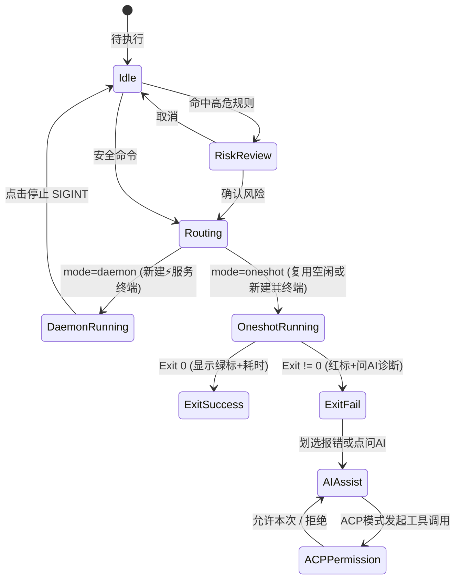

# CodeLab Studio v2.0 — 低保真线框图与交互流程

> 基准窗口：Tauri 2 桌面端 `1440 × 900`（最低适配 `1024 × 720`）
> 可视化版本：[wf-workbench.svg](./wf-workbench.svg)（三栏主工作台标注图）· [wf-flows.svg](./wf-flows.svg)（全链路用户与协议流程图）

---

## L1 · 欢迎页与课程库（Welcome & Course Hub）

```text
┌────────────────────────────────────────────────────────────────────────────────────────┐
│ ● ● ●   ◆ CodeLab Studio（本地开源桌面端）       [● 四语言环境: 3/4 就绪]   [◐]  [⚙ 设置] │ 44px 标题栏
├────────────────────────────────────────────────────────────────────────────────────────┤
│                                                                                        │
│  把任意 Markdown 实践手册，变成你的本地实战工作台                 [ ⬇ 导入课程包 ] [ + 创作课程包 ] │
│  所有代码、进度与日志保存在本地工作区（.codelab/），零登录、可离线运行                           │
│                                                                                        │
│  ┌─ 标杆内置课程（推荐首体验） ──────────────────────────────────────────────────────────┐ │
│  │ [Go] 实战手册 + 多终端 + 自动验收                 进度 4/10 练习 · task-api / task-api-gf │ │
│  │ 《Go 与 GoFrame 开发实践手册：从第一性原理出发》                                      │ │
│  │ 本地双终端联调 · gopls 代码提示 · HTTP 合同与竞态自动验收          [▓▓ 继续学习 ▓▓]     │ │
│  └────────────────────────────────────────────────────────────────────────────────────┘ │
│                                                                                        │
│  内置与已导入课程包                         语言筛选: (全部) (JS/TS) (Go) (Java) (Python) │
│  ┌─────────────────────┐ ┌─────────────────────┐ ┌─────────────────────┐               │
│  │ [JS/TS] 函数判题     │ │ [Python] 函数判题    │ │ [Java] 函数判题      │               │
│  │ TS 异步与数组流水线  │ │ Python 数据清洗实战  │ │ Java 集合与并发基础  │               │
│  │ 多文件 · Bun Test    │ │ 多文件 · pytest      │ │ 多文件 · JUnit 5     │               │
│  │ [ 进入工作台 ]       │ │ [ 进入工作台 ]       │ │ [ 进入工作台 ]       │               │
│  └─────────────────────┘ └─────────────────────┘ └─────────────────────┘               │
│                                                                                        │
│  最近本地工作区                                                                         │
│  📁 ~/codelab-workspaces/go-goframe-learning        4/10 练习 · 10 分钟前   [ 打开 ]    │
│  📁 ~/codelab-workspaces/python-data-clean          2/6 练习  · 昨天        [ 打开 ]    │
└────────────────────────────────────────────────────────────────────────────────────────┘
```

---

## L1 · 三栏主学习工作台（标准实践态 + AI 抽屉展开态）

```text
┌─────────────────────────────────────────────────────────────────────────────────────────────────┐
│ ● ● ●  ←  [Go ▾ Go 与 GoFrame 开发实践]   ████░░░░ 4/10   [● 环境就绪 ▾]  [标准|辅导|专注⌘B] [✨AI·ACP] [◐][⚙] │ 44px
├──────────────────────────────┬──────────────────────────────────────────┬───────────────────────┤
│ ① 左栏：交互式手册 (36%→30%) │ ③ 中栏上：产物文件树(196px) + Monaco(62%) │ ⑤ 右栏：AI 助教(372px)│
│ [☰ 练习 1：让一个请求完成往返]│ ┌──────────┬───────────────────────────┐ │ ✨ AI 助教 [ACP·Claude]│
│ ──────────────────────────── │ │ ▾ task-  │ main.go●  memory.go  [VS] │ │ [🧭 引导模式 | ⚡ 直接] │
│  先理解 HTTP 服务最小需要…    │ │   api/   ├───────────────────────────┤ │ ┌───────────────────┐ │
│                              │ │   go.mod │  1 package main           │ │ │ 引用: main.go L12 │ │
│ ┌ cwd:task-api  ⚡常驻服务 ┐ │ │   main.go│  2 import "net/http"      │ │ │ mux.HandleFunc... │ │
│ │ go run .    [▶运行][+][📋]│ │ │ ▸ internal│  ...                      │ │ └───────────────────┘ │
│ └──────────────────────────┘ │ │ ▸ migr.. │  ┌────────────────────┐   │ │ 这段写法要求 Go 1.22+ │
│                              │ │ ▸ task-  │  │[✨解释][🔍检查][💬问]│ ← ⑥│ 你注意到方法前缀吗？  │
│ ┌ cwd:task-api  ✓ 0 · 0.2s ┐ │ │   api-gf/│  └────────────────────┘   │ │ ┌─ ACP 权限审批 ────┐ │
│ │ curl -i .../healthz [▶]  │ │ │ [+新建]  ├───────────────────────────┤ │ │ 读取 memory.go     │ │
│ └──────────────────────────┘ │ │ [⇄对比]  │ ● Go LSP: 就绪 (task-api) │ │ │ [允许本次] [拒绝]  │ │
│                              │ └──────────┴───────────────────────────┘ │ └───────────────────┘ │
│ ┌─ ② 练习验收 (2/3) ───────┐ │ ═════════════ 可拖拽上下分隔 ════════════ │ ───────────────────── │
│ │ ✓ GET /healthz 返回 200  │ │ ④ 中栏下：多终端 + 测试判题双模面板(38%) │ [📖练习1 ×][📄main ×] │
│ │ ✓ POST /healthz 返回 405 │ │ [⚡服务:go run ■↻][⌘终端2][✓测试 3/4][+][🩺]│ ~1,120 / 6,000 tok   │
│ │ ✕ /missing 返回 404 [🩺] │ ├──────────────────────────────────────────┤ ┌───────────────────┐ │
│ │ [▓▓ ▶ 运行本节验收 ▓▓]    │ │ $ curl -i http://127.0.0.1:8080/healthz │ │ 输入你的问题...  ↵ │ │
│ └──────────────────────────┘ │ │ HTTP/1.1 200 OK   {"status":"ok"}       │ └───────────────────┘ │
│ ┌─ 思考题 ─────────────────┐ │ │ $ go test -race ./...                   │                       │
│ │ [✨ 和 AI 助教探讨此题]   │ │ └──────────────────────────────────────────┘                       │
│ └──────────────────────────┘ │                                                                   │
└──────────────────────────────┴──────────────────────────────────────────┴───────────────────────┘
       ↑ 可折叠章节大纲抽屉(☰)          ⑥ 划词浮层：手册/编辑器/终端三区通用，120ms 浮现，不遮挡选区
```

---

## L2 · 关键弹窗线框

### 1. 全局设置弹窗（BYOK + ACP 双协议 & 四语言运行时）

```text
┌─────────────────────────────────────────────────────────────────────────┐
│ 设置                                                                 [×] │
├─────────────────┬───────────────────────────────────────────────────────┤
│ • AI 模型与 ACP │  AI 接入协议:  ( ● 自定义 Provider (BYOK) ) ( ○ ACP 外部 Agent ) │
│ • 运行时与 LSP  │  ───────────────────────────────────────────────────  │
│ • 编辑器与桌面  │  [若选 Provider] 预设: OpenAI | DeepSeek | Anthropic | Ollama │
│ • 隐私与数据    │  Base URL: (https://api.deepseek.com/v1)               │
│                 │  Model:    (deepseek-chat)                             │
│                 │  API Key:  (••••••••••••• 存入系统钥匙串)  [测试连接]   │
│                 │  ───────────────────────────────────────────────────  │
│                 │  [若选 ACP] 预设 Agent: Claude Code | Gemini CLI | Codex | 自定义 │
│                 │  启动命令: (claude --acp)   传输: JSON-RPC 2.0 / stdio  │
│                 │  权限策略: (● 引导只读) (○ 每次询问) (○ 工作区读写)      │
│                 │            [执行 initialize 握手测试]                   │
└─────────────────┴───────────────────────────────────────────────────────┘
```

### 2. 导入 / 创作课程包弹窗 & 高危命令二次确认弹窗

```text
导入 / 创作课程包                                   高危命令安全确认
┌─────────────────────────────────────────┐       ┌─────────────────────────────────────┐
│ [ 导入本地 / Git 课程包 ] [ 创作课程包 ] │       │ ⚠ 检测到高危 Shell 命令              │
│ ─────────────────────────────────────── │       │ 命中规则：递归强制删除 (rm -rf)        │
│ 来源: (● 本地 .md/目录) (○ Git 仓库 URL) │       │ 目标目录：~/codelab-workspaces/task-api│
│ 路径: (~/docs/go-handbook/README.md)    │       │ ┌───────────────────────────────────┐ │
│ 实时解析预览：                           │       │ │ rm -rf /tmp/task-api-cache        │ │
│ ✓ 10 个章节 · 16 个命令块 · 9 组验收规则 │       │ └───────────────────────────────────┘ │
│ 绑定本地工作区: (~/codelab-workspaces/..)│       │ [ 取消（默认焦点）]  [ 我已了解风险，继续 ] │
│                [ 取消 ] [ 初始化工作区 ] │       └─────────────────────────────────────┘
└─────────────────────────────────────────┘
```

---

## 核心状态机（多终端路由 + ACP 权限审批）


