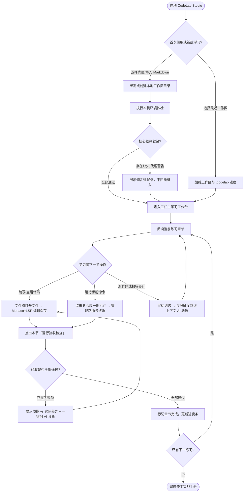
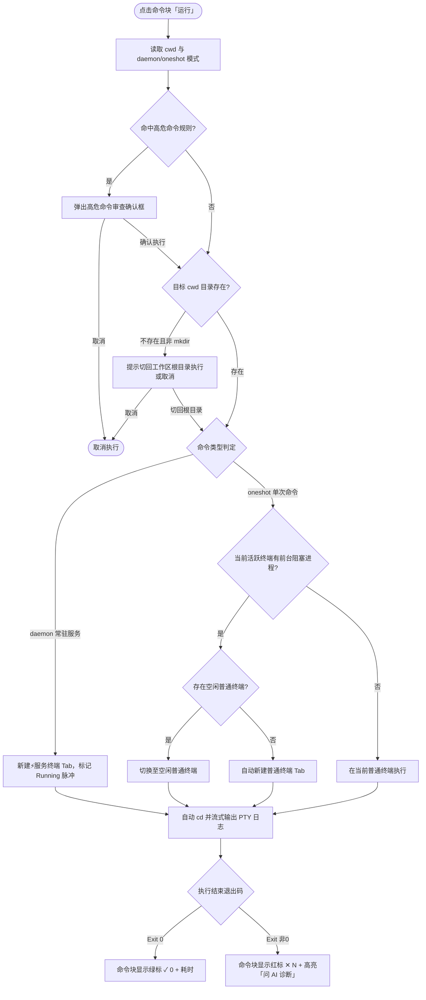
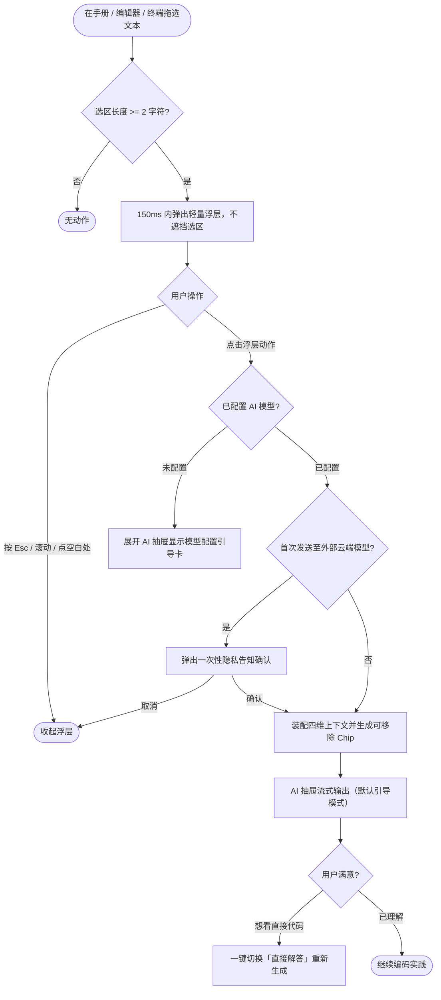
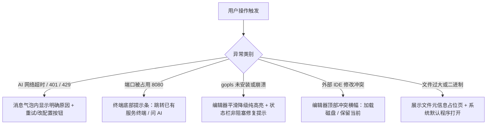

# CodeLab Studio（交互式编程实践学习工作台）— 设计需求文档

> 文档版本：v1.0  
> 更新时间：2026-11-20  
> 文档类型：设计需求文档（由 PRD v1.0 转化）  
> 对应阶段：步骤 5（PRD 转设计需求文档）

---

## 一、项目背景与设计目标

### 1.1 项目背景
CodeLab Studio 是一款面向个人开发者的本地交互式编程实践学习工作台（桌面端/本地 Web 客户端形态）。它针对当前开发者使用纯静态 Markdown 教程学习时“频繁切换编辑器与终端、手工复制粘贴命令、学习产物分散无提示、遇到报错提问上下文搬运困难”的四大痛点，将静态手册转化为「导学手册 + 工作区代码 + 智能多终端 + 上下文 AI 助教 + 自动验收」的一体化沉浸式实战空间。

### 1.2 设计目标

| 目标维度 | 具体指标 |
|---|---|
| **体验目标** | 1. **零窗口切换沉浸流**：在单工作台视图内自然串联“读手册 → 改代码 → 一键跑终端 → 划词问 AI → 看验收”，窗口切换频率下降 ≥ 80%；<br>2. **低认知负荷**：在三栏+底栏高信息密度布局下，通过清晰层级、可折叠面板与精准微反馈，保持视线聚焦当前任务，首次打开无需教程即可在 3 分钟内跑通首个命令。 |
| **业务目标** | 1. 助力内置《Go 与 GoFrame 开发实践手册》14 日完课率达到 ≥ 45%；<br>2. 划词提问与一键验收等核心交互功能的单次触发成功率 ≥ 98%、SUS 可用性评分 ≥ 80。 |
| **品牌目标** | 建立**“专业、克制、极客友好、有温度的实战导师”**视觉心智——兼具专业 IDE 的工程秩序感与交互式学习工具的清晰引导感，不花哨、不幼稚、不过度遮挡代码与终端。 |

### 1.3 核心设计挑战
1. **高信息密度与有限屏幕空间的平衡**：需要同时承载「章节大纲 + 教程正文 + 文件树 + 代码编辑器 + 多终端 + AI 助教」六大区域，如何在 1280×720 到 2560×1440 屏幕上既不拥挤又不丢上下文。
2. **常驻服务终端 vs 单次命令终端的心智清晰度**：后端实战（如练习 1 `go run .` 与 `curl`）天然存在多终端并行，需要让用户一眼分辨哪个终端正在跑服务、点击手册按钮后命令究竟跑在了哪个终端里。
3. **跨区域鼠标划选浮层的防干扰设计**：用户在手册、Monaco 编辑器、xterm.js 终端中频繁拖选文本用于复制，划词「问 AI」浮层必须“触手可及但绝不遮挡正文或抢占正常复制热键”。
4. **AI 助教的上下文透明与信任感**：开发者对发送本地代码给云端模型敏感，设计上需把“附带了哪些文件/报错”可视化、可一键删减，同时区分「引导模式」和「直接解答」的交互氛围。

---

## 二、用户角色与场景

### 2.1 用户画像

| 用户类型 | 特征 | 核心诉求 | 使用场景 |
|---|---|---|---|
| **进阶自学者（核心）** | 1～3 年研发经验，习惯深色主题与快捷键，常用 VS Code / GoLand 与 iTerm2 | 专注理解工程原理而非反复切窗与 `cd`；遇到报错快速定位；清楚知道自己这一节是否真正达标 | 下班/周末用 1～2 小时在本地电脑系统推进 Go/GoFrame 实战练习 |
| **新手转岗开发者** | 刚学完基础语法，首次搭完整后端项目，易卡在环境与目录结构上 | 清晰的前置环境检查指引、明确的文件目录可视化、温和不劝退的启发式 AI 辅导 | 首次搭建 `task-api` 工程、调试 `curl` 状态码与 SQLite 迁移 |

### 2.2 核心使用场景

#### 场景 1：双终端一键联调（练习 1：让一个请求完成往返）
> 用户在左侧手册看到 `go run .` 命令块，点击「▶ 运行」，底部终端自动新建绿色脉冲标记的 `⚡ 服务: go run .` 标签并输出 `listening on http://127.0.0.1:8080`；随后点击手册下方的 3 条 `curl -i` 命令块，系统自动在旁边新建 `⌘ 终端 2` 执行，手册命令块旁立即亮起 `✓ 0` 绿标，用户点击本节底部「▶ 运行验收检查」，三条状态码断言（`200`/`405`/`404`）依次变绿。

#### 场景 2：代码与终端报错划选问 AI（练习 3：并发竞态检测）
> 用户在中栏代码编辑器中修改 `internal/task/memory.go`，运行 `go test -race ./...` 后终端报出红色 `WARNING: DATA RACE`。用户直接在终端拖选报错堆栈，松手后右上角轻巧浮现 `[🩺 诊断报错] [💬 提问]` 气泡；点击「诊断报错」，右侧 AI 助教抽屉平滑滑出，输入框上方清晰挂着 3 枚上下文 Chip（`练习 3`、`memory.go`、`终端报错 42行`），AI 以引导式提问帮用户定位锁范围遗漏。

#### 场景 3：多目录产物对照与外部 IDE 切换（练习 7：迁移到 GoFrame）
> 左侧产物文件树实时列出同级目录 `task-api/` 与 `task-api-gf/`，用户一键点击即可在编辑器多标签间切换对照接口合同；若需进行大规模重构，点击编辑器右上角「在 VS Code 打开」，修改保存后切回 CodeLab Studio，文件树与编辑器已自动同步最新代码。

---

## 三、信息架构

### 3.1 整体信息架构图

```mermaid
graph TB
    App["CodeLab Studio 桌面/本地工作台"] --> Welcome["欢迎页 / 课程库"]
    App --> Workbench["主学习工作台"]
    App --> Settings["全局设置弹窗"]

    Welcome --> W1["内置标杆课程（Go & GoFrame）"]
    Welcome --> W2["导入本地 Markdown 手册"]
    Welcome --> W3["最近学习工作区列表"]

    Workbench --> TopBar["顶部全局工具栏"]
    Workbench --> LeftPane["左栏：交互式手册区"]
    Workbench --> CenterPane["中栏：工作区与终端区"]
    Workbench --> RightDrawer["右栏（可折叠）：AI 助教抽屉"]

    TopBar --> T1["工作区切换与返回欢迎页"]
    TopBar --> T2["学习进度条与本地统计概览"]
    TopBar --> T3["环境体检状态徽章"]
    TopBar --> T4["AI 助教开关 / 布局切换 / 设置"]

    LeftPane --> L1["章节大纲（可折叠侧边条）"]
    LeftPane --> L2["交互式手册正文（命令块/代码块）"]
    LeftPane --> L3["验收清单与自动验证卡"]
    LeftPane --> L4["思考题与 AI 探讨入口"]

    CenterPane --> EditorArea["上半区：产物文件树 + Monaco 编辑器"]
    CenterPane --> TermArea["下半区：多标签 PTY 终端面板"]
    EditorArea --> E1["实时产物文件树"]
    EditorArea --> E2["多标签代码编辑 + Go LSP 提示"]
    EditorArea --> E3["外部 IDE 打开 / 文件状态栏"]
    TermArea --> TM1["服务终端 Tab（常驻启停控制）"]
    TermArea --> TM2["命令终端 Tab（单次执行/报错诊断）"]

    RightDrawer --> AI1["引导模式 / 直接解答切换"]
    RightDrawer --> AI2["流式对话区与代码复制"]
    RightDrawer --> AI3["可视化四维上下文 Chip 栏"]

    Settings --> S1["AI 模型与 BYOK 钥匙串配置"]
    Settings --> S2["编辑器/终端与外部 IDE 配置"]
    Settings --> S3["隐私与本地数据清理"]
```



### 3.2 页面层级结构

```text
L1 欢迎页（冷启动/切换课程入口）
├── L2 课程初始化向导弹窗（选择/确认工作区路径 → 触发环境体检）
└── L2 全局设置弹窗（AI 配置 / 编辑器与终端 / 隐私与数据）

L1 主学习工作台（核心常驻视图，支持拖拽调整分栏比例）
├── L2 顶部工具栏（课程名、总进度、环境体检 Popover、布局预设、AI 开关、设置）
├── L2 左栏：交互式手册
│   ├── L3 章节大纲抽屉（练习 0 ~ 9 状态列表）
│   ├── L3 手册正文视图（含命令块执行条、cwd 编辑 Popover、划词浮层）
│   └── L3 底部验收与思考题卡片（含自动验证展开详情）
├── L2 中栏-上：产物与代码台
│   ├── L3 产物文件树（含新建/重命名/右键菜单）
│   └── L3 Monaco 编辑器（多标签、LSP 状态栏、划词浮层）
├── L2 中栏-下：多终端面板
│   ├── L3 终端标签栏（区分常驻服务/普通终端 + 启停/清空/诊断）
│   └── L3 xterm.js 终端视口（含划词浮层）
├── L2 右栏：AI 助教抽屉（默认收起，触发提问时平滑滑出，支持固定或覆盖）
└── L2 系统拦截弹窗（高危命令二次确认 / 外部文件冲突确认 / 首次云端 AI 隐私确认）
```

---

## 四、核心交互流程

### 4.1 主流程交互流程图（学习闭环）



### 4.2 关键分支流程：一键执行命令与智能终端路由



### 4.3 关键分支流程：划选文本唤起 AI 助教



### 4.4 异常流程处理总览



---

## 五、关键交互细节定义

### 5.1 三栏工作台与布局自适应

| 布局预设 | 默认宽度占比（以 1440px 宽为例） | 适用场景 | 交互细节 |
|---|---|---|---|
| **标准实践态（默认）** | 左栏手册 `36%`（~518px）｜中栏代码+终端 `64%`（~922px）｜右栏 AI 抽屉 `收起` | 正常读手册、写代码、跑终端 | 栏间 4px 拖拽分隔线（Hover 高亮主色）；双击分隔线恢复默认比例 |
| **AI 辅导态（展开抽屉）** | 左栏手册 `30%`（~432px）｜中栏代码+终端 `44%`（~634px）｜右栏 AI `26%`（~374px） | 划选提问或思考题研讨 | 屏幕宽 `< 1280px` 时，AI 抽屉改为右侧浮层覆盖（含轻阴影 `shadow-lg`），不挤压代码区至不可读 |
| **专注编码态** | 左栏手册 `折叠为 44px 章节窄条`｜中栏代码+终端 `全宽` | 集中编写代码与重构 | 顶部提供一键切换按钮及快捷键 `Cmd/Ctrl + B` |

- **中栏上下分割**：默认代码编辑区 `62%` / 底部终端区 `38%`；点击终端头部「最大化/还原」可临时拉高至 `80%` 查看长日志。

### 5.2 命令块状态展示逻辑

| 状态 | 视觉表现 | 交互反馈 |
|---|---|---|
| **待执行（Idle）** | 命令块右上角显示 `cwd` 灰底圆角标签 + 主色实心小按钮 `[▶ 运行]` + 图标按钮 `[+ 新终端]` `[复制]` | Hover 按钮颜色加深并显示 Tooltip（明确提示将路由至哪个终端） |
| **运行中（Running）** | 按钮变为旋转 Spinner + `[■ 停止]`；命令块左边框亮起 2px 动态主色条 | 点击「停止」发送 `SIGINT`；点击状态条跳转聚焦到对应终端 Tab |
| **执行成功（Exit 0）** | 右上角显示绿色徽章 `✓ 0 · 0.3s`（8 秒后降噪为淡灰绿保留，不刺眼） | 点击徽章可再次聚焦对应终端输出位置 |
| **执行失败（Exit ≠ 0）** | 左边框变为 2px 红色，右上角显示红底徽章 `✕ Exit 1` + 快捷按钮 `[🩺 问 AI]` | 点击「问 AI」自动携该命令与终端报错尾发起诊断 |

### 5.3 划词「问 AI」浮层交互规范
- **触发防误触**：仅响应鼠标拖选或双击选词且释放左键后触发；不响应 `Cmd/Ctrl + A` 全选（避免干扰全选复制）。
- **防遮挡定位**：优先显示在选区第一行正上方 `8px` 处；若上方空间 `< 48px` 则自动翻转至选区末行下方 `8px`，水平居中对齐选区并限制不超出当前面板边界。
- **动效规范**：`opacity 0→1` + `translateY(4px→0)`，时长 `120ms`，缓动 `cubic-bezier(0.16, 1, 0.3, 1)`；按 `Esc`、`Cmd/Ctrl+C` 复制或滚动面板时 `80ms` 淡出。

### 5.4 验收卡片状态转换逻辑
- **人工项**：未勾选（空心圆框）⇄ 已勾选（绿色实心对勾 + 文字轻度降透明度）。
- **自动项**：`待验证` → `验证中（脉冲加载动画）` → `通过（绿色对勾 + 耗时）` 或 `失败（红色感叹号 + 自动展开预期/实际对比折叠面板 + 问 AI 按钮）`。

---

## 六、页面布局规范

### 6.1 主学习工作台布局结构（标准实践态 + AI 抽屉展开态）

```text
┌───────────────────────────────────────────────────────────────────────────────────────┐
│ [Logo] Go 与 GoFrame 开发实践 ▾   [████░░░░ 4/10 练习]   [● 环境就绪]  [布局][✨AI][⚙] │ 44px 顶栏
├──────────────────────────┬───────────────────────────────────┬────────────────────────┤
│ [☰] 练习 1：让一个请求完成 │ 📁 文件树 │ main.go ●  go.mod × │ ✨ AI 助教 [引导|直接]×│
│ ──────────────────────── │ (180px)  ├───────────────────────┼────────────────────────┤
│                          │ ▾ task-  │  1 package main       │ ┌────────────────────┐ │
│  先理解 HTTP 服务最小需要 │   api/   │  2                    │ │ 引用：main.go L12  │ │
│  什么。                   │   go.mod │  3 import (           │ │ mux.HandleFunc...  │ │
│                          │   main.go│  4   "net/http"       │ └────────────────────┘ │
│  ┌─────────────────────┐ │          │  5 )                  │                        │
│  │ cwd: task-api [▶运行]│ │ [+ 新建] │  ...                  │ 这段路由注册写法要求   │
│  │ go run .            │ │          │  [✨解释][🔍检查][💬问] │ Go 1.22+，你注意到方法 │
│  └─────────────────────┘ │          │                       │ 前缀的作用了吗？       │
│                          │          ├───────────────────────┤                        │
│  ┌─────────────────────┐ │          │ Go LSP: 就绪 │ 外部IDE │                        │
│  │ cwd: task-api [▶运行]│ ├──────────┴───────────────────────┤                        │
│  │ curl -i .../healthz │ │ [⚡服务:go run ■][⌘终端2][+] [🩺] │ ────────────────────── │
│  └─────────────────────┘ ├──────────────────────────────────┤ [📖练习1 ×][📄main ×]  │
│                          │ $ curl -i http://127.0.0.1:8080/ │ ┌────────────────────┐ │
│  ┌─ 练习验收 (2/3) ────┐ │ HTTP/1.1 200 OK                  │ │ 输入你的问题...  ↵ │ │
│  │ ✓ GET /healthz 200  │ │ {"status":"ok"}                  │ └────────────────────┘ │
│  │ ✓ POST /healthz 405 │ │ $                                │                        │
│  │ ○ /missing 返回 404 │ │                                  │                        │
│  │ [▶ 运行本节验收]    │ │                                  │                        │
│  └─────────────────────┘ │                                  │                        │
└──────────────────────────┴──────────────────────────────────┴────────────────────────┘
      左栏：交互式手册               中栏：产物文件树 + 编辑器 + 终端         右栏：AI 助教抽屉
```

### 6.2 组件尺寸与间距规范

| 组件 | 尺寸规范 | 内外间距 | 对齐方式 |
|---|---|---|---|
| **顶部全局工具栏** | 高度固定 `44px`，全宽 | 左右 `padding: 0 16px`，元素间距 `12px` | 左：课程/工作区，中：进度条，右：功能入口 |
| **手册正文容器** | 最大阅读行宽 `680px` | 左右 `padding: 20px`，段落间距 `14px` | 左对齐，代码块满容器宽度 |
| **命令块卡片** | 头部高度 `32px`，最小总高 `72px`，圆角 `8px` | 头部左右 `12px`，代码区 `12px 14px` | 头部左：目录/类型徽章，右：操作按钮组 |
| **文件树节点项** | 单行高度 `28px`，每层缩进 `14px` | 左右 `padding: 0 8px`，图标与文字间距 `6px` | 左对齐，长文件名 `text-overflow: ellipsis` |
| **编辑器 / 终端标签** | 标签栏高度 `34px`，单标签最小宽 `96px` 最大宽 `180px` | 内边距 `0 12px` | 左侧图标 + 文件/终端名 + 右侧状态点/关闭按钮 |
| **划词悬浮工具条** | 高度 `32px`，圆角 `8px`，`shadow-lg` | 内边距 `4px 6px`，按钮间距 `4px` | 水平 Flex 居中对齐 |
| **主要操作按钮** | 常规 `h: 32px`，紧凑（命令块内）`h: 24px`，圆角 `6px` | 常规左右 `12px`，紧凑左右 `8px` | 图标+文字水平居中，间距 `4px` |

---

## 七、视觉风格定义

### 7.1 色彩体系（默认深色开发者主题 Dark Mode + 浅色主题 Light Mode）

| 色彩语义 | 深色模式（默认） | 浅色模式 | 用途 |
|---|---|---|---|
| **应用底色（Canvas）** | `#0F1117` | `#F6F8FA` | 顶栏、文件树、外层框架背景 |
| **主表面色（Surface）** | `#161B22` | `#FFFFFF` | 手册区、编辑器、终端、AI 抽屉背景 |
| **浮层卡片色（Elevated）** | `#1F2633` | `#FFFFFF`（配 `#E5E7EB` 边框） | 命令块头部、划词浮层、弹窗卡片 |
| **分割边框（Border）** | `#2A3140` | `#D8DEE6` | 面板分割线、卡片描边、输入框边框 |
| **品牌主色（Primary）** | `#3B82F6`（Hover `#2563EB`） | `#2563EB`（Hover `#1D4ED8`） | 主按钮（运行/验证）、焦点高亮、活跃标签下划线 |
| **AI 强调色（AI Accent）** | `#8B5CF6`（浅底 `rgba(139,92,246,0.14)`） | `#7C3AED`（浅底 `#F3E8FF`） | AI 助教图标、划词气泡、上下文 Chip、思考题高亮 |
| **成功色（Success）** | `#22C55E`（浅底 `rgba(34,197,94,0.14)`） | `#16A34A`（浅底 `#DCFCE7`） | 验收通过、退出码 0、常驻服务运行脉冲、LSP 就绪 |
| **警告色（Warning）** | `#F59E0B`（浅底 `rgba(245,158,11,0.14)`） | `#D97706`（浅底 `#FEF3C7`） | 环境警告、未安装 `gopls`、外部文件冲突 |
| **危险/错误色（Danger）** | `#EF4444`（浅底 `rgba(239,68,68,0.14)`） | `#DC2626`（浅底 `#FEE2E2`） | 命令非零退出、验收失败、高危命令拦截框 |
| **正文主字色（Text Primary）** | `#E6EDF3` | `#1F2328` | 标题、正文、代码默认色 |
| **次要字色（Text Secondary）** | `#8B949E` | `#57606A` | 辅助说明、路径标签、时间戳、次要图标 |

### 7.2 字体规范

- **UI 与手册正文字体栈**：`"Inter", -apple-system, BlinkMacSystemFont, "PingFang SC", "Hiragino Sans GB", "Microsoft YaHei", sans-serif`
- **代码与终端等宽字体栈**：`"JetBrains Mono", "Fira Code", "SF Mono", Menlo, Consolas, monospace`

| 层级 | 字号 | 行高 | 字重 | 用途 |
|---|---|---|---|---|
| **H1（手册主标题）** | `22px` | `30px` | Bold (700) | 课程名称、欢迎页标题 |
| **H2（练习章节标题）** | `18px` | `26px` | SemiBold (600) | `练习 0` ~ `练习 9` 标题 |
| **H3（小节/卡片标题）** | `15px` | `22px` | SemiBold (600) | 验收卡片标题、弹窗标题 |
| **Body（手册正文）** | `14px` | `23px`（1.65倍） | Regular (400) | 教程正文、AI 助教回答正文 |
| **UI Label（界面控件）** | `13px` | `18px` | Medium (500) | 标签页、文件树、按钮文字 |
| **Code / Terminal** | `13px`（可配置 12~20px） | `20px` | Regular (400) | 代码块、Monaco 编辑器、xterm.js 终端 |
| **Caption / Badge** | `11px`～`12px` | `16px` | Medium (500) | `cwd` 标签、退出码徽章、状态栏信息 |

### 7.3 图标规范
- **图标库建议**：Lucide Icons（线性极简风格，与现代 IDE 高度统一）。
- **尺寸标准**：顶栏/按钮主图标 `16×16px`，文件树/徽章小图标 `14×14px`，空状态插图图标 `32×32px`。
- **描边规范**：统一 `stroke-width: 1.75px`，圆角端点（`round`）；状态圆点使用 `8×8px` 实心圆（常驻运行态加 2s 柔和呼吸光环）。

---

## 八、异常状态处理

### 8.1 网络与 AI 接口异常

| 场景 | 界面呈现与交互处理 |
|---|---|
| **未配置 AI 模型** | AI 抽屉展示引导空状态卡片（插图 + 说明支持 OpenAI/DeepSeek/Claude/Ollama + 主按钮 `[前往配置 AI 模型]`） |
| **API 401/403 鉴权失败** | 红色气泡提示「API Key 无效或无模型访问权限」，提供 `[修改配置]` 快捷跳转 |
| **API 429 限流 / 5xx / 断网** | 警告气泡提示具体原因与状态码 + `[重试]` 按钮；离线时顶部提示条仅标示「AI 离线，本地实操不受影响」 |
| **流式输出卡死（> 30s 无新 Token）** | 自动中止请求，保留已输出部分并提示「响应超时，可点击继续或重试」 |

### 8.2 本地运行与业务异常

| 场景 | 界面呈现与交互处理 |
|---|---|
| **工作区空目录（刚初始化）** | 文件树区域展示温和引导空状态：“工作区已就绪，点击左侧练习 1 的命令开始创建你的第一个 Go 项目” |
| **Go 版本过低或 `GOPROXY` 不通** | 环境体检 Popover 标黄/标红，附带可一键点击执行的 `go env -w GOPROXY=https://goproxy.cn,direct` 修复按钮 |
| **服务未启动就点接口验收** | 验收运行器检测到 `connection refused`（如 `127.0.0.1:8080` 未监听），提示「目标服务尚未启动，请先运行练习中的 `go run .` 命令块」，并提供快捷定位按钮 |
| **8080 端口冲突** | 终端底部弹出黄色提示条，一键切换至占用该端口的已有服务 Tab 供停止，或引导修改监听端口 |
| **打开损坏或超大 Markdown 文件** | 弹窗提示明确原因（如“文件超过 5MB 上限”），保留在欢迎页不白屏 |

---

## 九、埋点需求

（遵循本地优先架构，默认落盘 `.codelab/metrics.json`，仅用户显式 Opt-in 开启匿名遥测后脱敏上报）

| 事件名称 | 触发时机 | 关键参数 |
|---|---|---|
| `app_launched` | 应用启动完成进入欢迎页 | `os_platform`, `cold_start_ms`, `app_version` |
| `course_opened` | 打开内置或外部 Markdown 手册 | `source` (builtin/local), `chapter_count`, `cmd_count` |
| `preflight_executed` | 环境体检结束 | `pass_cnt`, `warn_cnt`, `fail_cnt`, `gopls_ready` |
| `cmd_block_clicked` | 点击手册命令块运行 | `chapter_idx`, `mode` (daemon/oneshot), `new_tab` (bool) |
| `cmd_risk_modal_action` | 高危命令拦截弹窗交互 | `action` (confirm/cancel), `rule_id` |
| `cmd_finished` | 命令执行结束 | `exit_code`, `duration_ms`, `mode` |
| `file_tree_open` | 点击产物文件树打开代码 | `file_ext`, `lsp_status` |
| `selection_ai_clicked` | 点击划词浮层向 AI 提问 | `origin` (manual/editor/terminal), `action_type` |
| `ai_mode_switched` | 切换引导模式/直接解答 | `target_mode` (socratic/direct) |
| `ai_feedback_submitted` | 点击 AI 回答赞/踩 | `rating`, `mode`, `has_terminal_ctx` |
| `verify_chapter_clicked` | 点击运行本节自动验收 | `chapter_idx`, `passed_cnt`, `failed_cnt` |
| `chapter_marked_done` | 章节全部验收通过 | `chapter_idx`, `duration_min` |

---

## 十、设计交付清单

### 10.1 设计稿交付（Figma）

| 页面 / 模块 | 数量 | 状态覆盖要求 |
|---|---|---|
| 欢迎页与课程库 | 2 套 | 首次空状态 + 已有最近工作区列表（深/浅双色） |
| 主学习工作台（标准实践态） | 2 套 | 深色默认态 + 浅色态（以 Go 练习 1 为真实填充数据） |
| 主学习工作台（AI 辅导态） | 2 套 | 含划词浮层触发态 + 引导式流式回答态 + 上下文 Chip 栏 |
| 主学习工作台（异常与验收态） | 2 套 | 验收通过/失败对比态 + 终端报错诊断态 |
| 关键弹窗集合 | 5 个 | 工作区初始化、环境体检 Popover、高危命令二次确认、外部文件冲突横幅、全局设置弹窗 |

### 10.2 规范文档交付
- [ ] Design Tokens 色彩与双主题变量表（CSS Variables）
- [ ] 中英混排与等宽代码字体排版规范
- [ ] Lucide 图标映射表与状态指示灯规范
- [ ] 核心业务组件库（命令块、验收卡、划词浮层、上下文 Chip、终端 Tab、文件树节点）

### 10.3 原型交付
- [ ] 高保真交互原型（覆盖：打开内置课程 → 一键运行常驻服务与 `curl` → 划选报错问 AI → 运行验收检查全路径）

---

## 十一、设计风险评估

| 风险点 | 风险等级 | 应对方案 |
|---|---|---|
| **小屏笔记本（1280×720 / 13寸 MacBook）展开 AI 抽屉后三栏过窄** | **高** | 小于 1280px 宽度时，AI 抽屉自动切换为右侧浮层覆盖模式，并提供一键折叠手册栏快捷键（`Cmd/Ctrl+B`） |
| **划词浮层与 Monaco / xterm.js 原生右键菜单或文本选区冲突** | **中** | 划词浮层严格在松开鼠标后浮现于选区外部，绝不劫持右键菜单与 `Cmd/Ctrl+C`；按任意键盘输入即刻消失 |
| **多终端标签过多导致用户分不清哪一个是服务进程** | **中** | 通过图标与色彩语义强区分（`⚡` + 绿脉冲点 = 常驻服务，`⌘` = 普通命令），并在手册运行按钮上悬停显示目标终端名称 |
| **长 Markdown 手册中验收卡片与思考题视觉权重失衡** | **低** | 验收卡片使用左边框微着色 + 紧凑列表，避免大面积高饱和度背景干扰代码阅读 |

---

## 附录：关键术语表

| 术语 | 定义 |
|---|---|
| **工作区（Workspace）** | 与单本实践手册绑定的本地文件系统根目录，存放学习产出的源码、数据库迁移与 `.codelab/` 元数据 |
| **常驻服务终端（Daemon Terminal）** | 运行阻塞型长驻进程（如 `go run .`）的独立 PTY 标签页，受保护不被单次命令误输入打断 |
| **上下文 Chip** | AI 输入框上方展示本次请求所附带上下文（章节/代码文件/终端报错）的可视化标签，支持查看与一键移除 |
| **苏格拉底引导模式** | AI 助教默认教学模式，通过启发式线索与追问帮助学习者自行推导根因，而非直接代写全部答案 |
